# ۱. هسته مفهومی، چشم‌انداز و معماری تجریدی پلتفرم (Domain-Agnostic Diagnostic Engine)

این سند، معماری مفهومی کلان و چشم‌انداز مهندسی نرم‌افزار پلتفرم ارزیابی تشخیصی و تحلیل یادگیری را تبیین می‌کند. هدف این سیستم، فراتر رفتن از مدل‌های سنتی آزمون‌گیری (نمره‌دهی صرف و محاسبه درصد) و تبدیل شدن به یک **«موتور شناختی مستقل از دامنه (Domain-Agnostic Cognitive Diagnostic Engine)»** است.

---

## ۱. چرخش پارادایم: از ارزشیابی پایانی تا سنجش تشخیصی
در نرم‌افزارهای سنتی آموزش (LMS و آزمون‌گیرها)، فرآیند به صورت زیر است:
$$\text{محتوا} \longrightarrow \text{آزمون} \longrightarrow \text{نمره خام (درصد)} \longrightarrow \text{پایان}$$

در این پارادایم، نمره هیچ ارزش تشخیصی ندارد. اگر دانش‌آموزی نمره ۶۰٪ کسب کند، مشخص نیست که ۴۰٪ از دست رفته ناشی از:
۱. بی‌دقتی محاسباتی است؟
۲. عدم درک عمیق یک مفهوم پیش‌نیاز است؟
۳. بدفهمی شناختی ساختاریافته (Misconception) است؟
۴. یا سرعت خواندن و خستگی مفرط آزمون‌دهنده؟

### پارادایم پلتفرم ما:
$$\text{پایگاه دانش} \longrightarrow \text{تولید سوال با گزینه‌های نشانه‌دار} \longrightarrow \text{پاسخ‌یابی} \longrightarrow \text{ردیابی وضعیت شناختی} \longrightarrow \text{مسیر جبرانی سازگار}$$

این سیستم در پی پاسخ به پرسش بنیادین زیر است:
> **«فرد در کجای نقشه یادگیری ایستاده است، دقیقاً چه گره ذهنی یا بدفهمی مانع اوست، و کوتاه‌ترین مسیر برای باز کردن این گره چیست؟»**

---

## ۲. مدل تجریدی سیستم (The Core Abstraction Model)
این سیستم برای هر حوزه‌ای که دارای «دانش ساختارپذیر» باشد کارآمد است. چه ریاضی پایه پنجم، چه علوم پایه هشتم، چه داروشناسی در آموزش پزشکی دانشگاهی، و چه آموزش قوانین ایمنی کارگاهی در صنعت.

هسته انتزاعی سیستم بر پایه **۵ ماژول تجریدی** بنا شده است:

```mermaid
flowchart LR
    subgraph Ingestion ["۱. کشف و دریافت محتوا"]
        direction TB
        Src["منابع نامنظم (PDF, کتاب، وب، مقاله)"] --> Extract["پارس ساختار و استخراج متن و مدیا"]
    end

    subgraph Ontology ["۲. ساخت گراف دانش (Ontology Engine)"]
        direction TB
        Extract --> KG["درخت مفاهیم و روابط پیش‌نیازی (Q-Matrix)"]
    end

    subgraph Generation ["۳. مولد سنجش تشخیصی (Diagnostic Authoring)"]
        direction TB
        KG --> ItemGen["طراحی سوالات هدفمند + گزینه‌های مبتنی بر بدفهمی"]
    end

    subgraph Interaction ["۴. رابط تعاملی مناسب سن (Adaptive UX)"]
        direction TB
        ItemGen --> UI["ارائه سوال متناسب با ظرفیت شناختی کاربر"]
        UI --> Telemetry["جمع‌آوری پاسخ و داده‌های رفتاری"]
    end

    subgraph Diagnosis ["۵. موتور تشخیصی و مسیر جبرانی (CDM & Remediation)"]
        direction TB
        Telemetry --> CDM["مدل‌سازی شناختی (DINA/BKT)"]
        CDM --> Rec["گزارش گره‌های یادگیری + محتوای ترمیمی"]
    end

    Diagnosis -.->|"به‌روزرسانی سطح تسلط"| Ontology
```

### اجزای مدل تجریدی:

### ۱.۲. هستان‌شناسی یادگیری (Learning Knowledge Graph - LKG)
تمام دانش به یک گراف جهت‌دار بدون دور (DAG) یا شبکه معنایی تبدیل می‌شود:
* **گره‌ها (Nodes):** مفاهیم اتمیک (Atomic Knowledge Components - KC). به عنوان مثال: `جمع کسرها با مخرج مساوی`، `مفهوم کسر مساوی`، `ضرب ماتریس‌ها`، `فارماکوکینتیک داروهای آنتی‌بیوتیک`.
* **یال‌ها (Edges):** روابط پیش‌نیازی (`is_prerequisite_of`)، روابط شمول (`is_part_of`)، و روابط همبستگی مفهومی.
* **صفات گره:** سطح پیچیدگی شناختی بلوم (Bloom's Revised Taxonomy: یادآوری، فهمیدن، به‌کاربستن، تحلیل، ارزیابی، آفرینش).

### ۲.۲. ماتریس سنجش-مفهوم (Q-Matrix)
ماتریسی دودویی یا پیوسته با ابعاد $J \times K$ (که $J$ تعداد سوالات و $K$ تعداد مفاهیم/مهارت‌ها است):
$$q_{jk} = \begin{cases} 1 & \text{اگر سوال } j \text{ نیازمند مفهوم } k \text{ باشد} \\ 0 & \text{در غیر این صورت} \end{cases}$$
به این ترتیب، هیچ سوالی بدون ارتباط ارگانیک با یک یا چند مفهوم در گراف دانش وجود ندارد.

### ۳.۲. آناتومی سوال تشخیصی (Diagnostic Item Anatomy)
هر سوال دارای یک صورت سوال (Stem)، یک گزینه صحیح (Key) و تعدادی گزینه انحرافی (Distractors) است.
* **ویژگی متمایز کننده:** هر گزینه انحرافی $D_i$ دارای یک برچسب بدفهمی شناختی شناسه ($Misconception\_ID$) است. انتخاب گزینه انحرافی تصادفی نیست؛ بلکه شلیک مستقیمی است به نوع خطای شناختی مغز کاربر.

### ۴.۲. ردیابی تسلط و حالات پنهان ذهنی (Latent Trait & Knowledge Tracing)
وضعیت دانش‌آموز بردار احتمالاتی $\boldsymbol{\alpha} = (\alpha_1, \alpha_2, \dots, \alpha_K)$ است که در آن $\alpha_k \in [0, 1]$ میزان تسلط فرد بر مفهوم $k$ را نشان می‌دهد. با هر پاسخ، توزیع پسین این بردار با استفاده از روش‌های بیزی و مدل‌های تشخیصی شناختی به‌روزرسانی می‌شود.

### ۵.۲. هدایت جبرانی سازگار (Prescriptive Remediation)
به جای ارائه کلید خام سوالات، سیستم ضعیف‌ترین گره‌های دارای اولویت در زنجیره پیش‌نیازها را مشخص می‌کند و کپسول‌های آموزشی میکرو (Micro-learning chunks) متناسب با سن را برای رفع گره تجویز می‌کند.

---

## ۳. بیانیه مأموریت مهندسی نرم‌افزار
* **عدم وابستگی به ابزارهای تجاری پولی:** ساخت زیرساخت کاملاً خوداتکا بر پایه‌های FOSS (Free and Open-Source Software) قابل استقرار به صورت محلی و On-Premise یا سرورهای شخصی.
* **استقلال دامنه (Domain Flexibility):** خط لوله (Pipeline) طراحی شده باید توانایی پردازش متون درسی دبستان تا مقالات پیشرفته تخصصی را بدون تغییر در معماری اصلی سیستم دارا باشد.
* **حفظ سلامت روان و انگیزش مخاطب:** تفکیک روانشناختی میان رده‌های سنی مختلف و به صفر رساندن استرس ارزشیابی سنتی.