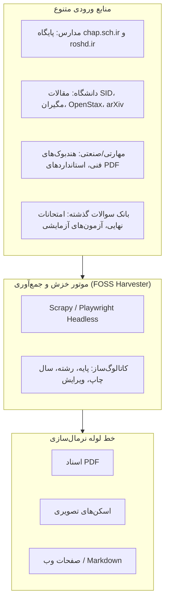
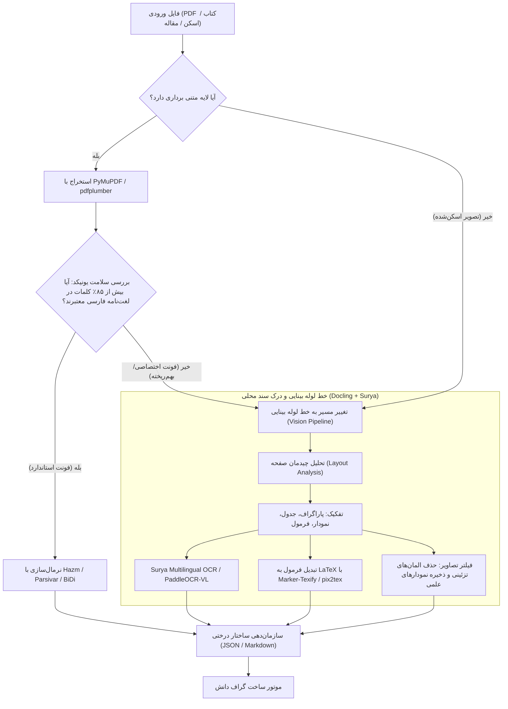

# ۴. مهندسی کشف محتوا، خط لوله استخراج متون، ریاضیات و تصویربرداری

قلب تپنده هر سیستم یادگیری خودکار، توانایی آن در تبدیل داده‌های خام، پراکنده و نامنظم جهان واقعی به یک پایگاه داده معنایی ساختاریافته و تمیز است. این سند به مهندسی فرآیند «کشف منابع (Content Sourcing)» و «خط لوله استخراج متون و فرمول‌ها (Extraction Pipeline)» با استفاده از ابزارهای کاملاً متن‌باز می‌پردازد.

---

## ۱. نقشه راه کشف و جمع‌آوری محتوا (Content Sourcing Architecture)

پیدا کردن محتوای معتبر، به‌روز و استاندارد نخستین گام خط لوله است. بسته به دامنه آموزش، استراتژی‌های کشف متفاوت خواهد بود:



### ۱.۱. مخازن مدارس و آموزش و پرورش (K-12 Ecosystem)
* **پایگاه `chap.sch.ir` (اداره کل نظارت بر نشر مواد آموزشی):**
  * ساختار پایگاه: دارای دسته‌بندی بر اساس دوره (ابتدایی، متوسطه اول، متوسطه دوم، فنی‌حرفه‌ای)، پایه تحصیلی، رشته و سال تحصیلی.
  * *چالش تغییرات سالانه:* کتاب‌های درسی در ایران ممکن است سال به سال دچار تغییرات جزئی یا تغییرات بنیادین در سرفصل‌ها شوند. سیستم باید شماره شابک (ISBN) و سال چاپ کتاب را متادیتا کند تا سوالات با کتاب درسی سال جاری دانش‌آموز مطابقت ۱۰۰٪ داشته باشد.
* **کتاب‌های راهنمای معلم (Teacher's Guides):**
  * در همان پایگاه `chap.sch.ir` تحت کد کتاب‌های راهنمای تدریس منتشر می‌شوند.
  * این کتاب‌ها ارزش طلایی دارند زیرا اهداف رفتاری، بودجه‌بندی زمانی، خطوط قرمز طراحی آزمون، و دقیقاً **فهرست بدفهمی‌های رایج دانش‌آموزان** در آن‌ها تشریح شده است.
* **بانک سوالات امتحانات نهایی کشوری و آزمون‌های استاندارد:**
  * وب‌سایت‌های آموزش و پرورش مناطق و پورتال‌های عمومی حاوی آزمون‌های نهایی سال‌های قبل به صورت PDF هستند که ساختار کلید استاندارد (پاسخ‌نامه رسمی مصوب) دارند.

### ۱.۲. مخازن آموزش عالی و آکادمیک (Higher Education & Research)
* **پایگاه‌های Open Access داخلی و بین‌المللی:**
  * پایگاه اطلاعات علمی جهاد دانشگاهی (`SID.ir`) و بخش چکیده‌های رایگان مگیران و ایران‌داک.
  * پایگاه‌های بین‌المللی با مجوز باز نظیر `OpenStax` (حاوی کتب رفرنس دانشگاهی فیزیک، شیمی، ریاضی، زیست، روانشناسی با لایسنس کاملاً آزاد Creative Commons)، `arXiv` و `PubMed Central`.
* **هندبوک‌های فنی و آموزش مهارتی (Vocational Training):**
  * مستندات متن‌باز، گیت‌هاب داکیومنت‌ها، استاندارد‌های فنی ISO، و آیین‌نامه‌های اجرایی که با فرمت PDF یا Markdown منتشر می‌شوند.

---

## ۲. کالبدشکافی چالش‌های استخراج متن فارسی و اسناد چندرسانه‌ای

استخراج متن فارسی از کتاب‌های درسی و دانشگاهی یکی از پیچیده‌ترین مسائل پردازش زبان طبیعی (NLP) است. این پیچیدگی ناشی از دلایل زیر است:

### ۲.۱. مصیبت فونت‌های InDesign و انکودینگ سفارشی (Custom CMap Problem)
در صفحه‌بندی کتاب‌های درسی، از فونت‌های خوشنویسی فارسی (نستعلیق، نیریزی، زر، لوتوس) استفاده می‌شود. نرم‌افزار InDesign هنگام اکسپورت PDF:
1. گلیف‌ها (اشکال بصری حروف) را به کدهای اسکی غیرمرتبط (مانند کد کاراکترهای لاتین یا Private Use Area در یونیکد) نگاشت می‌کند.
2. اتصالات حروف فارسی (آغازین، میانی، پایانی، تنها) را به عنوان کاراکترهای مجزا ذخیره می‌کند.
3. جهت نوشتار (Bi-directional) را در جریان بایتی به هم می‌ریزد (نوشته شدن از چپ به راست یا کلمات معکوس مانند «س-ل-ا-م» به جای «سلام»).
4. اعراب‌گذاری‌ها (حرکات فـَ فـِ فـُ) و نیم‌فاصله‌ها (ZWNJ - Zero Width Non-Joiner) به صورت کاراکترهای نامرئی شکسته ذخیره می‌شوند.

### ۲.۲. درهم‌تنیدگی متن، تصویر و فرمول (Multimodal Entanglement)
* در پایه‌های ابتدایی: یک سوال ممکن است به صورت «کدام کدو تنبل بزرگتر است؟» باشد و ۴ تصویر کدو تنبل بدون هیچ متنی در گزینه‌ها قرار داشته باشند. استخراج متن به تنهایی در اینجا کاملاً بی‌مصرف است!
* در پایه‌های دبیرستان و دانشگاه: متن سوال شامل نمادهای ریاضی پیچیده ($\int_0^\infty \frac{x^2}{e^x - 1} dx$)، نمودارهای برداری، و جدول‌های داده است.

---

## ۳. معماری خط لوله مهندسی استخراج متن و تصویر (FOSS Pipeline)

برای حل این چالش بدون پرداخت یک ریال هزینه ابری، معماری چندمرحله‌ای زیر با ابزارهای متن‌باز پیاده‌سازی می‌شود:



### ۳.۱. ابزارهای خط لوله و نقش مهندسی هر کدام:

1. **`Docling` (توسعه‌یافته توسط IBM Research - کاملاً متن‌باز Apache 2.0):**
   * *نقش:* ستون فقرات درک ساختار سند. Docling با استفاده از مدل‌های اختصاصی (مانند TableFormer)، ساختار جداول را به درستی می‌فهمد و اسناد چندستونه را بر اساس ترتیب خواندن واقعی انسان (Reading Order) به Markdown یا JSON تبدیل می‌کند.
2. **`Surya OCR` و `Marker`:**
   * *نقش:* یکی از قدرتمندترین موتورهای OCR محلی برای متون با خطوط غیرلاتین (شامل عربی و فارسی) و تحلیل خطوط و متن در سطوح دشوار. Marker فرمول‌های درون‌متنی را به صورت خودکار شناسایی کرده و به کدهای تمیز LaTeX تبدیل می‌کند.
3. **`PaddleOCR` با ماژول `PP-Structure`:**
   * *نقش:* پشتیبان صنعتی برای اسناد اسکن‌شده سنگین یا زمانی که فریم‌ریت پردازش بالا مدنظر است.
4. **پیش‌پردازش و نرمال‌سازی زبان فارسی (`Hazm` و `Parsivar` و `python-bidi`):**
   * تبدیل ارقام انگلیسی به فارسی یا بالعکس.
   * اصلاح نیم‌فاصله‌ها (مثال: تبدیل «می شود» به «می‌شود»).
   * یکپارچه‌سازی کاراکترهای عربی/فارسی (تبدیل «ي» عربی به «ی» فارسی، «ك» به «ک»).
   * نگهداری هوشمند اعراب در پایه‌های اول و دوم دبستان (جایی که تفاوت «گِل» و «گُل» وابسته به اعراب است).
5. **مدل بینایی-زبانی سبک محلی (`Qwen2.5-VL-3B/7B` یا `SmolVLM-2B` یا `MiniCPM-V`):**
   * برای حل چالش «متن‌های درون تصویر» و تصاویر مفهومی در پایه‌های ابتدایی و نمودارهای دانشگاهی، از مدل‌های VLM نسل جدید کم‌مصرف (با اشغال زیر ۴ گیگابایت VRAM) استفاده می‌شود که تصویر سوال را مستقیماً تحلیل کرده، موقعیت مکانی (Bounding Box) عناصر را تشخیص داده و متن یا ساختار ریاضی آن را به ساختار داده پیوست می‌کنند.

---

## ۴. تفکیک تصاویر علمی از نقاشی‌های فانتزی تزئینی (Image Disambiguation)

یکی از هشدارهای سند استراتژی اولیه، جلوگیری از غرق شدن در تصاویر تزئینی کتاب‌ها بود. راهکار مهندسی ما:
* **ماتریس ویژگی بصری:**
  * تصاویر تزئینی: معمولاً در حاشیه بیرونی صفحه، ابعاد نامتقارن، پالت رنگی کارتونی شلوغ، فاقد متن داخلی، فاقد زیرنویس (Caption) یا شماره شکل.
  * تصاویر مفهومی و علمی: معمولاً درون بدنه متن یا دقیقاً در کادر تمرین، همراه با متن‌هایی نظیر «شکل ۱»، «با توجه به نمودار زیر»، دارای برچسب‌های برداری و محورهای مختصات.
* **فیلتر خودکار:**
  یک کلاسیفایر تصویری سبک بر پایه `MobileNet` یا مدل چندوجهی `SigLIP` (متن‌باز)، با دقت بالای ۹۸٪ تصاویر استخراج‌شده را به دو دسته `Informational` و `Decorative` تقسیم می‌کند. تصاویر تزئینی دور ریخته می‌شوند و تصاویر علمی همراه با متادیتا و شناسه تمرین در پوشه دارایی‌ها (Asset Store) سیستم ذخیره می‌گردند.

---

## ۵. اسکلت داده خروجی مرحله استخراج (Canonical Schema)

خروجی نهایی این خط لوله برای هر درس/فصل، یک فایل ساختاریافته JSON با قالب زیر است:

```json
{
  "source_metadata": {
    "domain": "k12_school",
    "grade": "grade_4",
    "subject": "mathematics",
    "book_isbn": "978-964-05-XXXX-X",
    "edition_year": 1403,
    "chapter": 2,
    "topic": "کسر و عددهای مخلوط"
  },
  "learning_objectives": [
    {
      "objective_id": "KC_MATH4_02_01",
      "statement": "توانایی بازشناسی و رسم کسرهای مساوی با استفاده از شکل و ضرب صورت و مخرج",
      "bloom_level": "understanding",
      "prerequisites": ["KC_MATH3_03_02"]
    }
  ],
  "documented_misconceptions": [
    {
      "misconception_id": "MISC_MATH4_02_01",
      "description": "جمع بستن مستقیم صورت‌ها و مخرج‌ها در جمع کسرها بدون هم‌مخرج‌سازی",
      "source": "راهنمای تدریس ریاضی پایه چهارم - صفحه ۵۸"
    }
  ],
  "content_units": [
    {
      "unit_id": "CU_001",
      "type": "concept_explanation",
      "raw_text_clean": "برای پیدا کردن کسر مساوی با یک کسر، می‌توان صورت و مخرج آن را در یک عدد ثابت (غیر از صفر) ضرب کرد...",
      "formulas": ["\\frac{a}{b} = \\frac{a \\times k}{b \\times k}"],
      "diagrams": [
        {
          "asset_path": "assets/diagrams/math4_ch2_frac_strip.png",
          "alt_text": "نوار کسری نشان‌دهنده برابری یک‌دوم با دوچهارم"
        }
      ]
    }
  ]
}
```

این اسکیمای یکپارچه، خوراک آماده و بی‌نقصی است که در مرحله بعد به ایجنت‌های طراحی سوال و موتور تشخیصی شناختی تحویل داده می‌شود.