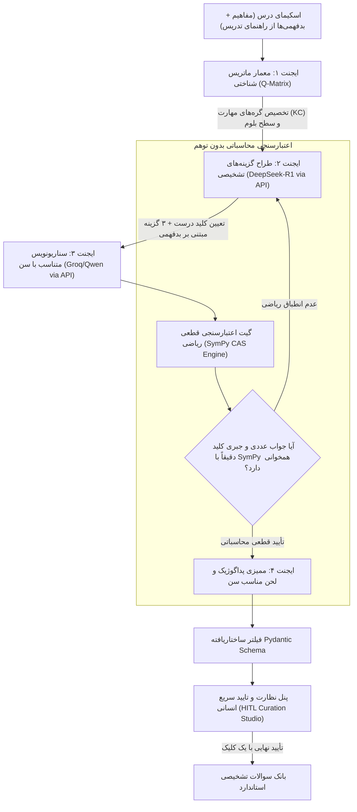
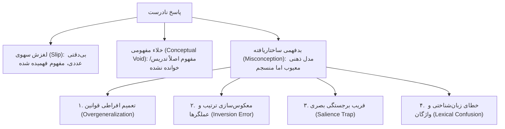

# ۵. معماری ایجنت‌های هوشمند، طراحی سوال تشخیصی و مدل‌های روان‌سنجی شناختی

طراحی سوال تشخیصی با تولید تصادفی کوییز متفاوت است. در یک سامانه تشخیصی، هر گزینه، هر کلمه و هر تصویر دارای بار شناختی محاسبه‌شده است. این سند به تبیین معماری ایجنت‌های محلی، روش‌شناسی روان‌سنجی (Psychometrics) و مدل‌های تشخیصی شناختی (CDMs) با ابزارهای کاملاً رایگان و متن‌باز می‌پردازد.

---

## ۱. چرخه حیات چندایجنت در تولید سوال (Multi-Agent Authoring Pipeline)

برای تضمین این که سوالات بدون توهم، از نظر علمی بی‌نقص، هماهنگ با سن و دارای ارزش تشخیصی باشند، یک معماری ارکستراسیون چندایجنت بر پایه مدل‌های محلی طراحی شده است:

### ۱.۱. وظایف تفصیلی هر جزء در خط لوله:

1. **ایجنت معمار ماتریس شناختی (Q-Matrix Agent):**
   * *سرویس:* فراخوانی سریع `Qwen / Llama 3.3` از طریق API
   * *وظیفه:* تفکیک اهداف رفتاری درس به گره‌های مهارتی اتمیک (KC) و تعیین ردیف‌های ماتریس $Q$.
2. **ایجنت طراح گزینه‌های تشخیصی (Misconception Distractor Architect):**
   * *سرویس:* فراخوانی `DeepSeek-R1 API` با قدرت تفکر عمیق (Chain-of-Thought)
   * *وظیفه حیاتی:* ایجاد ۳ گزینه انحرافی متناظر با بدفهمی‌های شناسنامه‌دار کتاب راهنمای معلم.
3. **گیت اعتبارسنجی قطعی جبری (Deterministic CAS - SymPy):**
   * *موتور ریاضی پایتون:* کتابخانه متن‌باز `SymPy`
   * *وظیفه حیاتی:* **قطع وابستگی به حدس LLM در ریاضی.** معادله سوال و تک‌تک گزینه‌ها به فرمت جبری کامپایل و حل می‌شوند. سیستم با قطعیت ۱۰۰٪ ریاضی اثبات می‌کند که کلید درست پاسخ یکتا دارد و هیچ دو گزینه‌ای هم‌ارز جبری نیستند.
4. **استودیوی نظارت انسانی سریع (HITL Curation Studio):**
   * *رابط کاربری:* وب‌داشبورد ادمین
   * *وظیفه:* سوالات و گزینه‌ها در یک نگاه به معلم یا ناظر نمایش داده می‌شوند و با زدن یک کلید اینتر تأیید و وارد بانک سوالات قطعی می‌شوند.

---

## ۲. پایه‌های روان‌سنجی: مدل دومرحله‌ای تشخیصی (Two-Stage Hybrid Diagnostic Framework)

برای حل «تله حجم نمونه در مدل DINA» و امکان عملکرد دقیق سیستم از روز اول برای حتی یک کاربر:

### مرحله اول: ردیابی مستقیم بدفهمی و مدل بیزی روز اول (Cold-Start / Day-1 BKT)
در فاز شروع و تا قبل از جمع‌آوری پاسخ‌های جمعیتی:
1. **تشخیص مستقیم بدفهمی (Direct Misconception Tagging):** چون هر گزینه غلط دارای شناسه بدفهمی منحصر‌به‌فرد است، با انتخاب هر گزینه انحرافی توسط دانش‌آموز، نوع خطای شناختی او به صورت مستقیم و قطعی ثبت می‌شود و نیازی به تخمین پارامتری DINA در روز اول نیست.
2. **ردیابی دانش بیزی (BKT):** احتمال تسلط بر مهارت با پارامترهای پیش‌فرض خبره‌محور (Priors: $P(L_0)=0.1, P(T)=0.2, P(G)=0.25, P(S)=0.1$) با هر پاسخ به‌روزرسانی می‌شود.

### مرحله دوم: کالیبراسیون داده‌محور DINA در مقیاس جمعیتی (Population-Scale DINA)
پس از ثبت پاسخ‌های بیش از ۲۰۰ دانش‌آموز در یک مبحث، ماژول کالیبراسیون آفلاین `EduCDM` فعال شده و پارامترهای تجربی لغزش ($s_j$) و حدس ($g_j$) را با الگوریتم EM محاسبه کرده و دقت ماتریس $Q$ را بهینه می‌سازد.
در مدل DINA، تسلط بر یک سوال زمانی حاصل می‌شود که دانش‌آموز بر تمام مهارت‌های پیش‌نیاز تعریف‌شده در ماتریس $Q$ برای آن سوال مسلط باشد:
$$\eta_{ij} = \prod_{k=1}^K \alpha_{ik}^{q_{jk}}$$
که در آن:
* $\alpha_{ik} \in \{0, 1\}$ نشان‌دهنده تسلط دانش‌آموز $i$ بر مفهوم $k$ است.
* $q_{jk} \in \{0, 1\}$ نشان‌دهنده نیاز سوال $j$ به مفهوم $k$ است.
* $\eta_{ij}$ متغیر وضعیت نهفته است (۱ اگر فرد تمام پیش‌نیازها را بلد باشد، و ۰ اگر حتی یک پیش‌نیاز را نداند).

اما انسان ماشین بی‌نقص نیست، بنابراین مدل دو پارامتر نویز شناختی حیاتی تعریف می‌کند:
1. **احتمال لغزش سهوی (Slip Parameter - $s_j$):** فرد مفهوم را بلد است، اما به خاطر حواس‌پرتی یا اشتباه محاسباتی ساده، گزینه غلط را می‌زند:
   $$s_j = P(X_{ij} = 0 \mid \eta_{ij} = 1)$$
2. **احتمال حدس تصادفی (Guess Parameter - $g_j$):** فرد مفهوم را بلد نیست، اما شانسکی گزینه درست را انتخاب می‌کند:
   $$g_j = P(X_{ij} = 1 \mid \eta_{ij} = 0)$$

احتمال پاسخ صحیح فرد $i$ به سوال $j$ چنین محاسبه می‌شود:
$$P(X_{ij} = 1 \mid \boldsymbol{\alpha}_i) = (1 - s_j)^{\eta_{ij}} \cdot g_j^{1 - \eta_{ij}}$$

* **کتابخانه پایتون مورد استفاده:** کتابخانه کاملاً متن‌باز و رایگان `EduCDM` (توسعه‌یافته توسط آزمایشگاه کلان‌داده USTC - تحت لایسنس MIT/Apache).

### ۲.۲. ردیابی پویای دانش بیزی (Bayesian Knowledge Tracing - BKT)
برای اینکه سیستم بداند کاربر در طول زمان چگونه در حال رشد است و چه زمانی یک مفهوم در ذهنش تثبیت شده، از BKT استفاده می‌شود. در هر گام آزمون، احتمال تسلط بر مهارت $k$ به کمک قضیه بیز آپدیت می‌شود:
$$P(L_t \mid \text{Correct}) = \frac{P(L_t) \cdot (1 - P(S))}{P(L_t) \cdot (1 - P(S)) + (1 - P(L_t)) \cdot P(G)}$$
$$P(L_t \mid \text{Incorrect}) = \frac{P(L_t) \cdot P(S)}{P(L_t) \cdot P(S) + (1 - P(L_t)) \cdot (1 - P(G))}$$
سپس برای گام بعدی با توجه به احتمال انتقال یادگیری ($P(T)$)، پیش‌بینی صورت می‌گیرد:
$$P(L_{t+1}) = P(L_t \mid \text{Obs}) + (1 - P(L_t \mid \text{Obs})) \cdot P(T)$$

* **کتابخانه پایتون مورد استفاده:** `pyBKT` و پکیج `EduKTM`.

---

## ۳. تاکسونومی خطاهای شناختی و گزینه‌های انحرافی هوشمند

سیستم انواع خطاهای شناختی را در یک ساختار چندلایه طبقه‌بندی می‌کند:

### نمونه‌های ملموس در پایه‌های مختلف:

1. **ابتدایی (ریاضی چهارم):**
   * *سوال:* کدام عدد از بقیه بزرگتر است؟ `۰.۳` یا `۰.۲۵`؟
   * *گزینه انحرافی انتخابی:* `۰.۲۵`
   * *تحلیل بدفهمی:* دانش‌آموز قانون اعداد صحیح را تعمیم داده است: «چون ۲۵ از ۳ بزرگتر است، پس ۰.۲۵ هم از ۰.۳ بزرگتر است». سیستم بلافاصله برچسب `MISC_DECIMAL_WHOLE_NUM_OVERGENERALIZATION` می‌زند.
2. **متوسطه (علوم/فیزیک نهم):**
   * *سوال:* وقتی اتومبیل با سرعت ثابت روی خط مستقیم حرکت می‌کند، جهت نیروی خالص وارد بر آن کدام است؟
   * *گزینه انحرافی انتخابی:* «در جهت حرکت اتومبیل».
   * *تحلیل بدفهمی:* تفکر ارسطویی در برابر قانون اول نیوتن؛ دانش‌آموز فکر می‌کند برای ادامه حرکت با سرعت ثابت، حتماً نیاز به نیروی خالصی در جهت حرکت است (`MISC_NEWTON_FIRST_ARISTOTELIAN`).
3. **دانشگاهی (برنامه‌نویسی پیشرفته / ساختار داده):**
   * *سوال:* اگر ظرفیت وکتور پر شود و یک عنصر اضافه کنیم، پیچیدگی زمانی استهلاکی (Amortized) چه خواهد بود؟
   * *گزینه انحرافی انتخابی:* $O(N)$
   * *تحلیل بدفهمی:* خلط میان بدترین حالت یک تک‌عملیات کپی در حافظه با تحلیل میانگین استهلاکی پویا (`MISC_AMORTIZED_VS_WORST_CASE`).

---

## ۴. روش حل چالش شروع سرد (Cold-Start Problem)

وقتی کاربر جدید وارد سیستم می‌شود و هیچ داده قبلی از او وجود ندارد، سیستم چگونه بدون اتلاف وقت و آزمون‌های طولانی، سطح او را تشخیص می‌دهد؟
* **آزمون انطباقی کامپیوتری (Computerized Adaptive Testing - CAT):**
  * سوال اول همیشه از سطح دشواری متوسط ($b \approx 0$) و از یک مفهوم کلیدی میانی پرسیده می‌شود.
  * با استفاده از مدل بیشینه اطلاعات فیشر (Fisher Information Matrix)، سوال بعدی سوالی انتخاب می‌شود که بیشترین عدم‌قطعیت را از بردار وضعیت شناختی کاربر بکاهد.
  * سیستم تنها با ۶ تا ۸ سوال انطباقی می‌تواند موقعیت دقیق کاربر را روی نقشه دانش کالیبره کند.