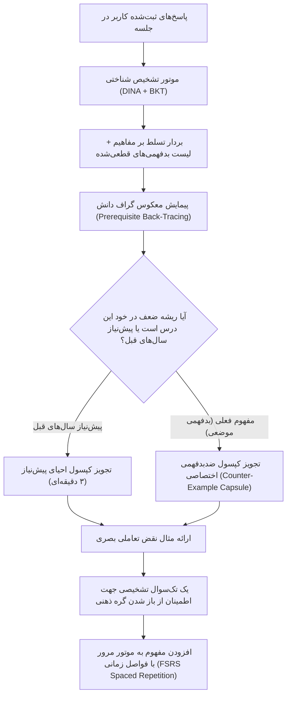

# ۷. موتور تحلیل تشخیصی، بازخورد و مسیرهای یادگیری جبرانی (Adaptive Remediation)

بزرگترین نقطه ضعف سیستم‌های ارزیابی سنتی، پایان یافتن کار سیستم در لحظه اعلام کارنامه است. کارنامه سنتی مانند برگه آزمایش خونی است که به بیمار تحویل داده شود اما هیچ پزشکی دارویی برای بیماری تجویز نکند! در پلتفرم ما، پایان آزمون، نقطه شروع فرآیند درمان آموزشی است. این سند به تبیین مهندسی الگوریتم‌های جبرانی و گزارش‌دهی هوشمند می‌پردازد.

---

## ۱. چرخه کامل درمان آموزشی: از تشخیص تا تثبیت (The Remediation Loop)



---

## ۲. الگوریتم ریشه‌یابی شکست: پیمایش معکوس پیش‌نیازها (Prerequisite Back-Tracing)

فرض کنید دانش‌آموزی در سوال مربوط به **«تقسیم کسرها»** شکست می‌خورد و گزینه انحرافی مربوط به ندانستن چرایی معکوس کردن کسر دوم را می‌زند.
* **رویکرد سنتی:** همان فرمول تقسیم کسر را ۱۰ بار دیگر به او نشان می‌دهد و ۲۰ تست تقسیم کسر برایش می‌فرستد! (باعث خستگی و نفرت دانش‌آموز).
* **رویکرد مهندسی پلتفرم ما:**
  سیستم گراف جهت‌دار بدون دور (DAG) پیش‌نیازها را به صورت معکوس پیمایش می‌کند:

```
[مفهوم ضرب اعداد] 
       ↓
[مفهوم کسر مساوی و معکوس یک عدد]  <--- سیستم وضعیت این گره را چک می‌کند (تسلط: ۰.۳۱ - بحرانی!)
       ↓
[ضرب کسرها]
       ↓
[تقسیم کسرها (گره شکست خورده)]
```

سیستم متوجه می‌شود که گره اصلی در گره «معکوس یک عدد و رابطه معکوس با عملگر ضرب» است. بنابراین، نسخه درمان به جای تکرار تقسیم کسر، یک انیمیشن ۴۰ ثانیه‌ای از مفهوم معکوس کردن و رابطه آن با ترازو است.

---

## ۳. آناتومی کپسول ضدبدفهمی (The Counter-Example Capsule)

بهترین شیوه از بین بردن یک بدفهمی، نه «نصیحت کلامی»، بلکه ارائه یک **«مثال نقض بصری یا ملموس (Cognitive Conflict)»** است که مغز را به یک چالش تناقض‌آمیز بکشد تا اسکیما خودبه‌خود فرو بریزد و بازسازی شود:

### نمونه اجرایی:
* **بدفهمی:** دانش‌آموز فکر می‌کند مساحت هر مستطیل که محیطش بزرگتر است، لزوماً بیشتر است.
* **کپسول جبرانی سیستم:**
  1. *ایجاد چالش ذهنی:* نمایش دو مستطیل همزمان:
     * مستطیل اول: ابعاد $1 \times 10$ (محیط: ۲۲، مساحت: ۱۰).
     * مستطیل دوم: ابعاد $5 \times 5$ (محیط: ۲۰، مساحت: ۲۵).
  2. *تعامل کاربر:* کاربر می‌تواند با کشیدن گوشه مستطیل‌ها ببیند که چطور با محیط کمتر می‌توان مساحت بسیار بیشتری را درون شکل جا داد.
  3. *نتیجه‌گیری خودکار ذهن:* مغز بدون اینکه کسی به او بگوید «فرمول را اشتباه حفظ کردی»، با مشاهده تناقض فیزیکی خطای شناختی خود را اصلاح می‌کند.

---

## ۴. مهندسی داشبوردهای تشخیصی برای بازیگران مختلف (Stakeholder Dashboards)

یک سیستم تشخیصی باید داده‌ها را متناسب با ادراک هر ذی‌نفع به زبان او ترجمه کند:

### ۴.۱. داشبورد کاربر (دانش‌آموز، دانشجو یا متخصص):
* **زبان بصری:** نقشه ستاره‌ای یا کهکشان مهارت‌ها (Skill Galaxy).
* گره‌های مسلط به رنگ سبز درخشان، گره‌های در حال تسلط به رنگ فیروزه‌ای، و گره‌های دارای گره کور به رنگ کهربایی با برچسب *«مأموریت کاوش بعدی شما»*.
* شاخص تاب‌آوری (Resilience Index): تجلیل از اصلاح اشتباهات گذشته به جای تشویق موفقیت‌های بی‌دردسر.

### ۴.۲. داشبورد والدین (در مقطع دبستان و متوسطه):
* **پرهیز از اصطلاحات غلیظ روان‌سنجی:** والدین با واژه‌هایی مثل «پارامتر تتا در IRT» گیج می‌شوند.
* **گزارش انسانی عمل‌گرا:**
  > *«سلام مادر کیان عزیز. در آزمون ۵ دقیقه‌ای امروز، کیان در محاسبات جمع و تفریق کسرها سرعت عالی داشت. تنها یک گره کوچک وجود دارد: او هنوز رابطه بین اندازه مخرج و کوچکتر شدن تکه‌ها را به صورت شهودی لمس نکرده است. پیشنهاد می‌کنیم امشب هنگام تقسیم یک عدد سیب، از او بخواهید برش‌های ۴ تایی و ۸ تایی را مقایسه کند. سیستم ما فردا یک تمرین ۲ دقیقه‌ای برای تثبیت این مفهوم به کیان پیشنهاد خواهد داد.»*

### ۴.۳. داشبورد معلمان و اساتید دانشگاه:
* **نقشه حرارتی کلاس (Classroom Heatmap Matrix):**
  * ستون‌ها: مفاهیم اتمیک درس.
  * سطرها: دانش‌آموزان یا دانشجویان.
  * سلول‌ها: رنگ‌بندی بر اساس بردار تسلط $\alpha_{ik}$.
* **پیشنهاد مداخله آموزشی جمعی:**
  * سیستم به معلم اعلام می‌کند: *«۶۸٪ کلاس در درک تفاوت مفهوم ظرفیت خازن در مدار جریان متناوب دارای بدفهمی فاز تاخیری هستند. تدریس مبحث بعدی را متوقف کنید و ۵ دقیقه اول جلسه بعد را به نمایش شبیه‌ساز فازور اختصاص دهید.»*

---

## ۵. تثبیت بلندمدت و جلوگیری از فراموشی (Spaced Repetition با الگوریتم FSRS)

دانشی که امروز اصلاح شده، اگر مرور نشود ظرف دو هفته آینده طبق منحنی فراموشی ابینگهاوس (Ebbinghaus Forgetting Curve) از بین می‌رود.
* **الگوریتم انتخابی:** استفاده از الگوریتم متن‌باز و پیشرفته `FSRS` (Free Spaced Repetition Scheduler - الگوریتم نسل جدید که از SM-2 آنکی دقیق‌تر است).
* **کارکرد:**
  هر گره اصلاح‌شده وارد صف مرور با فواصل زمانی هوشمند ($S_R$) می‌شود. در روز سوم، روز هفتم و روز بیست‌ویکم، یک سوال تک‌گزینه‌ای برق‌آسا در صفحه اصلی کاربر ظاهر می‌شود تا سیناپس‌های عصبی مربوطه تقویت شده و تسلط دائمی در حافظه بلندمدت تثبیت شود.