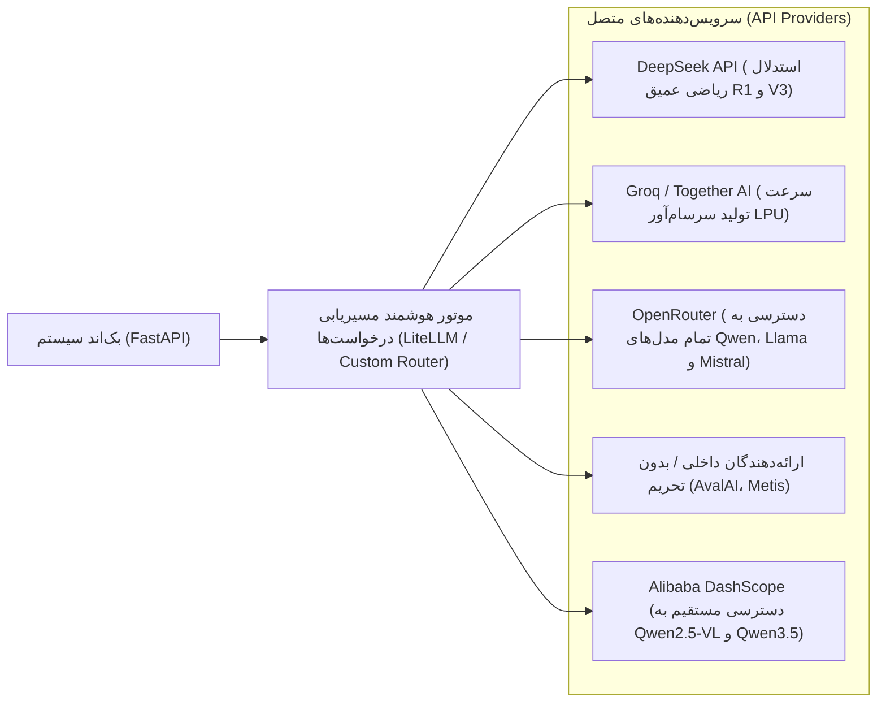

# ۸. معماری ارائه‌دهندگان هوش مصنوعی (API Providers) و پشته فناوری FOSS

بر اساس تصمیم راهبردی سیستم، **مدل‌های هوش مصنوعی بر روی سرورهای محلی اجرا نمی‌شوند**؛ بلکه جهت حذف هزینه‌های سنگین سخت‌افزاری (خرید کارت‌های گرافیک گران‌قیمت، مصرف برق و هزینه‌های نگهداری دیتاسنتر) و دستیابی به سرعت پردازش بالا (زیر ۲ ثانیه برای هر سوال)، از **سرویس‌دهنده‌های ابری و ارائه‌دهندگان API (AI API Providers)** استفاده می‌شود.

در عین حال، هسته نرم‌افزاری، پایگاه داده، منطق ریاضی و کلاینت‌ها ۱۰۰٪ متن‌باز و آزاد (FOSS) باقی می‌مانند و هیچ‌گونه وابستگی انحصاری (Vendor Lock-in) وجود نخواهد داشت.

---

## ۱. معماری اتصال به سرویس‌دهندگان هوش مصنوعی (API Gateway Architecture)

به جای وابستگی به یک سرویس‌دهنده خاص، یک لایه واسط یکپارچه با استفاده از پروتکل استاندارد سازگار با OpenAI (OpenAI-Compatible API Interface) در بک‌اند پیاده‌سازی می‌شود:

### مزایای استراتژیک استفاده از سرویس‌دهنده‌ها:
1. **حذف هزینه سرمایه‌ای (Zero CapEx):** هیچ نیازی به خرید سرورهای چندصد میلیونی مجهز به GPUهای RTX 3090 یا 4090 نیست.
2. **کاهش زمان پاسخ از چند دقیقه به ۲ ثانیه:** سرویس‌دهندگانی مانند Groq با تراشه‌های LPU نرخ تولید بیش از ۳۰۰ توکن بر ثانیه ارائه می‌دهند که فرآیند ارکستراسیون چندایجنت را آنی می‌سازد.
3. **دسترسی به بزرگترین مدل‌های استدلالی دنیا:** امکان استفاده مستقیم از قدرتمندترین مدل‌های استدلال (مانند DeepSeek-R1 و Qwen2.5-72B و Qwen2.5-VL) با هزینه‌ای ناچیز به ازای توکن مصرفی یا استفاده از پلن‌های رایگان.
4. **قابلیت سوییچ آنی (Failover):** در صورت اختلال در یک سرویس‌دهنده، درخواست‌ها در کسری از ثانیه به سرویس‌دهنده جایگزین روت می‌شوند.

---

## ۲. جدول مرجع کل پشته فناوری بازسامانه (Hybrid FOSS + Cloud AI Stack)

| لایه معماری | فناوری / سرویس انتخابی | ماهیت و لایسنس | هزینه / مدل استقرار | نقش اختصاصی در سامانه |
| :--- | :--- | :--- | :--- | :--- |
| **سرویس‌دهنده استدلال ریاضی و بدفهمی** | **DeepSeek API (R1 & V3)** | سرویس ابری (Cloud API) | بسیار اقتصادی (هزینه به ازای مصرف) | حل مسائل پیچیده، استدلال CoT و طراحی گزینه‌های مبتنی بر بدفهمی |
| **سرویس‌دهنده سرعت بالا و سناریونویسی** | **Groq / OpenRouter (Llama 3.3 / Qwen)** | سرویس ابری (Cloud API) | پلن‌های رایگان و ارزان | تولید سریع متون سناریو، ساده‌سازی لحن برای سنین مختلف |
| **سرویس‌دهنده بینایی و اسناد (VLM)** | **Qwen2.5-VL / DashScope API** | سرویس ابری (Cloud API) | اقتصادی | خواندن تصاویر کتاب‌ها، نمودارهای هندسی و استخراج ساختار صفحات |
| **موتور اعتبارسنجی قطعی ریاضی** | **SymPy** (موتور جبر نمادین پایتون) | کاملاً متن‌باز (BSD) | $۰$ رایگان | حل قطعی و بدون توهم فرمول‌ها، کسرهای مساوی و اعتبارسنجی کلید سوالات |
| **استودیو نظارت انسانی (HITL)** | **HITL Curation Studio** (وب پنل) | کدبیس اختصاصی پروژه | $۰$ رایگان | بازبینی، تأیید و اصلاح سریع مفاهیم و سوالات استخراج‌شده توسط معلم/ناظر |
| **مهندسی استخراج سند و ساختار** | **Docling** (IBM Research) | متن‌باز (Apache 2.0) | $۰$ رایگان | تفکیک جداول و چیدمان کتاب‌های درسی و راهنمای معلم |
| **پیش‌پردازش زبان فارسی** | **Hazm** + **Parsivar** + **python-bidi** | متن‌باز (MIT) | $۰$ رایگان | اصلاح رسم‌الخط، نیم‌فاصله‌ها و نگاشت راست‌به‌چپ متون فارسی |
| **پایگاه داده رابطه‌ای و برداری** | **PostgreSQL 16** + **pgvector** | متن‌باز (PostgreSQL) | $۰$ رایگان | نگهداری ساختار دروس، پروفایل دانش‌آموزان و وکتورهای جستجوی معنایی |
| **مدل‌سازی روان‌سنجی شناختی** | **pyBKT** (در شروع) + **EduCDM** (در مقیاس) | متن‌باز (MIT) | $۰$ رایگان | ردیابی پویای تسلط بیزی در روز اول و کالیبراسیون DINA در مقیاس جمعیتی |
| **موتور زمان‌بندی مرور ضدفراموشی** | **py-fsrs** | متن‌باز (MIT) | $۰$ رایگان | زمان‌بندی فواصل مرور هوشمند کپسول‌های ترمیمی بر اساس منحنی فراموشی |
| **بک‌اند و صف پردازش ناهمگام** | **FastAPI** + **Celery / Redis** | متن‌باز (MIT / BSD) | $۰$ رایگان | سرویس‌دهی API و مدیریت تسک‌های پس‌زمینه استخراج و تولید سوال |
| **کلاینت چندسکویی فرانت‌اند** | **Flutter** (Web / Android / Desktop) | متن‌باز (BSD 3-Clause) | $۰$ رایگان | اجرای ارگونومیک آزمون‌ها، پشتیبانی آفلاین و رندرینگ گرافیکی ۶۰ فریم |
| **قالب‌های تعاملی بصری پارامتریک** | **Parametric Visual Widgets Library** | کدبیس فلاتر پروژه | $۰$ رایگان | ۵ ویجت پارامتریک جهت پوشش کلیه مفاهیم بصری ریاضی بدون نیاز به کدنویسی اختصاصی |
| **رندرینگ فرمول‌های ریاضی** | **KaTeX** + فونت **Vazirmatn** | متن‌باز (MIT / OFL) | $۰$ رایگان | نمایش فوری فرمول‌ها و کسرهای فارسی در فرانت‌اند |

---

## ۳. امنیت، حریم خصوصی داده‌ها و مدیریت بودجه ابری

1. **ارسال نکردن اطلاعات هویتی دانش‌آموزان به API:**
   درخواست‌هایی که به ارائه‌دهندگان ابری (OpenRouter یا DeepSeek) ارسال می‌شوند، **صرفاً حاوی متون آموزشی درسی و اهداف یادگیری جهت تولید سوال** هستند. هیچ داده هویتی، نام کاربر، شناسه کاربری، یا سوابق عملکردی دانش‌آموز به سرورهای خارجی ارسال نمی‌شود. داده‌های دانش‌آموزان منحصراً درون پایگاه داده داخلی سیستم نگهداری می‌گردد.
2. **بهینه‌سازی هزینه و ذخیره‌سازی ابدی در بانک سوالات (Caching):**
   تولید سوال یک فرآیند یک‌باره برای هر درس است. پس از اینکه یک سوال از طریق API تولید، توسط SymPy اعتبارسنجی و توسط ناظر انسانی در پنل HITL تایید شد، برای همیشه در پایگاه داده ذخیره می‌شود و برای میلیون‌ها بار آزمون بدون نیاز به فراخوانی مجدد API مصرف خواهد شد. بنابراین هزینه APIها صرفاً مربوط به فاز اینجکشن محتواست و در زمان آزمون دادن دانش‌آموزان **هزینه صفر** خواهد بود.
