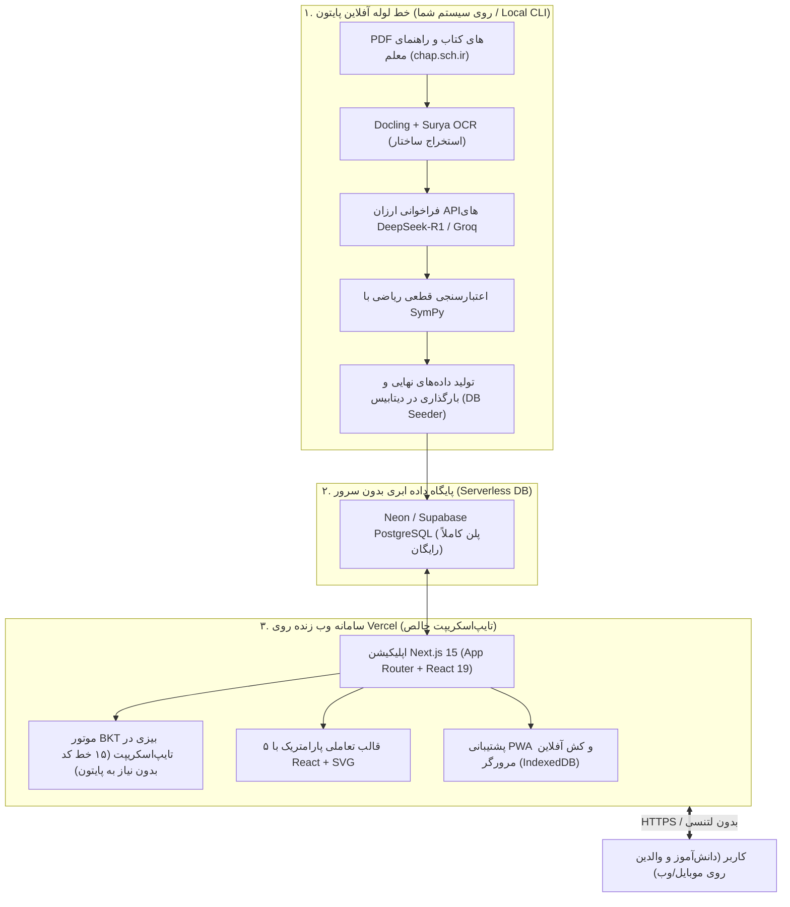

# ۸. معماری استقرار بر ورسل (Vercel)، تفکیک پایتون و پشته فناوری وب

بر اساس تصمیمات استراتژیک اتخاذ شده:
1. **فلاتر به طور کامل کنار گذاشته شد** و تمرکز منحصراً بر **«نسخه وب سبک، واکنش‌گرا و فوق‌سریع (Next.js PWA)»** قرار گرفت تا مشکل حجم سنگین دانلود اولیه (CanvasKit Bundle Size) و ناسازگاری‌های متنی فلاتر در وب حذف شود.
2. **پلتفرم میزبانی تا نسخه 1.0 بر روی Vercel قرار می‌گیرد** تا فرآیند استقرار خودکار، اتصال به دامنه، توزیع جهانی CDN و مدیریت بدون دغدغه سرور (Serverless) محقق شود.
3. **پایتون به هیچ وجه روی Vercel اجرا نمی‌شود؛** بلکه صرفاً به عنوان یک **«ابزار آفلاین خط تولید محتوا (Offline Ingestion CLI)»** روی سیستم توسعه‌دهنده جهت استخراج کتب و تولید سوالات عمل می‌کند و خروجی ساختاریافته را مستقیماً وارد دیتابیس می‌نماید.

---

## ۱. مدل تفکیک خط تولید (کارخانه پایتون) از سامانه کاربر (ویترین Next.js روی Vercel)

---

## ۲. جدول مرجع پشته فناوری نسخه وب و استقرار Vercel

| لایه معماری | فناوری انتخابی | ماهیت و لایسنس | هزینه / بستر استقرار | نقش فنی و مزیت معماری |
| :--- | :--- | :--- | :--- | :--- |
| **میزبانی و زیرساخت وب** | **Vercel** (Hobby Plan) | سرورلس (Serverless PaaS) | $۰$ کاملاً رایگان | استقرار خودکار از گیت‌هاب، توزیع جهانی CDN، کشینگ لبه (Edge) و مدیریت SSL |
| **فریم‌ورک فرانت‌اند و وب** | **Next.js 15 (React 19 + TypeScript)** | متن‌باز (MIT) | اجرا روی Vercel | لود اولیه آنی (FCP < 1s)، قابلیت PWA (اجرا شبیه اپلیکیشن بدون نصب)، بهینه‌سازی کامل متون فارسی |
| **استایل و سیستم طراحی** | **TailwindCSS v4 + Radix UI** | متن‌باز (MIT) | کلاینت وب | طراحی پاکیزه، بدون پرش لایوت، دسترسی‌پذیری عالی و سازگاری با اصول امیل کوالسکی |
| **قالب‌های بصری تعاملی** | **React + SVG + Lucide Icons** | کدبیس پروژه | کلاینت وب | ۵ قالب بصری پارامتریک کسر، محور، مساحت و ترازو با رندرینگ بومی وب در کسری از میلی‌ثانیه |
| **رندرینگ ریاضی و فرمول** | **KaTeX (rehype-katex) + Vazirmatn** | متن‌باز (MIT / OFL) | کلاینت وب | نمایش فوری و بی‌نقص فرمول‌های ریاضی و کسرها با خط استاندارد فارسی |
| **پایگاه داده سرورلس** | **Neon / Supabase (PostgreSQL 16)** | متن‌باز / سرورلس | $۰$ رایگان (Free Tier) | اتصال مستقیم و بومی به Vercel، پشتیبانی از pgvector، ظرفیت کافی برای ده‌ها هزار کاربر اولیه |
| **موتور ردیابی شناختی در لحظه** | **Pure TypeScript BKT Engine** | کدبیس پروژه | $۰$ اجرا روی Vercel | پیاده‌سازی ۴ فرمول بیزی در حد ۱۵ خط کد در Server Actions بدون نیاز به هیچ سرور پایتون |
| **سرویس‌دهنده هوش مصنوعی ابری** | **DeepSeek API (R1 & V3) / Groq** | سرویس ابری | اقتصادی به ازای مصرف | حل مسائل، استدلال تحلیلی و سناریونویسی در زمان آماده‌سازی محتوا |
| **ابزار استخراج آفلاین (Local)** | **Python (Docling + Surya + SymPy)** | ابزار داخلی توسعه | اجرا روی سیستم خودتان | دانلود و پارس کتب درسی و راهنمای معلم و تولید فایل‌های Seed دیتابیس (کاملاً جدا از هاست ورسل) |

---

## ۳. چرا حذف پایتون از سرور وب (Vercel) یک پیروزی مهندسی است؟

1. **پرهیز از محدودیت‌های حجم Vercel Serverless:**
   پکیج‌های علم داده پایتون (نظیر PyTorch، Docling و Surya) حجمی فراتر از ۲ تا ۳ گیگابایت دارند، در حالی که لایه سرورلس ورسل حداکثر ۲۵۰ مگابایت اجازه می‌دهد. انتقال پایتون به یک اسکریپت آفلاین محلی، این گره کور را به کلی باز کرد.
2. **صفر شدن زمان راه‌اندازی سرد (Zero Cold-Start):**
   توابع تایپ‌اسکریپت Next.js روی ورسل در کمتر از ۲۰ میلی‌ثانیه پاسخ می‌دهند، در حالی که توابع پایتونی کانتینری چندین ثانیه زمان برای بارگذاری ماژول‌ها تلف می‌کنند.
3. **حفظ پایداری در حین قطعی اینترنت (Offline-First via PWA):**
   با قابلیت Service Worker و IndexedDB مرورگر، سوالات ارزیابی می‌توانند در گوشی دانش‌آموز کش شوند و حتی بدون اینترنت در طول جلسه ۵ دقیقه‌ای اجرا شده و نتایج پس از اتصال ارسال گردند.
