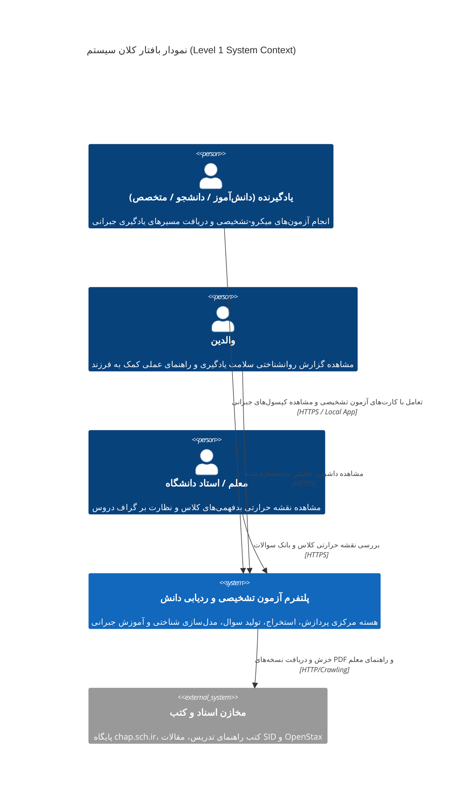
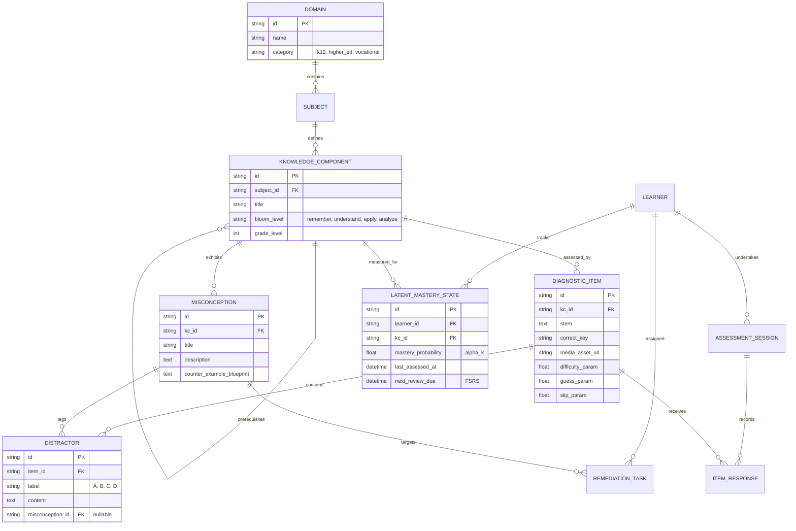

# ۹. سند مشخصات نیازمندی‌های نرم‌افزار (SRS) و معماری سیستم (SAD)

این سند مرجع رسمی مهندسی نرم‌افزار (Software Requirements Specification & System Architecture Document) پلتفرم ارزیابی تشخیصی و تحلیل یادگیری است. این سند بر اساس استانداردهای بین‌المللی IEEE 830 و الگوی معماری C4 تدوین شده است.

---

## ۱. مدل معماری C4: سطح ۱ - بافتار کلان سیستم (System Context Diagram)



---

## ۲. مدل معماری C4: سطح ۲ - ظروف اجرایی سیستم (Container Diagram)

```mermaid
C4Container
    title نمودار ظروف اجرایی پلتفرم (Level 2 Container Diagram)

    Person(user, "کاربران سامانه", "دانش‌آموز، دانشجو، والد، معلم")

    Container(frontend, "اپلیکیشن وب PWA (Next.js 16.4+)", "React 19.3+ / TypeScript / Vercel", "ارائه آزمون با لود آنی، React Compiler، ۵ کامپوننت پارامتریک React/SVG، پشتیبانی PWA و رندرینگ KaTeX")
    
    Container(apiGateway, "سرورلس و Server Actions", "Next.js App Router (روی Vercel)", "مدیریت احراز هویت، پاسخ به درخواست‌های آزمون و محاسبه آنی وضعیت تسلط")
    
    Container(psychoEngine, "موتور ردیابی شناختی BKT", "TypeScript (درون Next.js Server Actions)", "محاسبه آنی بردار تسلط بیزی در کمتر از ۲ میلی‌ثانیه بدون نیاز به پایتون")
    
    ContainerDb(relDb, "پایگاه داده سرورلس ابری", "Neon / Supabase (PostgreSQL 18)", "نسخه ۱۸ با پشتیبانی pgvector و کلاینت پرسرعت Drizzle ORM v0.45+")
    
    ContainerDb(localDb, "پایگاه داده آفلاین مرورگر", "IndexedDB / PWA Cache", "ذخیره پکیج‌های آزمون در حافظه مرورگر جهت تاب‌آوری در زمان قطعی اینترنت")

    Container(ingestCLI, "خط تولید آفلاین محتوا (Local CLI)", "Python 3.15+ (Docling, Surya, SymPy)", "ابزار محلی توسعه‌دهنده جهت استخراج کتب از chap.sch.ir، اعتبارسنجی ریاضی و بارگذاری داده در دیتابیس")
    
    Container(aiRouter, "مسیریاب APIهای ابری هوش مصنوعی", "DeepSeek API / Groq (Qwen3.5 & DeepSeek-R1)", "تولید سناریوها و بدفهمی‌های تشخیصی در فاز آفلاین آماده‌سازی")

    Rel(user, frontend, "استفاده از طریق مرورگر موبایل/دسکتاپ", "Web GUI")
    Rel(frontend, localDb, "کش کردن سوالات و پاسخ‌ها در حالت آفلاین", "Browser Storage API")
    Rel(frontend, apiGateway, "ارسال پاسخ‌های آزمون", "HTTPS / Server Actions")
    Rel(apiGateway, psychoEngine, "به‌روزرسانی شناختی تسلط", "In-Memory Function Call")
    Rel(apiGateway, relDb, "خواندن سوالات و ذخیره لاگ‌ها", "SQL / Drizzle or Prisma")
    Rel(ingestCLI, aiRouter, "ارسال متون درسی جهت تولید سوال", "HTTPS API")
    Rel(ingestCLI, relDb, "بارگذاری سوالات اعتبارسنجی‌شده در پایگاه داده", "SQL Pool")
    Rel(ingestEngine, graphDb, "ثبت گره‌های جدید دروس و پیوندها", "Graph API")
```

---

## ۳. فهرست نیازمندی‌های کارکردی سیستم (Functional Requirements)

* **FR-01 (خزش و دریافت اسناد):** سامانه باید توانایی دریافت دسته‌ای فایل‌های PDF کتاب‌های درسی و راهنمای معلم از مخازن مبدأ را با ثبت متادیتای سال، پایه و درس دارا باشد.
* **FR-02 (استخراج و پالایش متنی):** سامانه باید متن‌های استخراج‌شده را با موتورهای Docling و Surya پردازش کرده و عیوب فونت InDesign و نیم‌فاصله‌های شکسته فارسی را اصلاح نماید.
* **FR-03 (تفکیک المان‌های چندرسانه‌ای):** سامانه باید تصاویر مفهومی و علمی را از المان‌های تزئینی تفکیک کرده و نمودارها را با برچسب به متن مربوطه پیوست کند.
* **FR-04 (فرمول‌خوانی ساختاریافته):** سامانه باید کلیه عبارات ریاضی و فیزیک را به فرمت استاندارد LaTeX تبدیل و ذخیره کند.
* **FR-05 (تولید ساختاریافته چندایجنت):** سامانه باید از طریق پروتکل چندایجنت محلی (بدون وابستگی ابری)، برای هر مفهوم اتمیک، سوالات ۴ گزینه‌ای با گزینه‌های انحرافی متناظر با بدفهمی‌ها تولید کند.
* **FR-06 (اعتبارسنجی خصمانه):** هیچ سوالی نباید پیش از حل موفق و بی‌ابهام توسط ایجنت منتقد مستقل وارد بانک سوالات شود.
* **FR-07 (سازگاری چندپرسونایی):** رابط کاربری باید متناسب با پایه تحصیلی (صوت و لمس برای سنین پایین، فرمول و سناریو برای دانشگاه) المان‌های تعاملی را سوئیچ کند.
* **FR-08 (دکمه عدم اطمینان):** سامانه باید در تمام سوالات دکمه «مطمئن نیستم / نخوانده‌ام» را جهت حذف نویز حدس تصادفی ارائه دهد.
* **FR-09 (مدل‌سازی شناختی DINA و BKT):** سامانه باید بلافاصله پس از ثبت پاسخ‌ها، بردار تسلط پنهان ($\boldsymbol{\alpha}$) را محاسبه و گره‌های بدفهمی را استخراج کند.
* **FR-10 (پیمایش معکوس پیش‌نیازها):** در صورت بروز خطا، سامانه باید ریشه ضعف را تا مفاهیم پایه‌ای سال‌های قبل ردیابی کند.
* **FR-11 (کپسول ضدبدفهمی):** سامانه باید برای هر بدفهمی، مثال نقض ملموس و تعاملی را جهت فروپاشی اسکیمای معیوب ارائه نماید.
* **FR-12 (داشبورد سه‌گانه):** سامانه باید ۳ نمای مجزا برای یادگیرنده (کهکشان رشد)، والد (گزارش کلامی ساده) و معلم (نقشه حرارتی کلاس) ارائه دهد.
* **FR-13 (مرور هوشمند FSRS):** مفاهیم اصلاح‌شده باید به صورت خودکار در صف مرور با فواصل زمانی علمی قرار گیرند.
* **FR-14 (پشتیبانی محلی و آفلاین):** پکیج آزمون‌های تشخیصی باید قابلیت دانلود و اجرا به صورت ۱۰۰٪ آفلاین را داشته باشد.
* **FR-15 (استقلال از دامنه):** خط لوله استخراج و تولید سوال باید روی هر سند متنی ساختارپذیر (از کتاب دبستان تا هندبوک صنعتی) بدون بازنویسی نرم‌افزار کار کند.

---

## ۴. نیازمندی‌های غیرکارکردی سیستم (Non-Functional Requirements)

* **NFR-FOSS (تعهد ۱۰۰٪ به متن‌باز و صفر هزینه):** کلیه کتابخانه‌ها، فریم‌ورک‌ها، مدل‌های زبانی، دیتابیس‌ها و سرورها باید دارای لایسنس آزاد و رایگان باشند و هیچ ریالی هزینه تراکنشی یا اشتراکی نداشته باشند.
* **NFR-PERF-01 (کارایی فرانت‌اند):** تغییر کارت سوال و انیمیشن‌های تعاملی روی دستگاه‌های ضعیف اندرویدی باید با نرخ حداقل ۵۵ تا ۶۰ فریم بر ثانیه اجرا شود.
* **NFR-PERF-02 (تأخیر پاسخ):** تأخیر پردازش بردار شناختی DINA پس از پایان جلسه آزمون نباید فراتر از ۱.۵ ثانیه روی سرور معمولی باشد.
* **NFR-PRIVACY (حریم خصوصی داده‌های شناختی):** داده‌های رفتاری و خطاهای شناختی کودکان به عنوان داده‌های حساس طبقه‌بندی شده، به هیچ سرور خارجی ارسال نمی‌شود و در حالت محلی با رمزنگاری AES-256 ذخیره می‌گردد.
* **NFR-RELIABILITY (تحمل خرابی و قطعی شبکه):** قطع ناگهانی اینترنت در میانه آزمون نباید هیچ داده‌ای را از بین ببرد؛ پاسخ‌ها در حافظه موقت ذخیره شده و پس از وصل مجدد سینک می‌شوند.
* **NFR-ACCESSIBILITY (دسترس‌پذیری):** سامانه برای پایه‌های ابتدایی باید با استانداردهای WCAG 2.1 AAA (کنتراست رنگی، اندازه دکمه‌ها و خوانش صوتی) سازگار باشد.

---

## ۵. مدل داده و نمودار روابط موجودیت‌ها (Entity-Relationship Diagram)



---

## ۶. ماتریس جامع مدیریت ریسک (Risk Management Matrix)

| کد ریسک | عنوان و شرح ریسک | احتمال | شدت | سطح | اقدام پیشگیرانه مهندسی | اقدام واکنشی در زمان وقوع |
| :--- | :--- | :---: | :---: | :---: | :--- | :--- |
| **R-01** | خراب بودن ساختار فونت PDFهای آموزش و پرورش | بسیار بالا | بالا | **بحرانی** | عدم تکیه بر متن خام؛ پیاده‌سازی لایه Fallback به Docling و Surya OCR | اجرای خط لوله OCR بینایی روی صفحات دارای خطای یونیکد |
| **R-02** | توهم علمی مدل زبانی محلی در طرح سوال | متوسط | بسیار بالا | **بحرانی** | محدودسازی اجباری دامنه به متون مرجع + اعتبارسنجی چندایجنت خصمانه | بازبینی دوره‌ای سوالات با برچسب‌های بازخورد معلمان |
| **R-03** | خستگی و انصراف کودکان دبستان از آزمون | بالا | بالا | **شدید** | کاهش آزمون به ۵ سوال کوتاه، حذف متن طولانی و افزودن روخوانی صوتی | تشخیص خودکار کاهش سرعت تعامل و تعلیق آزمون با پیام تشویقی |
| **R-04** | قطعی گسترده اینترنت در زمان ارزشیابی | بسیار بالا | متوسط | **شدید** | پیاده‌سازی معماری Local-First با پایگاه داده داخلی SQLite روی کلاینت | ادامه آزمون به صورت آفلاین کامل و ارسال داده‌ها پس از برقراری وب |
| **R-05** | فشرده‌سازی افراطی گزینه‌ها بر اثر حدس تصادفی | بالا | متوسط | **متوسط** | تعبیه دکمه رسمی «نمی‌دانم/مطمئن نیستم» همراه با پاداش روانی صداقت | تصحیح پارامتر $g$ در مدل DINA و صفر کردن شانس‌های آماری |
| **R-06** | مقاومت معلمان و هراس از مداخله نرم‌افزار | متوسط | متوسط | **متوسط** | طراحی پنل اختصاصی برای معلمان و ارائه نقشه حرارتی کلاس به عنوان دستیار | رایگان نگه داشتن ابزار برای مدارس دولتی و معلمان |

---

## ۷. نقشه راه فازبندی توسعه مهندسی (Engineering Roadmap)

* **فاز ۰ (معماری و حل چالش‌های بنیادین):** تکمیل اسناد مهندسی، معماری ارائه‌دهندگان هوش مصنوعی، مدل اعتبارسنجی قطعی SymPy، و ۵ ویجت پارامتریک (وضعیت: تکمیل شده).
* **فاز ۱ (استخراج سرفصل‌ها و بدفهمی‌های کارتریج ریاضی دبستان):** دریافت کتاب‌های راهنمای معلم ریاضی پایه‌های چهارم و پنجم دبستان از `chap.sch.ir`، پارس ساختار با `Docling` و استخراج شناسنامه بدفهمی‌ها و اهداف رفتاری.
* **فاز ۲ (موتور تولید سوال از طریق Cloud AI Providers و اعتبارسنجی SymPy):** اتصال به APIهای ارزان و پرسرعت (DeepSeek-R1 و Groq)، پیاده‌سازی گیت محاسباتی `SymPy`، و توسعه وب‌پنل سریع نظارت انسانی (HITL Curation Studio).
* **فاز ۳ (موتور روان‌سنجی هیبرید و گراف پیش‌نیازها):** پیاده‌سازی ردیابی دانش بیزی (BKT با کتابخانه `pyBKT`) برای روز اول شروع سرد و ساخت زنجیره پیش‌نیازها با `NetworkX`.
* **فاز ۴ (توسعه وب‌اپلیکیشن Next.js 16.4+ روی Vercel و ۵ کامپوننت پارامتریک):** توسعه فرانت‌اند و بک‌اند یکپارچه بر بستر Next.js 16.4 و استقرار خودکار روی Vercel، پیاده‌سازی ۵ کامپوننت پارامتریک با React 19.3 + SVG، رندرینگ فرمول‌های ریاضی KaTeX و ذخیره‌سازی ابری روی Neon PostgreSQL 18 با Drizzle ORM.
* **فاز ۵ (پایلوت میدانی و آماده‌سازی کالیبراسیون DINA):** اجرای آزمایشی روی ۱۰۰ تا ۲۰۰ دانش‌آموز پایه چهارم و پنجم، تحلیل بازخورد والدین، و فعال‌سازی کالیبراسیون جمعیتی DINA پس از رسیدن نمونه آماری.