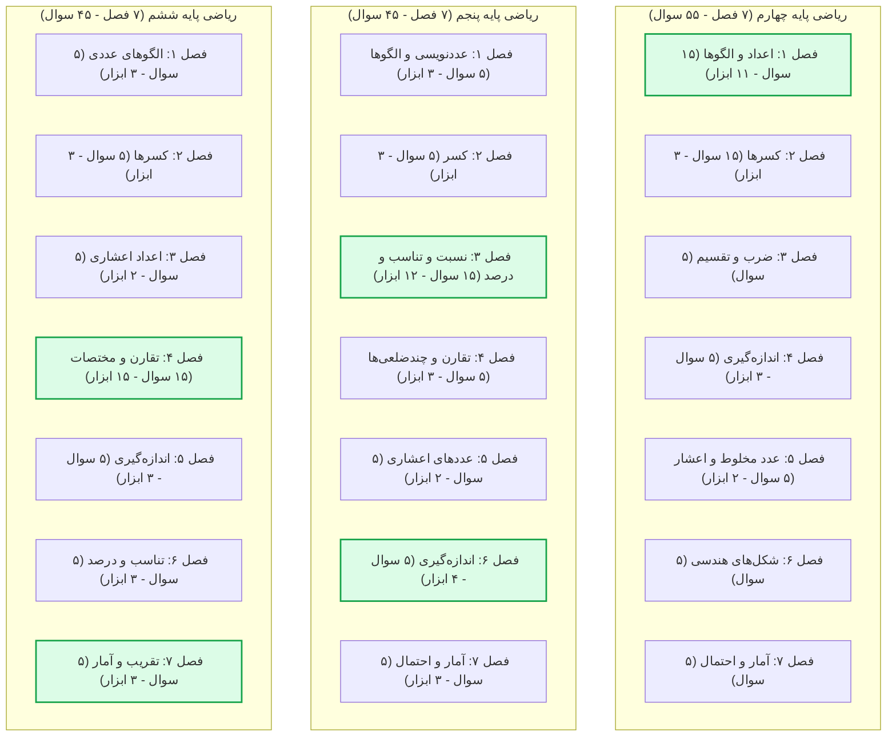

# اطلس جامع برنامه درسی، سوالات تشخیصی و ابزارهای دست‌ورزی تصویری

> **شناسه سند:** `DOC-CURRICULUM-VISUAL-TOOLS-MAP-V2`  
> **نسخه:** ۲.۰.۰ | **پوشش:** تمامی 145 سوال کانونیکال در تمامی ۲۱ فصل دوره دوم ابتدایی (پایه‌های ۴، ۵ و ۶)  
> **هدف:** منبع واحد حقیقت (Single Source of Truth) ارتباط میان «سرفصل و درس»، «مفاهیم شناختی (KC)»، «صورت سوال و کج‌فهمی‌های تشخیصی» و «ابزارهای بصری پارامتریک متصل» در سراسر سامانه.

## ۱. داشبورد وضعیت پوشش ابزارهای بصری به تفکیک ۲۱ فصل برنامه درسی

| ردیف | دوره و عنوان فصل | فایل کارتریج | تعداد مباحث | تعداد سوالات | وضعیت ابزار تصویری | درصد پوشش مستقیم | ابزارهای اصلی متصل یا پیشنهادی |
| :---: | :--- | :--- | :---: | :---: | :---: | :---: | :--- |
| 1 | پایه 4 - فصل 1: اعداد و الگوها | `grade4_math_ch1.json` | 5 | 15 | فعال در 11 سوال (73.3٪) | **73.3٪** | AbacusVisualizer, DotPatternVisualizer, InputOutputMachine, MatchstickPattern, PlaceValueBundles, PlaceValueTable |
| 2 | پایه 4 - فصل 2: کسر | `grade4_math_ch2.json` | 5 | 15 | فعال در 3 سوال (20.0٪) | **20.0٪** | FractionStrip, NumberLine |
| 3 | پایه 4 - فصل 3: ضرب و تقسیم | `grade4_math_ch3.json` | 5 | 5 | فعال در 0 سوال (0.0٪) | **0.0٪** | فاقد ابزار در کارتریج |
| 4 | پایه 4 - فصل 4: اندازه‌گیری | `grade4_math_ch4.json` | 5 | 5 | فعال در 3 سوال (60.0٪) | **60.0٪** | ClockVisualizer, ProtractorVisualizer |
| 5 | پایه 4 - فصل 5: عدد مخلوط و عدد اعشاری | `grade4_math_ch5.json` | 5 | 5 | فعال در 2 سوال (40.0٪) | **40.0٪** | AreaGrid, FractionCircle |
| 6 | پایه 4 - فصل 6: شکل‌های هندسی | `grade4_math_ch6.json` | 5 | 5 | فعال در 0 سوال (0.0٪) | **0.0٪** | فاقد ابزار در کارتریج |
| 7 | پایه 4 - فصل 7: آمار و احتمال | `grade4_math_ch7.json` | 5 | 5 | فعال در 0 سوال (0.0٪) | **0.0٪** | فاقد ابزار در کارتریج |
| 8 | پایه 5 - فصل 1: عددنویسی و الگوها | `grade5_math_ch1.json` | 5 | 5 | فعال در 5 سوال (100.0٪) | **100.0٪** | CompoundUnitCalculator, MatchstickPattern, PlaceValueTable |
| 9 | پایه 5 - فصل 2: کسر | `grade5_math_ch2.json` | 5 | 5 | فعال در 5 سوال (100.0٪) | **100.0٪** | FractionAreaMultiplier, FractionStrip |
| 10 | پایه 5 - فصل 3: نسبت، تناسب و درصد | `grade5_math_ch3.json` | 5 | 15 | فعال در 10 سوال (66.7٪) | **66.7٪** | AreaGrid, BalanceScale, FractionStrip, NumberLine |
| 11 | پایه 5 - فصل 4: تقارن و چندضلعی‌ها | `grade5_math_ch4.json` | 5 | 5 | فعال در 5 سوال (100.0٪) | **100.0٪** | ProtractorVisualizer, SymmetryPlayground |
| 12 | پایه 5 - فصل 5: عددهای اعشاری | `grade5_math_ch5.json` | 5 | 5 | فعال در 5 سوال (100.0٪) | **100.0٪** | AreaGrid, PlaceValueTable |
| 13 | پایه 5 - فصل 6: اندازه‌گیری | `grade5_math_ch6.json` | 5 | 5 | فعال در 5 سوال (100.0٪) | **100.0٪** | CircleMeasurementVisualizer, PolygonAreaDecomposer, VolumePrismVisualizer |
| 14 | پایه 5 - فصل 7: آمار و احتمال | `grade5_math_ch7.json` | 5 | 5 | فعال در 5 سوال (100.0٪) | **100.0٪** | BrokenLineGraph, ProbabilitySpinner |
| 15 | پایه 6 - فصل 1: الگوهای عددی | `grade6_math_ch1.json` | 5 | 5 | فعال در 5 سوال (100.0٪) | **100.0٪** | DotPatternVisualizer, IntegerNumberLine, PlaceValueTable |
| 16 | پایه 6 - فصل 2: کسرها | `grade6_math_ch2.json` | 5 | 5 | فعال در 5 سوال (100.0٪) | **100.0٪** | FractionAreaMultiplier, FractionDivisionVisualizer, FractionStrip |
| 17 | پایه 6 - فصل 3: اعداد اعشاری | `grade6_math_ch3.json` | 5 | 5 | فعال در 5 سوال (100.0٪) | **100.0٪** | PlaceValueTable |
| 18 | پایه 6 - فصل 4: تقارن و مختصات | `grade6_math_ch4.json` | 5 | 15 | فعال در 15 سوال (100.0٪) | **100.0٪** | CoordinateGridVisualizer, SymmetryPlayground |
| 19 | پایه 6 - فصل 5: اندازه‌گیری | `grade6_math_ch5.json` | 5 | 5 | فعال در 5 سوال (100.0٪) | **100.0٪** | AngleRelationshipVisualizer, AreaGrid, CylinderVolumeVisualizer |
| 20 | پایه 6 - فصل 6: تناسب و درصد | `grade6_math_ch6.json` | 5 | 5 | فعال در 5 سوال (100.0٪) | **100.0٪** | AreaGrid, BalanceScale |
| 21 | پایه 6 - فصل 7: تقریب و آمار | `grade6_math_ch7.json` | 5 | 5 | فعال در 5 سوال (100.0٪) | **100.0٪** | ApproximationRuler, ProbabilitySpinner |
| **کل** | **۲۱ فصل کانونیکال** | **۲۱ فایل کارتریج** | **105 مبحث** | **145 سوال** | **104 سوال دارای ابزار فعال** | **71.7٪ مستقیم** | **۲۸ کامپوننت پارامتریک آماده در مخزن** |

## ۲. اطلس ۲۸ ابزار دست‌ورزی پارامتریک در رجیستری مخزن (`VisualTemplateRegistry.tsx`)

| ردیف | نام کامپوننت | پایه و کاربرد اصلی | مسیر پیاده‌سازی |
| :---: | :--- | :--- | :--- |
| 1 | `FractionStrip` | کسرها، مقایسه و کسرهای مساوی | `web/components/parametric/FractionStrip.tsx` |
| 2 | `NumberLine` | محور اعداد صحیح، اعشار و کسر | `web/components/parametric/NumberLine.tsx` |
| 3 | `AreaGrid` | مساحت مستطیل، اعشار و کسر | `web/components/parametric/AreaGrid.tsx` |
| 4 | `BalanceScale` | ترازوی دوکفه‌ای و معادلات | `web/components/parametric/BalanceScale.tsx` |
| 5 | `BucketSort` | دسته‌بندی و مرتب‌سازی داده‌ها | `web/components/parametric/BucketSort.tsx` |
| 6 | `PlaceValueTable` | جدول ارزش مکانی تا طبقه میلیارد | `web/components/parametric/PlaceValueTable.tsx` |
| 7 | `PlaceValueBundles` | بسته‌های مجسم ارزش مکانی | `web/components/parametric/PlaceValueBundles.tsx` |
| 8 | `AbacusVisualizer` | چرتکه ده‌دهی و ارزش مکانی | `web/components/parametric/AbacusVisualizer.tsx` |
| 9 | `InputOutputMachine` | ماشین ورودی-خروجی الگوها | `web/components/parametric/InputOutputMachine.tsx` |
| 10 | `MatchstickPattern` | الگوهای هندسی چوب‌کبریتی | `web/components/parametric/MatchstickPattern.tsx` |
| 11 | `DotPatternVisualizer` | الگوهای نقطه‌ای و شبکه‌ای | `web/components/parametric/DotPatternVisualizer.tsx` |
| 12 | `ProtractorVisualizer` | نقاله تعاملی و اندازه‌گیری زاویه | `web/components/parametric/ProtractorVisualizer.tsx` |
| 13 | `ClockVisualizer` | ساعت تعاملی و زمان سپری‌شده | `web/components/parametric/ClockVisualizer.tsx` |
| 14 | `FractionCircle` | کسر دایره‌ای و تفکیک قطاع‌ها | `web/components/parametric/FractionCircle.tsx` |
| 15 | `ProbabilitySpinner` | گردونه شانس و احتمال تجربی | `web/components/parametric/ProbabilitySpinner.tsx` |
| 16 | `BrokenLineGraph` | نمودار خط شکسته در گذر زمان | `web/components/parametric/BrokenLineGraph.tsx` |
| 17 | `VolumePrismVisualizer` | حجم مکعب و مکعب‌مستطیل سه‌بعدی | `web/components/parametric/VolumePrismVisualizer.tsx` |
| 18 | `SymmetryPlayground` | تقارن محوری و مرکزی چندضلعی‌ها | `web/components/parametric/SymmetryPlayground.tsx` |
| 19 | `FractionAreaMultiplier` | ضرب مساحتی کسر در کسر | `web/components/parametric/FractionAreaMultiplier.tsx` |
| 20 | `PolygonAreaDecomposer` | مساحت لوزی و ذوزنقه با تجزیه | `web/components/parametric/PolygonAreaDecomposer.tsx` |
| 21 | `CircleMeasurementVisualizer` | محیط دایره و محاسبه عدد پی | `web/components/parametric/CircleMeasurementVisualizer.tsx` |
| 22 | `CompoundUnitCalculator` | عددهای مرکب زمانی با پیمانه ۶۰ | `web/components/parametric/CompoundUnitCalculator.tsx` |
| 23 | `CoordinateGridVisualizer` | دستگاه مختصات دو بعدی و انتقال | `web/components/parametric/CoordinateGridVisualizer.tsx` |
| 24 | `IntegerNumberLine` | محور اعداد صحیح با دماسنج و دریا | `web/components/parametric/IntegerNumberLine.tsx` |
| 25 | `AngleRelationshipVisualizer` | زاویه‌های متمم، مکمل و متقابل | `web/components/parametric/AngleRelationshipVisualizer.tsx` |
| 26 | `FractionDivisionVisualizer` | تقسیم کسرها با مدل نواری مساحتی | `web/components/parametric/FractionDivisionVisualizer.tsx` |
| 27 | `CylinderVolumeVisualizer` | استوانه سه‌بعدی و گسترده جانبی | `web/components/parametric/CylinderVolumeVisualizer.tsx` |
| 28 | `ApproximationRuler` | خط‌کش تقریب (قطع کردن و گرد کردن) | `web/components/parametric/ApproximationRuler.tsx` |

## ۳. اطلس جامع تمامی ۱۴۵ سوال تشخیصی در ۲۱ فصل برنامه درسی

### ۲.1. ریاضی پایه ۴ ابتدایی - فصل ۱: اعداد و الگوها
> **فایل منبع کارتریج:** [`data/canonical/grade4_math_ch1.json`](file:///g:/Code/education/data/canonical/grade4_math_ch1.json) | **شناسه درس:** `SUBJ-MATH4-CH01` | **تعداد سوالات:** 15

#### 🟢 سوال `ITEM-MATH4-CH01-001` — 
- **شناسه مبحث (KC ID):** ``
- **متن صورت سوال (Stem):** چرتکه‌ی زیر چه عددی را نشان می‌دهد؟
- **پاسخ صحیح (کلید):** `—` | **ضریب دشواری:** `0.35`
- **کج‌فهمی‌های تشخیصی گزینه‌ها:** سنجش مفهومی مستقیم بدون کج‌فهمی اختصاصی
- **وضعیت ابزار دست‌ورزی:** 🟢 **ابزار فعال در سوال** (`AbacusVisualizer`)
- **تنظیمات پارامتریک (Props):** `{"number": 407053, "showDigitBadges": false, "showRodIndices": true}`

#### 🟢 سوال `ITEM-MATH4-CH01-002` — 
- **شناسه مبحث (KC ID):** ``
- **متن صورت سوال (Stem):** در جدول ارزش مکانی زیر، چه رقمی باید در جای علامت ؟ قرار گیرد تا عدد $470295$ کامل شود؟
- **پاسخ صحیح (کلید):** `—` | **ضریب دشواری:** `0.3`
- **کج‌فهمی‌های تشخیصی گزینه‌ها:** سنجش مفهومی مستقیم بدون کج‌فهمی اختصاصی
- **وضعیت ابزار دست‌ورزی:** 🟢 **ابزار فعال در سوال** (`PlaceValueTable`)
- **تنظیمات پارامتریک (Props):** `{"number": 470295, "tiers": ["thousands", "ones"], "hiddenSlot": "دهگان‌هزار", "showLabels": true}`

#### 🟢 سوال `ITEM-MATH4-CH01-003` — 
- **شناسه مبحث (KC ID):** ``
- **متن صورت سوال (Stem):** اگر $3$ بسته صد‌هزارتایی، $5$ بسته ده‌هزارتایی و $8$ بسته هزارتایی را در کنار هم قرار دهیم، چه عددی ساخته می‌شود؟
- **پاسخ صحیح (کلید):** `—` | **ضریب دشواری:** `0.38`
- **کج‌فهمی‌های تشخیصی گزینه‌ها:** سنجش مفهومی مستقیم بدون کج‌فهمی اختصاصی
- **وضعیت ابزار دست‌ورزی:** 🟢 **ابزار فعال در سوال** (`PlaceValueBundles`)
- **تنظیمات پارامتریک (Props):** `{"bundles": [{"count": 3, "unitValue": 100000, "unitLabel": "صدهزارتایی", "theme": "purple"}, {"count": 5, "unitValue": 10000, "unitLabel": "ده‌هزارتایی", "theme": "emerald"}, {"count": 8, "unitValue": 1000, "unitLabel": "هزارتایی", "theme": "sky"}]}`

#### 🟢 سوال `ITEM-MATH4-CH01-004` — 
- **شناسه مبحث (KC ID):** ``
- **متن صورت سوال (Stem):** شکل گسترده‌ی عدد $530408$ با کدام گزینه برابر است؟
- **پاسخ صحیح (کلید):** `—` | **ضریب دشواری:** `0.4`
- **کج‌فهمی‌های تشخیصی گزینه‌ها:** سنجش مفهومی مستقیم بدون کج‌فهمی اختصاصی
- **وضعیت ابزار دست‌ورزی:** 🟢 **ابزار فعال در سوال** (`PlaceValueTable`)
- **تنظیمات پارامتریک (Props):** `{"number": 530408, "tiers": ["thousands", "ones"], "showLabels": true, "label": "جدول ارزش مکانی عدد ۵۳۰,۴۰۸:"}`

#### 🔴 سوال `ITEM-MATH4-CH01-005` — 
- **شناسه مبحث (KC ID):** ``
- **متن صورت سوال (Stem):** با رقم‌های $2$، $0$، $5$، $8$، $3$ و $9$ بدون تکرار، «بزرگ‌ترین» عدد شش‌رقمی کدام است؟
- **پاسخ صحیح (کلید):** `—` | **ضریب دشواری:** `0.45`
- **کج‌فهمی‌های تشخیصی گزینه‌ها:** سنجش مفهومی مستقیم بدون کج‌فهمی اختصاصی
- **وضعیت ابزار دست‌ورزی:** 🔴 **فاقد ابزار تصویری**

#### 🟢 سوال `ITEM-MATH4-CH01-006` — 
- **شناسه مبحث (KC ID):** ``
- **متن صورت سوال (Stem):** در عدد $40400$، ارزش رقم «$4$» سمت چپ، چند برابر ارزش رقم «$4$» دیگر است؟
- **پاسخ صحیح (کلید):** `—` | **ضریب دشواری:** `0.48`
- **کج‌فهمی‌های تشخیصی گزینه‌ها:** سنجش مفهومی مستقیم بدون کج‌فهمی اختصاصی
- **وضعیت ابزار دست‌ورزی:** 🟢 **ابزار فعال در سوال** (`PlaceValueTable`)
- **تنظیمات پارامتریک (Props):** `{"number": 40400, "tiers": ["thousands", "ones"], "showLabels": true, "highlightColumn": "دهگان‌هزار", "label": "جدول ارزش مکانی عدد ۴۰,۴۰۰:"}`

#### 🟢 سوال `ITEM-MATH4-CH01-007` — 
- **شناسه مبحث (KC ID):** ``
- **متن صورت سوال (Stem):** در یک الگوی هندسی چوب‌کبریت‌ها، شکل اول با $4$ چوب‌کبریت، شکل دوم با $7$ چوب‌کبریت و شکل سوم با $10$ چوب‌کبریت ساخته شده است. شکل دهم با چند چوب‌کبریت ساخته می‌شود؟
- **پاسخ صحیح (کلید):** `—` | **ضریب دشواری:** `0.5`
- **کج‌فهمی‌های تشخیصی گزینه‌ها:** سنجش مفهومی مستقیم بدون کج‌فهمی اختصاصی
- **وضعیت ابزار دست‌ورزی:** 🟢 **ابزار فعال در سوال** (`MatchstickPattern`)
- **تنظیمات پارامتریک (Props):** `{"patternKind": "squares", "stages": [{"stageNumber": 1, "count": 4, "isTarget": false}, {"stageNumber": 2, "count": 7, "isTarget": false}, {"stageNumber": 3, "count": 10, "isTarget": false}, {"stageNumber": 4, "count": 13, "isTarget": true}], "showCounts": true, "label": "مراحل ساخت الگوی چوب‌کبریت‌ها:"}`

#### 🔴 سوال `ITEM-MATH4-CH01-008` — 
- **شناسه مبحث (KC ID):** ``
- **متن صورت سوال (Stem):** در دنباله‌ی عددی مقابل، عدد بعدی کدام است؟ $$1, 2, 4, 8, 16, \dots$$
- **پاسخ صحیح (کلید):** `—` | **ضریب دشواری:** `0.38`
- **کج‌فهمی‌های تشخیصی گزینه‌ها:** سنجش مفهومی مستقیم بدون کج‌فهمی اختصاصی
- **وضعیت ابزار دست‌ورزی:** 🔴 **فاقد ابزار تصویری**

#### 🟢 سوال `ITEM-MATH4-CH01-009` — 
- **شناسه مبحث (KC ID):** ``
- **متن صورت سوال (Stem):** در الگوی مثلثی نقطه‌ها (مسئله صفحه ۲ کتاب)، تعداد نقطه‌ها به ترتیب $1$، $3$، $6$، $10$ و $15$ است. شکل هفتم با چند نقطه درست می‌شود؟
- **پاسخ صحیح (کلید):** `—` | **ضریب دشواری:** `0.52`
- **کج‌فهمی‌های تشخیصی گزینه‌ها:** سنجش مفهومی مستقیم بدون کج‌فهمی اختصاصی
- **وضعیت ابزار دست‌ورزی:** 🟢 **ابزار فعال در سوال** (`DotPatternVisualizer`)
- **تنظیمات پارامتریک (Props):** `{"shapeType": "triangle", "stages": [{"stageNumber": 1, "dotCount": 1, "rows": 1}, {"stageNumber": 2, "dotCount": 3, "rows": 2}, {"stageNumber": 3, "dotCount": 6, "rows": 3}, {"stageNumber": 4, "dotCount": 10, "rows": 4, "isTarget": true}], "showCounts": true, "label": "الگوی آرایش نقطه‌ها در شکل‌های متوالی:"}`

#### 🟢 سوال `ITEM-MATH4-CH01-010` — 
- **شناسه مبحث (KC ID):** ``
- **متن صورت سوال (Stem):** یک ماشین «محیط‌یاب»، طول ضلع مثلث متساوی‌الاضلاع را می‌گیرد و محیط آن را به عنوان خروجی تحویل می‌دهد. اگر عدد $14$ وارد این ماشین شود، چه عددی خارج می‌شود؟
- **پاسخ صحیح (کلید):** `—` | **ضریب دشواری:** `0.35`
- **کج‌فهمی‌های تشخیصی گزینه‌ها:** سنجش مفهومی مستقیم بدون کج‌فهمی اختصاصی
- **وضعیت ابزار دست‌ورزی:** 🟢 **ابزار فعال در سوال** (`InputOutputMachine`)
- **تنظیمات پارامتریک (Props):** `{"inputVal": 14, "outputVal": "؟", "operations": [{"op": "mul", "value": 3}], "machineTitle": "ماشین محیط‌یاب مثلث متساوی‌الاضلاع", "showTable": true, "tablePairs": [{"input": 2, "output": 6}, {"input": 5, "output": 15}, {"input": 14, "output": "؟"}], "label": "نمای عملکرد ماشین محیط‌یاب:"}`

#### 🟢 سوال `ITEM-MATH4-CH01-011` — 
- **شناسه مبحث (KC ID):** ``
- **متن صورت سوال (Stem):** در یک ماشین دو مرحله‌ای ورودی-خروجی، هر عددی وارد شود ابتدا «ضرب در ۴» و سپس حاصل «منهای ۵» می‌شود. اگر عدد $6$ وارد این ماشین شود، خروجی کدام است؟
- **پاسخ صحیح (کلید):** `—` | **ضریب دشواری:** `0.42`
- **کج‌فهمی‌های تشخیصی گزینه‌ها:** سنجش مفهومی مستقیم بدون کج‌فهمی اختصاصی
- **وضعیت ابزار دست‌ورزی:** 🟢 **ابزار فعال در سوال** (`InputOutputMachine`)
- **تنظیمات پارامتریک (Props):** `{"inputVal": 6, "outputVal": "؟", "operations": [{"op": "mul", "value": 4}, {"op": "sub", "value": 5}], "machineTitle": "ماشین دو مرحله‌ای", "label": "نمودار فرآیند ماشین دو مرحله‌ای:"}`

#### 🟢 سوال `ITEM-MATH4-CH01-012` — 
- **شناسه مبحث (KC ID):** ``
- **متن صورت سوال (Stem):** قاعده‌ی یک ماشین ورودی-خروجی «ضرب در ۳، سپس به علاوه ۴» است. اگر از این ماشین عدد $25$ خارج شده باشد، چه عددی وارد آن شده بود؟
- **پاسخ صحیح (کلید):** `—` | **ضریب دشواری:** `0.52`
- **کج‌فهمی‌های تشخیصی گزینه‌ها:** سنجش مفهومی مستقیم بدون کج‌فهمی اختصاصی
- **وضعیت ابزار دست‌ورزی:** 🟢 **ابزار فعال در سوال** (`InputOutputMachine`)
- **تنظیمات پارامتریک (Props):** `{"inputVal": "؟", "outputVal": 25, "operations": [{"op": "mul", "value": 3}, {"op": "add", "value": 4}], "machineTitle": "ماشین ورودی-خروجی (مسیر معکوس)", "label": "نمودار ماشین با خروجی مشخص:"}`

#### 🔴 سوال `ITEM-MATH4-CH01-013` — 
- **شناسه مبحث (KC ID):** ``
- **متن صورت سوال (Stem):** چند بسته «صدهزارتایی» در کنار هم، یک عدد «یک میلیون» ($1000000$) را تشکیل می‌دهند؟
- **پاسخ صحیح (کلید):** `—` | **ضریب دشواری:** `0.32`
- **کج‌فهمی‌های تشخیصی گزینه‌ها:** سنجش مفهومی مستقیم بدون کج‌فهمی اختصاصی
- **وضعیت ابزار دست‌ورزی:** 🔴 **فاقد ابزار تصویری**

#### 🔴 سوال `ITEM-MATH4-CH01-014` — 
- **شناسه مبحث (KC ID):** ``
- **متن صورت سوال (Stem):** نماد عددی «سی و پنج میلیون و چهارصد و هشت هزار و نه» با کدام گزینه برابر است؟
- **پاسخ صحیح (کلید):** `—` | **ضریب دشواری:** `0.42`
- **کج‌فهمی‌های تشخیصی گزینه‌ها:** سنجش مفهومی مستقیم بدون کج‌فهمی اختصاصی
- **وضعیت ابزار دست‌ورزی:** 🔴 **فاقد ابزار تصویری**

#### 🟢 سوال `ITEM-MATH4-CH01-015` — 
- **شناسه مبحث (KC ID):** ``
- **متن صورت سوال (Stem):** ارزش مجموع دو فقره چک‌پول $500000$ ریالی و چهار فقره چک‌پول $1000000$ ریالی برابر با چند ریال است؟
- **پاسخ صحیح (کلید):** `—` | **ضریب دشواری:** `0.45`
- **کج‌فهمی‌های تشخیصی گزینه‌ها:** سنجش مفهومی مستقیم بدون کج‌فهمی اختصاصی
- **وضعیت ابزار دست‌ورزی:** 🟢 **ابزار فعال در سوال** (`PlaceValueBundles`)
- **تنظیمات پارامتریک (Props):** `{"bundles": [{"count": 4, "unitValue": 1000000, "unitLabel": "یک میلیونی", "theme": "purple"}, {"count": 2, "unitValue": 500000, "unitLabel": "پانصدهزارتایی", "theme": "emerald"}], "label": "دسته‌های چک‌پول ریالی:"}`

### ۲.2. ریاضی پایه چهارم ابتدایی - فصل دوم: کسر
> **فایل منبع کارتریج:** [`data/canonical/grade4_math_ch2.json`](file:///g:/Code/education/data/canonical/grade4_math_ch2.json) | **شناسه درس:** `SUBJ-MATH4-FRACTIONS` | **تعداد سوالات:** 15

#### 🔴 سوال `ITEM-MATH4-CH02-001` — 
- **شناسه مبحث (KC ID):** ``
- **متن صورت سوال (Stem):** حاصل عبارت $\frac{2}{7} + \frac{3}{7}$ کدام است؟
- **پاسخ صحیح (کلید):** `—` | **ضریب دشواری:** `0.35`
- **کج‌فهمی‌های تشخیصی گزینه‌ها:** سنجش مفهومی مستقیم بدون کج‌فهمی اختصاصی
- **وضعیت ابزار دست‌ورزی:** 🔴 **فاقد ابزار تصویری**

#### 🔴 سوال `ITEM-MATH4-CH02-002` — 
- **شناسه مبحث (KC ID):** ``
- **متن صورت سوال (Stem):** کدام یک از مقایسه‌های زیر درباره دو کسر $\frac{1}{4}$ و $\frac{1}{6}$ درست است؟
- **پاسخ صحیح (کلید):** `—` | **ضریب دشواری:** `0.45`
- **کج‌فهمی‌های تشخیصی گزینه‌ها:** سنجش مفهومی مستقیم بدون کج‌فهمی اختصاصی
- **وضعیت ابزار دست‌ورزی:** 🔴 **فاقد ابزار تصویری**

#### 🔴 سوال `ITEM-MATH4-CH02-003` — 
- **شناسه مبحث (KC ID):** ``
- **متن صورت سوال (Stem):** کدام کسر با کسر $\frac{2}{3}$ مساوی است؟
- **پاسخ صحیح (کلید):** `—` | **ضریب دشواری:** `0.4`
- **کج‌فهمی‌های تشخیصی گزینه‌ها:** سنجش مفهومی مستقیم بدون کج‌فهمی اختصاصی
- **وضعیت ابزار دست‌ورزی:** 🔴 **فاقد ابزار تصویری**

#### 🟢 سوال `ITEM-MATH4-CH02-004` — 
- **شناسه مبحث (KC ID):** ``
- **متن صورت سوال (Stem):** روی یک محور اعداد، بین عدد صفر و عدد یک به ۴ فاصله مساوی تقسیم شده است. نقطه نشان‌دهنده دومین خط بعد از صفر کدام کسر است؟
- **پاسخ صحیح (کلید):** `—` | **ضریب دشواری:** `0.42`
- **کج‌فهمی‌های تشخیصی گزینه‌ها:** سنجش مفهومی مستقیم بدون کج‌فهمی اختصاصی
- **وضعیت ابزار دست‌ورزی:** 🟢 **ابزار فعال در سوال** (`NumberLine`)
- **تنظیمات پارامتریک (Props):** `{"min": 0, "max": 1, "partitions": 4, "targetPoint": 0.5, "targetLabel": "نقطه مورد نظر"}`

#### 🔴 سوال `ITEM-MATH4-CH02-005` — 
- **شناسه مبحث (KC ID):** ``
- **متن صورت سوال (Stem):** اگر یک نوار کاغذی به ۸ قسمت مساوی تقسیم شده باشد و ۵ قسمت آن رنگ شده باشد، کسر مربوط به بخش‌های رنگ‌نشده کدام است؟
- **پاسخ صحیح (کلید):** `—` | **ضریب دشواری:** `0.38`
- **کج‌فهمی‌های تشخیصی گزینه‌ها:** سنجش مفهومی مستقیم بدون کج‌فهمی اختصاصی
- **وضعیت ابزار دست‌ورزی:** 🔴 **فاقد ابزار تصویری**

#### 🟢 سوال `ITEM-MATH4-CH02-006` — 
- **شناسه مبحث (KC ID):** ``
- **متن صورت سوال (Stem):** با توجه به شکل زیر، آیا قسمت رنگ‌شده کسر $\frac{1}{3}$ شکل را نشان می‌دهد؟
- **پاسخ صحیح (کلید):** `—` | **ضریب دشواری:** `0.4`
- **کج‌فهمی‌های تشخیصی گزینه‌ها:** سنجش مفهومی مستقیم بدون کج‌فهمی اختصاصی
- **وضعیت ابزار دست‌ورزی:** 🟢 **ابزار فعال در سوال** (`FractionStrip`)
- **تنظیمات پارامتریک (Props):** `{"segmentRatios": [45, 18, 37], "coloredSegments": [1]}`

#### 🔴 سوال `ITEM-MATH4-CH02-007` — 
- **شناسه مبحث (KC ID):** ``
- **متن صورت سوال (Stem):** در یک جعبه ۱۲ عدد مداد رنگی وجود دارد. اگر $\frac{1}{4}$ مدادها قرمز باشند، چند مداد قرمز در جعبه هست؟
- **پاسخ صحیح (کلید):** `—` | **ضریب دشواری:** `0.35`
- **کج‌فهمی‌های تشخیصی گزینه‌ها:** سنجش مفهومی مستقیم بدون کج‌فهمی اختصاصی
- **وضعیت ابزار دست‌ورزی:** 🔴 **فاقد ابزار تصویری**

#### 🔴 سوال `ITEM-MATH4-CH02-008` — 
- **شناسه مبحث (KC ID):** ``
- **متن صورت سوال (Stem):** اگر به صورت و مخرج کسر $\frac{2}{5}$ عدد ۳ را اضافه کنیم تا کسر $\frac{5}{8}$ حاصل شود، آیا این دو کسر مساوی هستند؟
- **پاسخ صحیح (کلید):** `—` | **ضریب دشواری:** `0.5`
- **کج‌فهمی‌های تشخیصی گزینه‌ها:** سنجش مفهومی مستقیم بدون کج‌فهمی اختصاصی
- **وضعیت ابزار دست‌ورزی:** 🔴 **فاقد ابزار تصویری**

#### 🔴 سوال `ITEM-MATH4-CH02-009` — 
- **شناسه مبحث (KC ID):** ``
- **متن صورت سوال (Stem):** صورت و مخرج کسر $\frac{6}{9}$ را اگر بر ۳ تقسیم کنیم، کدام کسر مساوی با آن به دست می‌آید؟
- **پاسخ صحیح (کلید):** `—` | **ضریب دشواری:** `0.32`
- **کج‌فهمی‌های تشخیصی گزینه‌ها:** سنجش مفهومی مستقیم بدون کج‌فهمی اختصاصی
- **وضعیت ابزار دست‌ورزی:** 🔴 **فاقد ابزار تصویری**

#### 🔴 سوال `ITEM-MATH4-CH02-010` — 
- **شناسه مبحث (KC ID):** ``
- **متن صورت سوال (Stem):** کدام رابطه مقایسه بین کسرها با مخرج‌های مساوی درست است؟
- **پاسخ صحیح (کلید):** `—` | **ضریب دشواری:** `0.3`
- **کج‌فهمی‌های تشخیصی گزینه‌ها:** سنجش مفهومی مستقیم بدون کج‌فهمی اختصاصی
- **وضعیت ابزار دست‌ورزی:** 🔴 **فاقد ابزار تصویری**

#### 🔴 سوال `ITEM-MATH4-CH02-011` — 
- **شناسه مبحث (KC ID):** ``
- **متن صورت سوال (Stem):** علی $\frac{1}{3}$ یک کیک و سامان $\frac{1}{5}$ همان کیک را خورده است. چه کسی سهم بیشتری خورده است؟
- **پاسخ صحیح (کلید):** `—` | **ضریب دشواری:** `0.45`
- **کج‌فهمی‌های تشخیصی گزینه‌ها:** سنجش مفهومی مستقیم بدون کج‌فهمی اختصاصی
- **وضعیت ابزار دست‌ورزی:** 🔴 **فاقد ابزار تصویری**

#### 🔴 سوال `ITEM-MATH4-CH02-012` — 
- **شناسه مبحث (KC ID):** ``
- **متن صورت سوال (Stem):** حاصل عبارت تفریق $\frac{6}{10} - \frac{2}{10}$ کدام است؟
- **پاسخ صحیح (کلید):** `—` | **ضریب دشواری:** `0.35`
- **کج‌فهمی‌های تشخیصی گزینه‌ها:** سنجش مفهومی مستقیم بدون کج‌فهمی اختصاصی
- **وضعیت ابزار دست‌ورزی:** 🔴 **فاقد ابزار تصویری**

#### 🔴 سوال `ITEM-MATH4-CH02-013` — 
- **شناسه مبحث (KC ID):** ``
- **متن صورت سوال (Stem):** حاصل عبارت $\frac{1}{6} + \frac{2}{6} + \frac{1}{6}$ برابر با کدام کسر است؟
- **پاسخ صحیح (کلید):** `—` | **ضریب دشواری:** `0.4`
- **کج‌فهمی‌های تشخیصی گزینه‌ها:** سنجش مفهومی مستقیم بدون کج‌فهمی اختصاصی
- **وضعیت ابزار دست‌ورزی:** 🔴 **فاقد ابزار تصویری**

#### 🔴 سوال `ITEM-MATH4-CH02-014` — 
- **شناسه مبحث (KC ID):** ``
- **متن صورت سوال (Stem):** روی محور اعداد، فاصله بین عدد صفر تا یک با ۲ خط نشانه‌گذاری در وسط به چند بخش مساوی تقسیم شده است؟
- **پاسخ صحیح (کلید):** `—` | **ضریب دشواری:** `0.48`
- **کج‌فهمی‌های تشخیصی گزینه‌ها:** سنجش مفهومی مستقیم بدون کج‌فهمی اختصاصی
- **وضعیت ابزار دست‌ورزی:** 🔴 **فاقد ابزار تصویری**

#### 🟢 سوال `ITEM-MATH4-CH02-015` — 
- **شناسه مبحث (KC ID):** ``
- **متن صورت سوال (Stem):** روی یک محور، فاصله بین ۰ و ۱ به ۶ قسمت مساوی تقسیم شده و نقطه مورد نظر روی پنجمین خط بعد از صفر قرار دارد. این نقطه چه کسری را نشان می‌دهد؟
- **پاسخ صحیح (کلید):** `—` | **ضریب دشواری:** `0.42`
- **کج‌فهمی‌های تشخیصی گزینه‌ها:** سنجش مفهومی مستقیم بدون کج‌فهمی اختصاصی
- **وضعیت ابزار دست‌ورزی:** 🟢 **ابزار فعال در سوال** (`NumberLine`)
- **تنظیمات پارامتریک (Props):** `{"min": 0, "max": 1, "partitions": 6, "targetPoint": 0.833, "targetLabel": "نقطه مورد نظر"}`

### ۲.3. ریاضی پایه 4 ابتدایی - فصل 3: ضرب و تقسیم
> **فایل منبع کارتریج:** [`data/canonical/grade4_math_ch3.json`](file:///g:/Code/education/data/canonical/grade4_math_ch3.json) | **شناسه درس:** `SUBJ-MATH4-CH03` | **تعداد سوالات:** 5

#### 🔴 سوال `ITEM-MATH4-CH03-001` — 
- **شناسه مبحث (KC ID):** ``
- **متن صورت سوال (Stem):** یک باغچه مستطیل‌شکل به طول $34$ متر و عرض $25$ متر داریم. اگر برای محاسبه‌ی مساحت آن از روش ضرب مساحتی استفاده کنیم و باغچه را به ۴ مستطیل فرعی با مساحت‌های $(30 \times 20)$، $(30 \times 5)$، $(4 \times 20)$ و $(4 \times 5)$ تقسیم کنیم، مساحت کل باغچه چند متر مربع می‌شود؟
- **پاسخ صحیح (کلید):** `—` | **ضریب دشواری:** `0.35`
- **کج‌فهمی‌های تشخیصی گزینه‌ها:** سنجش مفهومی مستقیم بدون کج‌فهمی اختصاصی
- **وضعیت ابزار دست‌ورزی:** 🔴 **فاقد ابزار تصویری**

#### 🔴 سوال `ITEM-MATH4-CH03-002` — 
- **شناسه مبحث (KC ID):** ``
- **متن صورت سوال (Stem):** حاصل ضرب ستونی زیر کدام است؟ $$\begin{array}{r} 46 \\ \times \ 37 \\ \hline \end{array}$$
- **پاسخ صحیح (کلید):** `—` | **ضریب دشواری:** `0.45`
- **کج‌فهمی‌های تشخیصی گزینه‌ها:** سنجش مفهومی مستقیم بدون کج‌فهمی اختصاصی
- **وضعیت ابزار دست‌ورزی:** 🔴 **فاقد ابزار تصویری**

#### 🔴 سوال `ITEM-MATH4-CH03-003` — 
- **شناسه مبحث (KC ID):** ``
- **متن صورت سوال (Stem):** قیمت هر بسته آموزشی $29$ هزار تومان است. مدیر مدرسه‌ای می‌خواهد برای $48$ دانش‌آموز از این بسته‌ها تهیه کند. اگر او برای تخمین هزینه‌ی کل، هر دو عدد را به «نزدیک‌ترین ده‌گان» گرد کند، هزینه تقریبی کل بسته‌ها چند هزار تومان می‌شود؟
- **پاسخ صحیح (کلید):** `—` | **ضریب دشواری:** `0.4`
- **کج‌فهمی‌های تشخیصی گزینه‌ها:** سنجش مفهومی مستقیم بدون کج‌فهمی اختصاصی
- **وضعیت ابزار دست‌ورزی:** 🔴 **فاقد ابزار تصویری**

#### 🔴 سوال `ITEM-MATH4-CH03-004` — 
- **شناسه مبحث (KC ID):** ``
- **متن صورت سوال (Stem):** در تقسیم عدد $51$ بر مقسوم‌علیه $6$، کدام تساوی نشان‌دهنده‌ی یک تقسیم «درست و کامل» است؟
- **پاسخ صحیح (کلید):** `—` | **ضریب دشواری:** `0.5`
- **کج‌فهمی‌های تشخیصی گزینه‌ها:** سنجش مفهومی مستقیم بدون کج‌فهمی اختصاصی
- **وضعیت ابزار دست‌ورزی:** 🔴 **فاقد ابزار تصویری**

#### 🔴 سوال `ITEM-MATH4-CH03-005` — 
- **شناسه مبحث (KC ID):** ``
- **متن صورت سوال (Stem):** حاصل تقسیم $824 \div 4$ کدام است؟
- **پاسخ صحیح (کلید):** `—` | **ضریب دشواری:** `0.48`
- **کج‌فهمی‌های تشخیصی گزینه‌ها:** سنجش مفهومی مستقیم بدون کج‌فهمی اختصاصی
- **وضعیت ابزار دست‌ورزی:** 🔴 **فاقد ابزار تصویری**

### ۲.4. ریاضی پایه ۴ ابتدایی - فصل ۴: اندازه‌گیری
> **فایل منبع کارتریج:** [`data/canonical/grade4_math_ch4.json`](file:///g:/Code/education/data/canonical/grade4_math_ch4.json) | **شناسه درس:** `SUBJ-MATH4-CH04` | **تعداد سوالات:** 5

#### 🟢 سوال `ITEM-MATH4-CH04-001` — 
- **شناسه مبحث (KC ID):** ``
- **متن صورت سوال (Stem):** اگر یک زاویه از زاویه راست ($90^\circ$) بزرگتر و از زاویه نیم‌صفحه ($180^\circ$) کوچکتر باشد، این زاویه چه نامیده می‌شود؟
- **پاسخ صحیح (کلید):** `—` | **ضریب دشواری:** `0.3`
- **کج‌فهمی‌های تشخیصی گزینه‌ها:** سنجش مفهومی مستقیم بدون کج‌فهمی اختصاصی
- **وضعیت ابزار دست‌ورزی:** 🟢 **ابزار فعال در سوال** (`ProtractorVisualizer`)
- **تنظیمات پارامتریک (Props):** `{"angleDegree": 135, "showProtractor": false, "showClassification": false, "showDegreeLabel": false, "vertexLabel": "ب", "label": "نمای زاویه مورد نظر:"}`

#### 🟢 سوال `ITEM-MATH4-CH04-002` — 
- **شناسه مبحث (KC ID):** ``
- **متن صورت سوال (Stem):** علی یک زاویه را با نقاله اندازه گرفته است. یکی از نیم‌خط‌های زاویه روی صفر درجه‌ی سمت راست نقاله قرار دارد و نیم‌خط دیگر از روبه‌روی دو عدد $50^\circ$ و $130^\circ$ عبور می‌کند. اندازه واقعی این زاویه چقدر است؟
- **پاسخ صحیح (کلید):** `—` | **ضریب دشواری:** `0.45`
- **کج‌فهمی‌های تشخیصی گزینه‌ها:** سنجش مفهومی مستقیم بدون کج‌فهمی اختصاصی
- **وضعیت ابزار دست‌ورزی:** 🟢 **ابزار فعال در سوال** (`ProtractorVisualizer`)
- **تنظیمات پارامتریک (Props):** `{"angleDegree": 50, "showProtractor": true, "startRayAngle": 0, "showClassification": false, "showDegreeLabel": false, "showDualScale": true, "vertexLabel": "ب", "label": "نقاله و زاویه اندازه گرفته شده توسط علی:"}`

#### 🟢 سوال `ITEM-MATH4-CH04-003` — 
- **شناسه مبحث (KC ID):** ``
- **متن صورت سوال (Stem):** زنگ ورزش دبستان در ساعت $10:45$ شروع شد و $40$ دقیقه طول کشید. این کلاس در چه ساعتی به پایان رسید؟
- **پاسخ صحیح (کلید):** `—` | **ضریب دشواری:** `0.5`
- **کج‌فهمی‌های تشخیصی گزینه‌ها:** سنجش مفهومی مستقیم بدون کج‌فهمی اختصاصی
- **وضعیت ابزار دست‌ورزی:** 🟢 **ابزار فعال در سوال** (`ClockVisualizer`)
- **تنظیمات پارامتریک (Props):** `{"hours": 10, "minutes": 45, "elapsedMinutes": 40, "showDigital": true, "label": "ساعت شروع زنگ ورزش (۱۰:۴۵) با چرخش ۴۰ دقیقه‌ای:"}`

#### 🔴 سوال `ITEM-MATH4-CH04-004` — 
- **شناسه مبحث (KC ID):** ``
- **متن صورت سوال (Stem):** مساحت یک مستطیل به طول $8$ سانتی‌متر و عرض $5$ سانتی‌متر چند سانتی‌متر مربع است؟
- **پاسخ صحیح (کلید):** `—` | **ضریب دشواری:** `0.35`
- **کج‌فهمی‌های تشخیصی گزینه‌ها:** سنجش مفهومی مستقیم بدون کج‌فهمی اختصاصی
- **وضعیت ابزار دست‌ورزی:** 🔴 **فاقد ابزار تصویری**

#### 🔴 سوال `ITEM-MATH4-CH04-005` — 
- **شناسه مبحث (KC ID):** ``
- **متن صورت سوال (Stem):** یک بطری حاوی $2$ لیتر و $350$ میلی‌لیتر آبمیوه است. حجم این آبمیوه روی هم چند میلی‌لیتر است؟
- **پاسخ صحیح (کلید):** `—` | **ضریب دشواری:** `0.4`
- **کج‌فهمی‌های تشخیصی گزینه‌ها:** سنجش مفهومی مستقیم بدون کج‌فهمی اختصاصی
- **وضعیت ابزار دست‌ورزی:** 🔴 **فاقد ابزار تصویری**

### ۲.5. ریاضی پایه ۴ ابتدایی - فصل ۵: عدد مخلوط و عدد اعشاری
> **فایل منبع کارتریج:** [`data/canonical/grade4_math_ch5.json`](file:///g:/Code/education/data/canonical/grade4_math_ch5.json) | **شناسه درس:** `SUBJ-MATH4-CH05` | **تعداد سوالات:** 5

#### 🟢 سوال `ITEM-MATH4-CH05-001` — 
- **شناسه مبحث (KC ID):** ``
- **متن صورت سوال (Stem):** شکل رو‌به‌رو شامل $3$ دایره کامل رنگ‌شده و $2$ قسمت از $5$ قسمت یک دایره دیگر است. این مقدار با کدام عدد مخلوط نشان داده می‌شود؟
- **پاسخ صحیح (کلید):** `—` | **ضریب دشواری:** `0.35`
- **کج‌فهمی‌های تشخیصی گزینه‌ها:** سنجش مفهومی مستقیم بدون کج‌فهمی اختصاصی
- **وضعیت ابزار دست‌ورزی:** 🟢 **ابزار فعال در سوال** (`FractionCircle`)
- **تنظیمات پارامتریک (Props):** `{"totalSlices": 5, "shadedSlices": 2, "wholeUnits": 3, "colorTheme": "indigo", "showFractionBadge": false, "showSliceLabels": false, "label": "شکل رو‌به‌رو با ۳ واحد کامل و ۲ قسمت از ۵ قسمت:"}`

#### 🔴 سوال `ITEM-MATH4-CH05-002` — 
- **شناسه مبحث (KC ID):** ``
- **متن صورت سوال (Stem):** کسر بزرگتر از واحد $\frac{14}{3}$ با کدام عدد مخلوط برابر است؟
- **پاسخ صحیح (کلید):** `—` | **ضریب دشواری:** `0.45`
- **کج‌فهمی‌های تشخیصی گزینه‌ها:** سنجش مفهومی مستقیم بدون کج‌فهمی اختصاصی
- **وضعیت ابزار دست‌ورزی:** 🔴 **فاقد ابزار تصویری**

#### 🟢 سوال `ITEM-MATH4-CH05-003` — 
- **شناسه مبحث (KC ID):** ``
- **متن صورت سوال (Stem):** کسر $\frac{7}{100}$ با کدام نماد اعشاری نمایش داده می‌شود؟
- **پاسخ صحیح (کلید):** `—` | **ضریب دشواری:** `0.4`
- **کج‌فهمی‌های تشخیصی گزینه‌ها:** سنجش مفهومی مستقیم بدون کج‌فهمی اختصاصی
- **وضعیت ابزار دست‌ورزی:** 🟢 **ابزار فعال در سوال** (`AreaGrid`)
- **تنظیمات پارامتریک (Props):** `{"rows": 10, "cols": 10, "initialColored": 7, "coloredCount": 7, "color": "indigo", "hideBadge": true}`

#### 🔴 سوال `ITEM-MATH4-CH05-004` — 
- **شناسه مبحث (KC ID):** ``
- **متن صورت سوال (Stem):** کدام رابطه مقایسه‌ای در بین گزینه‌های زیر درست است؟
- **پاسخ صحیح (کلید):** `—` | **ضریب دشواری:** `0.45`
- **کج‌فهمی‌های تشخیصی گزینه‌ها:** سنجش مفهومی مستقیم بدون کج‌فهمی اختصاصی
- **وضعیت ابزار دست‌ورزی:** 🔴 **فاقد ابزار تصویری**

#### 🔴 سوال `ITEM-MATH4-CH05-005` — 
- **شناسه مبحث (KC ID):** ``
- **متن صورت سوال (Stem):** حاصل جمع دو عدد اعشاری $3/6 + 2/15$ کدام است؟
- **پاسخ صحیح (کلید):** `—` | **ضریب دشواری:** `0.5`
- **کج‌فهمی‌های تشخیصی گزینه‌ها:** سنجش مفهومی مستقیم بدون کج‌فهمی اختصاصی
- **وضعیت ابزار دست‌ورزی:** 🔴 **فاقد ابزار تصویری**

### ۲.6. ریاضی پایه ۴ ابتدایی - فصل ۶: شکل‌های هندسی
> **فایل منبع کارتریج:** [`data/canonical/grade4_math_ch6.json`](file:///g:/Code/education/data/canonical/grade4_math_ch6.json) | **شناسه درس:** `SUBJ-MATH4-CH06` | **تعداد سوالات:** 5

#### 🔴 سوال `ITEM-MATH4-CH06-001` — 
- **شناسه مبحث (KC ID):** ``
- **متن صورت سوال (Stem):** دو خط در صفحه به گونه‌ای قرار دارند که هر چه آن‌ها را از دو طرف امتداد دهیم، هرگز یکدیگر را قطع نمی‌کنند و فاصله بین آن‌ها همواره ثابت است. این دو خط چه نام دارند؟
- **پاسخ صحیح (کلید):** `—` | **ضریب دشواری:** `0.3`
- **کج‌فهمی‌های تشخیصی گزینه‌ها:** سنجش مفهومی مستقیم بدون کج‌فهمی اختصاصی
- **وضعیت ابزار دست‌ورزی:** 🔴 **فاقد ابزار تصویری**

#### 🔴 سوال `ITEM-MATH4-CH06-002` — 
- **شناسه مبحث (KC ID):** ``
- **متن صورت سوال (Stem):** چهارضلعی که در آن «هر چهار ضلع با هم برابر» هستند و «قطرها عمودمنصف یکدیگرند» چه نام دارد؟
- **پاسخ صحیح (کلید):** `—` | **ضریب دشواری:** `0.4`
- **کج‌فهمی‌های تشخیصی گزینه‌ها:** سنجش مفهومی مستقیم بدون کج‌فهمی اختصاصی
- **وضعیت ابزار دست‌ورزی:** 🔴 **فاقد ابزار تصویری**

#### 🔴 سوال `ITEM-MATH4-CH06-003` — 
- **شناسه مبحث (KC ID):** ``
- **متن صورت سوال (Stem):** در یک متوازی‌الاضلاع، «ارتفاع» نسبت به یک «قاعده» چگونه خطی است؟
- **پاسخ صحیح (کلید):** `—` | **ضریب دشواری:** `0.35`
- **کج‌فهمی‌های تشخیصی گزینه‌ها:** سنجش مفهومی مستقیم بدون کج‌فهمی اختصاصی
- **وضعیت ابزار دست‌ورزی:** 🔴 **فاقد ابزار تصویری**

#### 🔴 سوال `ITEM-MATH4-CH06-004` — 
- **شناسه مبحث (KC ID):** ``
- **متن صورت سوال (Stem):** یک متوازی‌الاضلاع دارای قاعده‌ای به طول $12$ سانتی‌متر و ارتفاع مربوط به آن قاعده به طول $6$ سانتی‌متر است. اگر طول ضلع دیگر آن $8$ سانتی‌متر باشد، مساحت این متوازی‌الاضلاع چند سانتی‌متر مربع است؟
- **پاسخ صحیح (کلید):** `—` | **ضریب دشواری:** `0.45`
- **کج‌فهمی‌های تشخیصی گزینه‌ها:** سنجش مفهومی مستقیم بدون کج‌فهمی اختصاصی
- **وضعیت ابزار دست‌ورزی:** 🔴 **فاقد ابزار تصویری**

#### 🔴 سوال `ITEM-MATH4-CH06-005` — 
- **شناسه مبحث (KC ID):** ``
- **متن صورت سوال (Stem):** مساحت مثلثی با قاعده $10$ سانتی‌متر و ارتفاع متناظر $7$ سانتی‌متر چند سانتی‌متر مربع است؟
- **پاسخ صحیح (کلید):** `—` | **ضریب دشواری:** `0.4`
- **کج‌فهمی‌های تشخیصی گزینه‌ها:** سنجش مفهومی مستقیم بدون کج‌فهمی اختصاصی
- **وضعیت ابزار دست‌ورزی:** 🔴 **فاقد ابزار تصویری**

### ۲.7. ریاضی پایه ۴ ابتدایی - فصل ۷: آمار و احتمال
> **فایل منبع کارتریج:** [`data/canonical/grade4_math_ch7.json`](file:///g:/Code/education/data/canonical/grade4_math_ch7.json) | **شناسه درس:** `SUBJ-MATH4-CH07` | **تعداد سوالات:** 5

#### 🔴 سوال `ITEM-MATH4-CH07-001` — 
- **شناسه مبحث (KC ID):** ``
- **متن صورت سوال (Stem):** در یک نظرسنجی کلاسی برای شمارش کتاب‌های مورد علاقه دانش‌آموزان، برای کتاب داستان ۴ بسته خط‌نشان پنج‌تایی و ۳ خط‌نشان تکی ثبت شده است. تعداد کل دانش‌آموزانی که کتاب داستان را انتخاب کرده‌اند چند نفر است؟
- **پاسخ صحیح (کلید):** `—` | **ضریب دشواری:** `0.25`
- **کج‌فهمی‌های تشخیصی گزینه‌ها:** سنجش مفهومی مستقیم بدون کج‌فهمی اختصاصی
- **وضعیت ابزار دست‌ورزی:** 🔴 **فاقد ابزار تصویری**

#### 🔴 سوال `ITEM-MATH4-CH07-002` — 
- **شناسه مبحث (KC ID):** ``
- **متن صورت سوال (Stem):** در یک نمودار ستونی، محور عمودی که تعداد گل‌ها را نشان می‌دهد با گام‌های ۵تایی (۰، ۵، ۱۰، ۱۵، ۲۰، ...) درجه‌بندی شده است. اگر ستون مربوط به گل‌های رز دقیقاً روی خط چهارم بعد از عدد صفر قرار گیرد، تعداد گل‌های رز چند شاخه است؟
- **پاسخ صحیح (کلید):** `—` | **ضریب دشواری:** `0.35`
- **کج‌فهمی‌های تشخیصی گزینه‌ها:** سنجش مفهومی مستقیم بدون کج‌فهمی اختصاصی
- **وضعیت ابزار دست‌ورزی:** 🔴 **فاقد ابزار تصویری**

#### 🔴 سوال `ITEM-MATH4-CH07-003` — 
- **شناسه مبحث (KC ID):** ``
- **متن صورت سوال (Stem):** پزشک می‌خواهد دمای بدن یک کودک را که در طول ۲۴ ساعت هر ۳ ساعت یک‌بار اندازه‌گیری شده است روی نمودار ثبت کند تا روند بالا رفتن یا کاهش تب را به صورت پیوسته ببیند. کدام نمودار بهترین گزینه برای این هدف است؟
- **پاسخ صحیح (کلید):** `—` | **ضریب دشواری:** `0.3`
- **کج‌فهمی‌های تشخیصی گزینه‌ها:** سنجش مفهومی مستقیم بدون کج‌فهمی اختصاصی
- **وضعیت ابزار دست‌ورزی:** 🔴 **فاقد ابزار تصویری**

#### 🔴 سوال `ITEM-MATH4-CH07-004` — 
- **شناسه مبحث (KC ID):** ``
- **متن صورت سوال (Stem):** یک نمودار دایره‌ای به ۴ قسمت مساوی تقسیم شده است. ۲ قسمت آن با رنگ سبز، ۱ قسمت آن با رنگ زرد و ۱ قسمت با رنگ نارنجی مشخص شده است. چه کسری از کل این نمودار به رنگ سبز تعلق دارد؟
- **پاسخ صحیح (کلید):** `—` | **ضریب دشواری:** `0.3`
- **کج‌فهمی‌های تشخیصی گزینه‌ها:** سنجش مفهومی مستقیم بدون کج‌فهمی اختصاصی
- **وضعیت ابزار دست‌ورزی:** 🔴 **فاقد ابزار تصویری**

#### 🔴 سوال `ITEM-MATH4-CH07-005` — 
- **شناسه مبحث (KC ID):** ``
- **متن صورت سوال (Stem):** درون یک کیسه کدر ۹۹ مهره سفید و فقط ۱ مهره سیاه قرار دارد که از نظر اندازه و وزن کاملاً یکسان هستند. اگر یک مهره را بدون نگاه کردن از کیسه خارج کنیم، کدام گزینه وضعیت خروج مهره سفید را به درستی توصیف می‌کند؟
- **پاسخ صحیح (کلید):** `—` | **ضریب دشواری:** `0.4`
- **کج‌فهمی‌های تشخیصی گزینه‌ها:** سنجش مفهومی مستقیم بدون کج‌فهمی اختصاصی
- **وضعیت ابزار دست‌ورزی:** 🔴 **فاقد ابزار تصویری**

### ۲.8. ریاضی پایه پنجم ابتدایی - فصل اول: عددنویسی و الگوها
> **فایل منبع کارتریج:** [`data/canonical/grade5_math_ch1.json`](file:///g:/Code/education/data/canonical/grade5_math_ch1.json) | **شناسه درس:** `SUBJ-MATH5-CH01` | **تعداد سوالات:** 5

#### 🟢 سوال `ITEM-MATH5-C01-01` — 
- **شناسه مبحث (KC ID):** ``
- **متن صورت سوال (Stem):** عدد «پنج میلیارد و هفتاد میلیون و چهارصد» به رقم کدام است؟
- **پاسخ صحیح (کلید):** `—` | **ضریب دشواری:** `0.35`
- **کج‌فهمی‌های تشخیصی گزینه‌ها:** سنجش مفهومی مستقیم بدون کج‌فهمی اختصاصی
- **وضعیت ابزار دست‌ورزی:** 🟢 **ابزار فعال در سوال** (`PlaceValueTable`)
- **تنظیمات پارامتریک (Props):** `{"number": 5070000400, "tiers": ["billions", "millions", "thousands", "ones"]}`

#### 🟢 سوال `ITEM-MATH5-C01-02` — 
- **شناسه مبحث (KC ID):** ``
- **متن صورت سوال (Stem):** در الگوی ۳، ۷، ۱۱، ۱۵، ... تعداد چوب‌کبریت‌ها در **شکل بیستم** چند تاست؟
- **پاسخ صحیح (کلید):** `—` | **ضریب دشواری:** `0.45`
- **کج‌فهمی‌های تشخیصی گزینه‌ها:** سنجش مفهومی مستقیم بدون کج‌فهمی اختصاصی
- **وضعیت ابزار دست‌ورزی:** 🟢 **ابزار فعال در سوال** (`MatchstickPattern`)
- **تنظیمات پارامتریک (Props):** `{"stepCount": 4}`

#### 🟢 سوال `ITEM-MATH5-C01-03` — 
- **شناسه مبحث (KC ID):** ``
- **متن صورت سوال (Stem):** مدت زمان ۱۸۵ دقیقه برابر با کدام گزینه است؟
- **پاسخ صحیح (کلید):** `—` | **ضریب دشواری:** `0.35`
- **کج‌فهمی‌های تشخیصی گزینه‌ها:** سنجش مفهومی مستقیم بدون کج‌فهمی اختصاصی
- **وضعیت ابزار دست‌ورزی:** 🟢 **ابزار فعال در سوال** (`CompoundUnitCalculator`)
- **تنظیمات پارامتریک (Props):** `{"initialH": 3, "initialM": 5, "initialS": 0}`

#### 🟢 سوال `ITEM-MATH5-C01-04` — 
- **شناسه مبحث (KC ID):** ``
- **متن صورت سوال (Stem):** حاصل جمع دو زمان «۲ ساعت و ۴۵ دقیقه» و «۱ ساعت و ۳۵ دقیقه» کدام است؟
- **پاسخ صحیح (کلید):** `—` | **ضریب دشواری:** `0.4`
- **کج‌فهمی‌های تشخیصی گزینه‌ها:** سنجش مفهومی مستقیم بدون کج‌فهمی اختصاصی
- **وضعیت ابزار دست‌ورزی:** 🟢 **ابزار فعال در سوال** (`CompoundUnitCalculator`)
- **تنظیمات پارامتریک (Props):** `{"mode": "addition"}`

#### 🟢 سوال `ITEM-MATH5-C01-05` — 
- **شناسه مبحث (KC ID):** ``
- **متن صورت سوال (Stem):** حاصل تفریق «۳ ساعت و ۱۵ دقیقه» منهای «۱ ساعت و ۴۰ دقیقه» کدام است؟
- **پاسخ صحیح (کلید):** `—` | **ضریب دشواری:** `0.5`
- **کج‌فهمی‌های تشخیصی گزینه‌ها:** سنجش مفهومی مستقیم بدون کج‌فهمی اختصاصی
- **وضعیت ابزار دست‌ورزی:** 🟢 **ابزار فعال در سوال** (`CompoundUnitCalculator`)
- **تنظیمات پارامتریک (Props):** `{"mode": "subtraction"}`

### ۲.9. ریاضی پایه پنجم ابتدایی - فصل دوم: کسر
> **فایل منبع کارتریج:** [`data/canonical/grade5_math_ch2.json`](file:///g:/Code/education/data/canonical/grade5_math_ch2.json) | **شناسه درس:** `SUBJ-MATH5-CH02` | **تعداد سوالات:** 5

#### 🟢 سوال `ITEM-MATH5-C02-01` — 
- **شناسه مبحث (KC ID):** ``
- **متن صورت سوال (Stem):** کسر $\frac{۱۷}{۵}$ برابر با کدام عدد مخلوط است؟
- **پاسخ صحیح (کلید):** `—` | **ضریب دشواری:** `0.3`
- **کج‌فهمی‌های تشخیصی گزینه‌ها:** سنجش مفهومی مستقیم بدون کج‌فهمی اختصاصی
- **وضعیت ابزار دست‌ورزی:** 🟢 **ابزار فعال در سوال** (`FractionStrip`)
- **تنظیمات پارامتریک (Props):** `{"totalSegments": 5, "initialColored": 5}`

#### 🟢 سوال `ITEM-MATH5-C02-02` — 
- **شناسه مبحث (KC ID):** ``
- **متن صورت سوال (Stem):** حاصل جمع $۲\frac{۱}{۳} + ۱\frac{۱}{۴}$ کدام است؟
- **پاسخ صحیح (کلید):** `—` | **ضریب دشواری:** `0.4`
- **کج‌فهمی‌های تشخیصی گزینه‌ها:** سنجش مفهومی مستقیم بدون کج‌فهمی اختصاصی
- **وضعیت ابزار دست‌ورزی:** 🟢 **ابزار فعال در سوال** (`FractionStrip`)
- **تنظیمات پارامتریک (Props):** `{"totalSegments": 12, "initialColored": 7}`

#### 🟢 سوال `ITEM-MATH5-C02-03` — 
- **شناسه مبحث (KC ID):** ``
- **متن صورت سوال (Stem):** حاصل ضرب $\frac{۳}{۴} \times \frac{۲}{۵}$ پس از ساده کردن کدام است؟
- **پاسخ صحیح (کلید):** `—` | **ضریب دشواری:** `0.35`
- **کج‌فهمی‌های تشخیصی گزینه‌ها:** سنجش مفهومی مستقیم بدون کج‌فهمی اختصاصی
- **وضعیت ابزار دست‌ورزی:** 🟢 **ابزار فعال در سوال** (`FractionAreaMultiplier`)
- **تنظیمات پارامتریک (Props):** `{"initialNumA": 3, "initialDenA": 4, "initialNumB": 2, "initialDenB": 5}`

#### 🟢 سوال `ITEM-MATH5-C02-04` — 
- **شناسه مبحث (KC ID):** ``
- **متن صورت سوال (Stem):** یک طناب به طول $\frac{۴}{۵}$ متر را به ۲ قطعه مساوی تقسیم می‌کنیم. طول هر قطعه چند متر است؟
- **پاسخ صحیح (کلید):** `—` | **ضریب دشواری:** `0.4`
- **کج‌فهمی‌های تشخیصی گزینه‌ها:** سنجش مفهومی مستقیم بدون کج‌فهمی اختصاصی
- **وضعیت ابزار دست‌ورزی:** 🟢 **ابزار فعال در سوال** (`FractionStrip`)
- **تنظیمات پارامتریک (Props):** `{"totalSegments": 5, "initialColored": 4}`

#### 🟢 سوال `ITEM-MATH5-C02-05` — 
- **شناسه مبحث (KC ID):** ``
- **متن صورت سوال (Stem):** حاصل تفریق $۳\frac{۱}{۴} - ۱\frac{۳}{۴}$ کدام است؟
- **پاسخ صحیح (کلید):** `—` | **ضریب دشواری:** `0.5`
- **کج‌فهمی‌های تشخیصی گزینه‌ها:** سنجش مفهومی مستقیم بدون کج‌فهمی اختصاصی
- **وضعیت ابزار دست‌ورزی:** 🟢 **ابزار فعال در سوال** (`FractionStrip`)
- **تنظیمات پارامتریک (Props):** `{"totalSegments": 4, "initialColored": 2}`

### ۲.10. ریاضی پایه پنجم ابتدایی - فصل سوم: نسبت، تناسب و درصد
> **فایل منبع کارتریج:** [`data/canonical/grade5_math_ch3.json`](file:///g:/Code/education/data/canonical/grade5_math_ch3.json) | **شناسه درس:** `SUBJ-MATH5-RATIO` | **تعداد سوالات:** 15

#### 🟢 سوال `ITEM-MATH5-C03-01` — 
- **شناسه مبحث (KC ID):** ``
- **متن صورت سوال (Stem):** در یک گلدان، ۳ شاخه گل رز قرمز و ۵ شاخه گل رز سفید وجود دارد. نسبت تعداد گل‌های قرمز به **کل گل‌ها** کدام است؟
- **پاسخ صحیح (کلید):** `—` | **ضریب دشواری:** `0.4`
- **کج‌فهمی‌های تشخیصی گزینه‌ها:** سنجش مفهومی مستقیم بدون کج‌فهمی اختصاصی
- **وضعیت ابزار دست‌ورزی:** 🟢 **ابزار فعال در سوال** (`FractionStrip`)
- **تنظیمات پارامتریک (Props):** `{"totalSegments": 8, "initialColored": 3, "color": "rose"}`

#### 🟢 سوال `ITEM-MATH5-C03-02` — 
- **شناسه مبحث (KC ID):** ``
- **متن صورت سوال (Stem):** طول یک مداد ۱۵ سانتی‌متر و طول یک خط‌کش نیم متر است. نسبت طول مداد به طول خط‌کش کدام است؟
- **پاسخ صحیح (کلید):** `—` | **ضریب دشواری:** `0.55`
- **کج‌فهمی‌های تشخیصی گزینه‌ها:** سنجش مفهومی مستقیم بدون کج‌فهمی اختصاصی
- **وضعیت ابزار دست‌ورزی:** 🟢 **ابزار فعال در سوال** (`NumberLine`)
- **تنظیمات پارامتریک (Props):** `{"divisions": 10, "targetPoint": 3, "unitLength": 1}`

#### 🔴 سوال `ITEM-MATH5-C03-03` — 
- **شناسه مبحث (KC ID):** ``
- **متن صورت سوال (Stem):** کدام گزینه بیان درستی از مفهوم «نسبت» است؟
- **پاسخ صحیح (کلید):** `—` | **ضریب دشواری:** `0.45`
- **کج‌فهمی‌های تشخیصی گزینه‌ها:** سنجش مفهومی مستقیم بدون کج‌فهمی اختصاصی
- **وضعیت ابزار دست‌ورزی:** 🔴 **فاقد ابزار تصویری**

#### 🟢 سوال `ITEM-MATH5-C03-04` — 
- **شناسه مبحث (KC ID):** ``
- **متن صورت سوال (Stem):** اگر نسبت ۲ به ۳ با نسبت ۶ به عدد مجهول برابر باشد (تناسب)، عدد مجهول کدام است؟
- **پاسخ صحیح (کلید):** `—` | **ضریب دشواری:** `0.35`
- **کج‌فهمی‌های تشخیصی گزینه‌ها:** سنجش مفهومی مستقیم بدون کج‌فهمی اختصاصی
- **وضعیت ابزار دست‌ورزی:** 🟢 **ابزار فعال در سوال** (`BalanceScale`)
- **تنظیمات پارامتریک (Props):** `{"leftValue": 1, "rightValue": 1, "leftLabel": "۲ به ۳", "rightLabel": "۶ به ؟"}`

#### 🔴 سوال `ITEM-MATH5-C03-05` — 
- **شناسه مبحث (KC ID):** ``
- **متن صورت سوال (Stem):** کدام جفت نسبت، یک **تناسب** تشکیل می‌دهند؟
- **پاسخ صحیح (کلید):** `—` | **ضریب دشواری:** `0.45`
- **کج‌فهمی‌های تشخیصی گزینه‌ها:** سنجش مفهومی مستقیم بدون کج‌فهمی اختصاصی
- **وضعیت ابزار دست‌ورزی:** 🔴 **فاقد ابزار تصویری**

#### 🔴 سوال `ITEM-MATH5-C03-06` — 
- **شناسه مبحث (KC ID):** ``
- **متن صورت سوال (Stem):** اگر در یک نسبت هر دو عدد را بر ۴ تقسیم کنیم، نسبت حاصل چه تغییری می‌کند؟
- **پاسخ صحیح (کلید):** `—` | **ضریب دشواری:** `0.4`
- **کج‌فهمی‌های تشخیصی گزینه‌ها:** سنجش مفهومی مستقیم بدون کج‌فهمی اختصاصی
- **وضعیت ابزار دست‌ورزی:** 🔴 **فاقد ابزار تصویری**

#### 🟢 سوال `ITEM-MATH5-C03-07` — 
- **شناسه مبحث (KC ID):** ``
- **متن صورت سوال (Stem):** در یک کارگاه با ۳ لیتر رنگ می‌توان ۱۲ مترمربع دیوار را رنگ‌آمیزی کرد. با ۷ لیتر رنگ چند مترمربع دیوار رنگ می‌شود؟
- **پاسخ صحیح (کلید):** `—` | **ضریب دشواری:** `0.45`
- **کج‌فهمی‌های تشخیصی گزینه‌ها:** سنجش مفهومی مستقیم بدون کج‌فهمی اختصاصی
- **وضعیت ابزار دست‌ورزی:** 🟢 **ابزار فعال در سوال** (`BalanceScale`)
- **تنظیمات پارامتریک (Props):** `{"leftValue": 1, "rightValue": 1, "leftLabel": "۳ به ۱۲", "rightLabel": "۷ به ؟"}`

#### 🟢 سوال `ITEM-MATH5-C03-08` — 
- **شناسه مبحث (KC ID):** ``
- **متن صورت سوال (Stem):** قیمت ۵ کیلوگرم پرتقال ۱۰۰ هزار تومان است. قیمت ۸ کیلوگرم از همان پرتقال چقدر است؟
- **پاسخ صحیح (کلید):** `—` | **ضریب دشواری:** `0.4`
- **کج‌فهمی‌های تشخیصی گزینه‌ها:** سنجش مفهومی مستقیم بدون کج‌فهمی اختصاصی
- **وضعیت ابزار دست‌ورزی:** 🟢 **ابزار فعال در سوال** (`NumberLine`)
- **تنظیمات پارامتریک (Props):** `{"divisions": 10, "targetPoint": 8, "unitLength": 20}`

#### 🔴 سوال `ITEM-MATH5-C03-09` — 
- **شناسه مبحث (KC ID):** ``
- **متن صورت سوال (Stem):** در جدول تناسب زیر، مقدار $\square$ کدام است؟   $$\frac{4}{\square} = \frac{12}{21}$$
- **پاسخ صحیح (کلید):** `—` | **ضریب دشواری:** `0.45`
- **کج‌فهمی‌های تشخیصی گزینه‌ها:** سنجش مفهومی مستقیم بدون کج‌فهمی اختصاصی
- **وضعیت ابزار دست‌ورزی:** 🔴 **فاقد ابزار تصویری**

#### 🟢 سوال `ITEM-MATH5-C03-10` — 
- **شناسه مبحث (KC ID):** ``
- **متن صورت سوال (Stem):** پول یک کتاب ۵۰ هزار تومانی را علی و رضا به نسبت ۲ به ۳ پرداخت کردند. سهم علی چقدر است؟
- **پاسخ صحیح (کلید):** `—` | **ضریب دشواری:** `0.5`
- **کج‌فهمی‌های تشخیصی گزینه‌ها:** سنجش مفهومی مستقیم بدون کج‌فهمی اختصاصی
- **وضعیت ابزار دست‌ورزی:** 🟢 **ابزار فعال در سوال** (`FractionStrip`)
- **تنظیمات پارامتریک (Props):** `{"totalSegments": 5, "initialColored": 2, "color": "emerald"}`

#### 🔴 سوال `ITEM-MATH5-C03-11` — 
- **شناسه مبحث (KC ID):** ``
- **متن صورت سوال (Stem):** زاویه‌های یک مثلث به نسبت ۱، ۲ و ۳ هستند. بزرگترین زاویه این مثلث چند درجه است؟ (مجموع زوایای مثلث ۱۸۰ درجه است)
- **پاسخ صحیح (کلید):** `—` | **ضریب دشواری:** `0.6`
- **کج‌فهمی‌های تشخیصی گزینه‌ها:** سنجش مفهومی مستقیم بدون کج‌فهمی اختصاصی
- **وضعیت ابزار دست‌ورزی:** 🔴 **فاقد ابزار تصویری**

#### 🟢 سوال `ITEM-MATH5-C03-12` — 
- **شناسه مبحث (KC ID):** ``
- **متن صورت سوال (Stem):** نسبت سن مریم به مادرش ۲ به ۵ است. اگر اختلاف سن آن‌ها ۲۴ سال باشد، سن مریم چند سال است؟
- **پاسخ صحیح (کلید):** `—` | **ضریب دشواری:** `0.65`
- **کج‌فهمی‌های تشخیصی گزینه‌ها:** سنجش مفهومی مستقیم بدون کج‌فهمی اختصاصی
- **وضعیت ابزار دست‌ورزی:** 🟢 **ابزار فعال در سوال** (`NumberLine`)
- **تنظیمات پارامتریک (Props):** `{"divisions": 6, "targetPoint": 2, "unitLength": 8}`

#### 🟢 سوال `ITEM-MATH5-C03-13` — 
- **شناسه مبحث (KC ID):** ``
- **متن صورت سوال (Stem):** کسر $\frac{7}{20}$ برابر با چند درصد است؟
- **پاسخ صحیح (کلید):** `—` | **ضریب دشواری:** `0.4`
- **کج‌فهمی‌های تشخیصی گزینه‌ها:** سنجش مفهومی مستقیم بدون کج‌فهمی اختصاصی
- **وضعیت ابزار دست‌ورزی:** 🟢 **ابزار فعال در سوال** (`AreaGrid`)
- **تنظیمات پارامتریک (Props):** `{"rows": 10, "cols": 10, "coloredCount": 35, "color": "indigo"}`

#### 🟢 سوال `ITEM-MATH5-C03-14` — 
- **شناسه مبحث (KC ID):** ``
- **متن صورت سوال (Stem):** کالایی با قیمت ۲۰۰ هزار تومان، ۲۰ درصد تخفیف خورده است. خریدار چه مبلغی بابت کالا می‌پردازد؟
- **پاسخ صحیح (کلید):** `—` | **ضریب دشواری:** `0.55`
- **کج‌فهمی‌های تشخیصی گزینه‌ها:** سنجش مفهومی مستقیم بدون کج‌فهمی اختصاصی
- **وضعیت ابزار دست‌ورزی:** 🟢 **ابزار فعال در سوال** (`AreaGrid`)
- **تنظیمات پارامتریک (Props):** `{"rows": 10, "cols": 10, "initialColored": 20, "color": "amber"}`

#### 🟢 سوال `ITEM-MATH5-C03-15` — 
- **شناسه مبحث (KC ID):** ``
- **متن صورت سوال (Stem):** در یک آزمون با ۵۰ سوال، دانش‌آموزی به ۴۰ سوال پاسخ صحیح داده است. او به چند درصد سوالات پاسخ صحیح داده است؟
- **پاسخ صحیح (کلید):** `—` | **ضریب دشواری:** `0.45`
- **کج‌فهمی‌های تشخیصی گزینه‌ها:** سنجش مفهومی مستقیم بدون کج‌فهمی اختصاصی
- **وضعیت ابزار دست‌ورزی:** 🟢 **ابزار فعال در سوال** (`AreaGrid`)
- **تنظیمات پارامتریک (Props):** `{"rows": 10, "cols": 10, "coloredCount": 80, "color": "emerald"}`

### ۲.11. ریاضی پایه پنجم ابتدایی - فصل چهارم: تقارن و چندضلعی‌ها
> **فایل منبع کارتریج:** [`data/canonical/grade5_math_ch4.json`](file:///g:/Code/education/data/canonical/grade5_math_ch4.json) | **شناسه درس:** `SUBJ-MATH5-CH04` | **تعداد سوالات:** 5

#### 🟢 سوال `ITEM-MATH5-C04-01` — 
- **شناسه مبحث (KC ID):** ``
- **متن صورت سوال (Stem):** کدام شکل هندسی دقیقاً **۲ خط تقارن** دارد؟
- **پاسخ صحیح (کلید):** `—` | **ضریب دشواری:** `0.35`
- **کج‌فهمی‌های تشخیصی گزینه‌ها:** سنجش مفهومی مستقیم بدون کج‌فهمی اختصاصی
- **وضعیت ابزار دست‌ورزی:** 🟢 **ابزار فعال در سوال** (`SymmetryPlayground`)
- **تنظیمات پارامتریک (Props):** `{"initialMode": "axial", "initialShape": "rectangle"}`

#### 🟢 سوال `ITEM-MATH5-C04-02` — 
- **شناسه مبحث (KC ID):** ``
- **متن صورت سوال (Stem):** کدام‌یک از شکل‌های زیر **مرکز تقارن** دارد؟
- **پاسخ صحیح (کلید):** `—` | **ضریب دشواری:** `0.35`
- **کج‌فهمی‌های تشخیصی گزینه‌ها:** سنجش مفهومی مستقیم بدون کج‌فهمی اختصاصی
- **وضعیت ابزار دست‌ورزی:** 🟢 **ابزار فعال در سوال** (`SymmetryPlayground`)
- **تنظیمات پارامتریک (Props):** `{"initialMode": "central", "initialShape": "parallelogram"}`

#### 🟢 سوال `ITEM-MATH5-C04-03` — 
- **شناسه مبحث (KC ID):** ``
- **متن صورت سوال (Stem):** نیمساز یک زاویه ۷۰ درجه، آن را به دو زاویه چند درجه تقسیم می‌کند؟
- **پاسخ صحیح (کلید):** `—` | **ضریب دشواری:** `0.25`
- **کج‌فهمی‌های تشخیصی گزینه‌ها:** سنجش مفهومی مستقیم بدون کج‌فهمی اختصاصی
- **وضعیت ابزار دست‌ورزی:** 🟢 **ابزار فعال در سوال** (`ProtractorVisualizer`)
- **تنظیمات پارامتریک (Props):** `{"angle": 70}`

#### 🟢 سوال `ITEM-MATH5-C04-04` — 
- **شناسه مبحث (KC ID):** ``
- **متن صورت سوال (Stem):** در یک مثلث، دو زاویه برابر با ۴۰ درجه و ۶۵ درجه هستند. اندازه **زاویه سوم** چند درجه است؟
- **پاسخ صحیح (کلید):** `—` | **ضریب دشواری:** `0.35`
- **کج‌فهمی‌های تشخیصی گزینه‌ها:** سنجش مفهومی مستقیم بدون کج‌فهمی اختصاصی
- **وضعیت ابزار دست‌ورزی:** 🟢 **ابزار فعال در سوال** (`ProtractorVisualizer`)
- **تنظیمات پارامتریک (Props):** `{"angle": 75}`

#### 🟢 سوال `ITEM-MATH5-C04-05` — 
- **شناسه مبحث (KC ID):** ``
- **متن صورت سوال (Stem):** مجموع زاویه‌های داخلی هر چهارضلعی همواره برابر با چند درجه است؟
- **پاسخ صحیح (کلید):** `—` | **ضریب دشواری:** `0.3`
- **کج‌فهمی‌های تشخیصی گزینه‌ها:** سنجش مفهومی مستقیم بدون کج‌فهمی اختصاصی
- **وضعیت ابزار دست‌ورزی:** 🟢 **ابزار فعال در سوال** (`SymmetryPlayground`)
- **تنظیمات پارامتریک (Props):** `{"initialShape": "parallelogram"}`

### ۲.12. ریاضی پایه پنجم ابتدایی - فصل پنجم: عددهای اعشاری
> **فایل منبع کارتریج:** [`data/canonical/grade5_math_ch5.json`](file:///g:/Code/education/data/canonical/grade5_math_ch5.json) | **شناسه درس:** `SUBJ-MATH5-CH05` | **تعداد سوالات:** 5

#### 🟢 سوال `ITEM-MATH5-C05-01` — 
- **شناسه مبحث (KC ID):** ``
- **متن صورت سوال (Stem):** کسر $\frac{۳۵}{۱۰۰۰}$ به صورت عدد اعشاری کدام است؟
- **پاسخ صحیح (کلید):** `—` | **ضریب دشواری:** `0.35`
- **کج‌فهمی‌های تشخیصی گزینه‌ها:** سنجش مفهومی مستقیم بدون کج‌فهمی اختصاصی
- **وضعیت ابزار دست‌ورزی:** 🟢 **ابزار فعال در سوال** (`PlaceValueTable`)
- **تنظیمات پارامتریک (Props):** `{"number": 0.035, "tiers": ["ones"]}`

#### 🟢 سوال `ITEM-MATH5-C05-02` — 
- **شناسه مبحث (KC ID):** ``
- **متن صورت سوال (Stem):** کدام مقایسه بین اعداد اعشاری زیر درست است؟
- **پاسخ صحیح (کلید):** `—` | **ضریب دشواری:** `0.4`
- **کج‌فهمی‌های تشخیصی گزینه‌ها:** سنجش مفهومی مستقیم بدون کج‌فهمی اختصاصی
- **وضعیت ابزار دست‌ورزی:** 🟢 **ابزار فعال در سوال** (`PlaceValueTable`)
- **تنظیمات پارامتریک (Props):** `{"number": 0.4, "tiers": ["ones"]}`

#### 🟢 سوال `ITEM-MATH5-C05-03` — 
- **شناسه مبحث (KC ID):** ``
- **متن صورت سوال (Stem):** حاصل جمع $۳.۶ + ۲.۴۵$ کدام است؟
- **پاسخ صحیح (کلید):** `—` | **ضریب دشواری:** `0.35`
- **کج‌فهمی‌های تشخیصی گزینه‌ها:** سنجش مفهومی مستقیم بدون کج‌فهمی اختصاصی
- **وضعیت ابزار دست‌ورزی:** 🟢 **ابزار فعال در سوال** (`PlaceValueTable`)
- **تنظیمات پارامتریک (Props):** `{"number": 6.05, "tiers": ["ones"]}`

#### 🟢 سوال `ITEM-MATH5-C05-04` — 
- **شناسه مبحث (KC ID):** ``
- **متن صورت سوال (Stem):** حاصل تفریق $۵ - ۲.۳۴$ کدام است؟
- **پاسخ صحیح (کلید):** `—` | **ضریب دشواری:** `0.5`
- **کج‌فهمی‌های تشخیصی گزینه‌ها:** سنجش مفهومی مستقیم بدون کج‌فهمی اختصاصی
- **وضعیت ابزار دست‌ورزی:** 🟢 **ابزار فعال در سوال** (`PlaceValueTable`)
- **تنظیمات پارامتریک (Props):** `{"number": 2.66, "tiers": ["ones"]}`

#### 🟢 سوال `ITEM-MATH5-C05-05` — 
- **شناسه مبحث (KC ID):** ``
- **متن صورت سوال (Stem):** حاصل ضرب $۰.۴ \times ۰.۰۳$ کدام است؟
- **پاسخ صحیح (کلید):** `—` | **ضریب دشواری:** `0.45`
- **کج‌فهمی‌های تشخیصی گزینه‌ها:** سنجش مفهومی مستقیم بدون کج‌فهمی اختصاصی
- **وضعیت ابزار دست‌ورزی:** 🟢 **ابزار فعال در سوال** (`AreaGrid`)
- **تنظیمات پارامتریک (Props):** `{"rows": 10, "cols": 10, "initialColored": 12}`

### ۲.13. ریاضی پایه پنجم ابتدایی - فصل ششم: اندازه‌گیری
> **فایل منبع کارتریج:** [`data/canonical/grade5_math_ch6.json`](file:///g:/Code/education/data/canonical/grade5_math_ch6.json) | **شناسه درس:** `SUBJ-MATH5-CH06` | **تعداد سوالات:** 5

#### 🟢 سوال `ITEM-MATH5-C06-01` — 
- **شناسه مبحث (KC ID):** ``
- **متن صورت سوال (Stem):** قطرهای یک لوزی ۸ سانتی‌متر و ۶ سانتی‌متر هستند. **مساحت لوزی** چند سانتی‌متر مربع است؟
- **پاسخ صحیح (کلید):** `—` | **ضریب دشواری:** `0.35`
- **کج‌فهمی‌های تشخیصی گزینه‌ها:** سنجش مفهومی مستقیم بدون کج‌فهمی اختصاصی
- **وضعیت ابزار دست‌ورزی:** 🟢 **ابزار فعال در سوال** (`PolygonAreaDecomposer`)
- **تنظیمات پارامتریک (Props):** `{"initialShapeType": "rhombus", "diag1": 8, "diag2": 6}`

#### 🟢 سوال `ITEM-MATH5-C06-02` — 
- **شناسه مبحث (KC ID):** ``
- **متن صورت سوال (Stem):** یک ذوزنقه دارای قاعده‌های ۶ و ۱۰ سانتی‌متر و ارتفاع ۵ سانتی‌متر است. **مساحت آن** چند سانتی‌متر مربع است؟
- **پاسخ صحیح (کلید):** `—` | **ضریب دشواری:** `0.4`
- **کج‌فهمی‌های تشخیصی گزینه‌ها:** سنجش مفهومی مستقیم بدون کج‌فهمی اختصاصی
- **وضعیت ابزار دست‌ورزی:** 🟢 **ابزار فعال در سوال** (`PolygonAreaDecomposer`)
- **تنظیمات پارامتریک (Props):** `{"initialShapeType": "trapezoid", "baseA": 6, "baseB": 10, "height": 5}`

#### 🟢 سوال `ITEM-MATH5-C06-03` — 
- **شناسه مبحث (KC ID):** ``
- **متن صورت سوال (Stem):** دایره‌ای به **شعاع ۵ سانتی‌متر** داریم. **مساحت این دایره** با فرض $\pi \approx ۳.۱۴$ چند سانتی‌متر مربع است؟
- **پاسخ صحیح (کلید):** `—` | **ضریب دشواری:** `0.45`
- **کج‌فهمی‌های تشخیصی گزینه‌ها:** سنجش مفهومی مستقیم بدون کج‌فهمی اختصاصی
- **وضعیت ابزار دست‌ورزی:** 🟢 **ابزار فعال در سوال** (`CircleMeasurementVisualizer`)
- **تنظیمات پارامتریک (Props):** `{"radius": 5}`

#### 🟢 سوال `ITEM-MATH5-C06-04` — 
- **شناسه مبحث (KC ID):** ``
- **متن صورت سوال (Stem):** یک جعبه به طول ۵، عرض ۴ و ارتفاع ۳ سانتی‌متر است. **حجم این جعبه** چند سانتی‌متر مکعب است؟
- **پاسخ صحیح (کلید):** `—` | **ضریب دشواری:** `0.3`
- **کج‌فهمی‌های تشخیصی گزینه‌ها:** سنجش مفهومی مستقیم بدون کج‌فهمی اختصاصی
- **وضعیت ابزار دست‌ورزی:** 🟢 **ابزار فعال در سوال** (`VolumePrismVisualizer`)
- **تنظیمات پارامتریک (Props):** `{"initialLength": 5, "initialWidth": 4, "initialHeight": 3}`

#### 🟢 سوال `ITEM-MATH5-C06-05` — 
- **شناسه مبحث (KC ID):** ``
- **متن صورت سوال (Stem):** یک مخزن مکعب‌مستطیل به ابعاد ۲۰، ۱۰ و ۱۵ سانتی‌متر گنجایش **چند لیتر آب** را دارد؟
- **پاسخ صحیح (کلید):** `—` | **ضریب دشواری:** `0.5`
- **کج‌فهمی‌های تشخیصی گزینه‌ها:** سنجش مفهومی مستقیم بدون کج‌فهمی اختصاصی
- **وضعیت ابزار دست‌ورزی:** 🟢 **ابزار فعال در سوال** (`VolumePrismVisualizer`)
- **تنظیمات پارامتریک (Props):** `{"initialLength": 4, "initialWidth": 3, "initialHeight": 2}`

### ۲.14. ریاضی پایه پنجم ابتدایی - فصل هفتم: آمار و احتمال
> **فایل منبع کارتریج:** [`data/canonical/grade5_math_ch7.json`](file:///g:/Code/education/data/canonical/grade5_math_ch7.json) | **شناسه درس:** `SUBJ-MATH5-CH07` | **تعداد سوالات:** 5

#### 🟢 سوال `ITEM-MATH5-C07-01` — 
- **شناسه مبحث (KC ID):** ``
- **متن صورت سوال (Stem):** برای نمایش تغییرات دمای هوای یک شهر در طول ۲۴ ساعت، کدام نمودار مناسب‌تر است؟
- **پاسخ صحیح (کلید):** `—` | **ضریب دشواری:** `0.25`
- **کج‌فهمی‌های تشخیصی گزینه‌ها:** سنجش مفهومی مستقیم بدون کج‌فهمی اختصاصی
- **وضعیت ابزار دست‌ورزی:** 🟢 **ابزار فعال در سوال** (`BrokenLineGraph`)
- **تنظیمات پارامتریک (Props):** `{"title": "تغییرات دمای شبانه‌روز"}`

#### 🟢 سوال `ITEM-MATH5-C07-02` — 
- **شناسه مبحث (KC ID):** ``
- **متن صورت سوال (Stem):** میانگین نمرات چهار آزمون یک دانش‌آموز که نمرات او ۱۶، ۱۷، ۱۵ و ۲۰ است، کدام است؟
- **پاسخ صحیح (کلید):** `—` | **ضریب دشواری:** `0.35`
- **کج‌فهمی‌های تشخیصی گزینه‌ها:** سنجش مفهومی مستقیم بدون کج‌فهمی اختصاصی
- **وضعیت ابزار دست‌ورزی:** 🟢 **ابزار فعال در سوال** (`BrokenLineGraph`)
- **تنظیمات پارامتریک (Props):** `{"title": "نمرات آزمون‌ها"}`

#### 🟢 سوال `ITEM-MATH5-C07-03` — 
- **شناسه مبحث (KC ID):** ``
- **متن صورت سوال (Stem):** میانگین قد ۵ بازیکن بسکتبال ۱۹۰ سانتی‌متر است. **مجموع قد** آنها چند سانتی‌متر است؟
- **پاسخ صحیح (کلید):** `—` | **ضریب دشواری:** `0.4`
- **کج‌فهمی‌های تشخیصی گزینه‌ها:** سنجش مفهومی مستقیم بدون کج‌فهمی اختصاصی
- **وضعیت ابزار دست‌ورزی:** 🟢 **ابزار فعال در سوال** (`BrokenLineGraph`)
- **تنظیمات پارامتریک (Props):** `{"title": "قد بازیکنان"}`

#### 🟢 سوال `ITEM-MATH5-C07-04` — 
- **شناسه مبحث (KC ID):** ``
- **متن صورت سوال (Stem):** احتمال آمدن عدد ۷ در پرتاب یک تاس معمولی ۶ وجهی چگونه است؟
- **پاسخ صحیح (کلید):** `—` | **ضریب دشواری:** `0.25`
- **کج‌فهمی‌های تشخیصی گزینه‌ها:** سنجش مفهومی مستقیم بدون کج‌فهمی اختصاصی
- **وضعیت ابزار دست‌ورزی:** 🟢 **ابزار فعال در سوال** (`ProbabilitySpinner`)
- **تنظیمات پارامتریک (Props):** `{"segments": [{"label": "1", "color": "blue"}, {"label": "2", "color": "red"}]}`

#### 🟢 سوال `ITEM-MATH5-C07-05` — 
- **شناسه مبحث (KC ID):** ``
- **متن صورت سوال (Stem):** یک چرخنده به ۴ قسمت مساوی تقسیم شده است: ۳ قسمت آبی و ۱ قسمت قرمز. عقربه را می‌چرخانیم؛ کدام جمله درست است؟
- **پاسخ صحیح (کلید):** `—` | **ضریب دشواری:** `0.35`
- **کج‌فهمی‌های تشخیصی گزینه‌ها:** سنجش مفهومی مستقیم بدون کج‌فهمی اختصاصی
- **وضعیت ابزار دست‌ورزی:** 🟢 **ابزار فعال در سوال** (`ProbabilitySpinner`)
- **تنظیمات پارامتریک (Props):** `{"segments": [{"label": "آبی", "color": "#3b82f6"}, {"label": "آبی", "color": "#3b82f6"}, {"label": "آبی", "color": "#3b82f6"}, {"label": "قرمز", "color": "#ef4444"}]}`

### ۲.15. ریاضی پایه ششم ابتدایی - فصل اول: الگوهای عددی
> **فایل منبع کارتریج:** [`data/canonical/grade6_math_ch1.json`](file:///g:/Code/education/data/canonical/grade6_math_ch1.json) | **شناسه درس:** `SUBJ-MATH6-CH01` | **تعداد سوالات:** 5

#### 🟢 سوال `ITEM-MATH6-C01-01` — 
- **شناسه مبحث (KC ID):** ``
- **متن صورت سوال (Stem):** کدام عدد، **بیستمین عدد فرد طبیعی** است؟
- **پاسخ صحیح (کلید):** `—` | **ضریب دشواری:** `0.4`
- **کج‌فهمی‌های تشخیصی گزینه‌ها:** سنجش مفهومی مستقیم بدون کج‌فهمی اختصاصی
- **وضعیت ابزار دست‌ورزی:** 🟢 **ابزار فعال در سوال** (`DotPatternVisualizer`)
- **تنظیمات پارامتریک (Props):** `{"patternType": "arithmetic", "step": 20}`

#### 🟢 سوال `ITEM-MATH6-C01-02` — 
- **شناسه مبحث (KC ID):** ``
- **متن صورت سوال (Stem):** کدام‌یک از اعداد زیر هم بر ۲ و هم بر ۳ بخش‌پذیر است (بخش‌پذیر بر ۶)؟
- **پاسخ صحیح (کلید):** `—` | **ضریب دشواری:** `0.35`
- **کج‌فهمی‌های تشخیصی گزینه‌ها:** سنجش مفهومی مستقیم بدون کج‌فهمی اختصاصی
- **وضعیت ابزار دست‌ورزی:** 🟢 **ابزار فعال در سوال** (`PlaceValueTable`)
- **تنظیمات پارامتریک (Props):** `{"number": 342, "tiers": ["ones"]}`

#### 🟢 سوال `ITEM-MATH6-C01-03` — 
- **شناسه مبحث (KC ID):** ``
- **متن صورت سوال (Stem):** دمای هوای شهر اردبیل ۵ درجه زیر صفر و دمای شهر اهواز ۲۲ درجه بالای صفر است. اختلاف دمای این دو شهر چند درجه است؟
- **پاسخ صحیح (کلید):** `—` | **ضریب دشواری:** `0.4`
- **کج‌فهمی‌های تشخیصی گزینه‌ها:** سنجش مفهومی مستقیم بدون کج‌فهمی اختصاصی
- **وضعیت ابزار دست‌ورزی:** 🟢 **ابزار فعال در سوال** (`IntegerNumberLine`)
- **تنظیمات پارامتریک (Props):** `{"initialValue": -5, "initialCompareValue": 22, "contextMode": "thermometer"}`

#### 🟢 سوال `ITEM-MATH6-C01-04` — 
- **شناسه مبحث (KC ID):** ``
- **متن صورت سوال (Stem):** قرینه عدد «منفی ۷» نسبت به عدد «صفر» کدام است؟
- **پاسخ صحیح (کلید):** `—` | **ضریب دشواری:** `0.25`
- **کج‌فهمی‌های تشخیصی گزینه‌ها:** سنجش مفهومی مستقیم بدون کج‌فهمی اختصاصی
- **وضعیت ابزار دست‌ورزی:** 🟢 **ابزار فعال در سوال** (`IntegerNumberLine`)
- **تنظیمات پارامتریک (Props):** `{"initialValue": -7, "showOpposite": true}`

#### 🟢 سوال `ITEM-MATH6-C01-05` — 
- **شناسه مبحث (KC ID):** ``
- **متن صورت سوال (Stem):** کدام مقایسه بین اعداد صحیح زیر **نادرست** است؟
- **پاسخ صحیح (کلید):** `—` | **ضریب دشواری:** `0.45`
- **کج‌فهمی‌های تشخیصی گزینه‌ها:** سنجش مفهومی مستقیم بدون کج‌فهمی اختصاصی
- **وضعیت ابزار دست‌ورزی:** 🟢 **ابزار فعال در سوال** (`IntegerNumberLine`)
- **تنظیمات پارامتریک (Props):** `{"initialValue": -8, "initialCompareValue": -3}`

### ۲.16. ریاضی پایه ششم ابتدایی - فصل دوم: کسرها
> **فایل منبع کارتریج:** [`data/canonical/grade6_math_ch2.json`](file:///g:/Code/education/data/canonical/grade6_math_ch2.json) | **شناسه درس:** `SUBJ-MATH6-CH02` | **تعداد سوالات:** 5

#### 🟢 سوال `ITEM-MATH6-C02-01` — 
- **شناسه مبحث (KC ID):** ``
- **متن صورت سوال (Stem):** حاصل عبارت $۳\frac{۱}{۲} - ۱\frac{۲}{۳}$ کدام است؟
- **پاسخ صحیح (کلید):** `—` | **ضریب دشواری:** `0.45`
- **کج‌فهمی‌های تشخیصی گزینه‌ها:** سنجش مفهومی مستقیم بدون کج‌فهمی اختصاصی
- **وضعیت ابزار دست‌ورزی:** 🟢 **ابزار فعال در سوال** (`FractionStrip`)
- **تنظیمات پارامتریک (Props):** `{"totalSegments": 6, "initialColored": 5}`

#### 🟢 سوال `ITEM-MATH6-C02-02` — 
- **شناسه مبحث (KC ID):** ``
- **متن صورت سوال (Stem):** حاصل ضرب $\frac{۹}{۱۶} \times \frac{۸}{۲۷}$ پس از ساده‌سازی کامل کدام است؟
- **پاسخ صحیح (کلید):** `—` | **ضریب دشواری:** `0.35`
- **کج‌فهمی‌های تشخیصی گزینه‌ها:** سنجش مفهومی مستقیم بدون کج‌فهمی اختصاصی
- **وضعیت ابزار دست‌ورزی:** 🟢 **ابزار فعال در سوال** (`FractionAreaMultiplier`)
- **تنظیمات پارامتریک (Props):** `{"initialNumA": 9, "initialDenA": 16, "initialNumB": 8, "initialDenB": 27}`

#### 🟢 سوال `ITEM-MATH6-C02-03` — 
- **شناسه مبحث (KC ID):** ``
- **متن صورت سوال (Stem):** چه تعداد نوار $\frac{۱}{۸}$ متری در نواری به طول $\frac{۳}{۴}$ متر جا می‌شود؟
- **پاسخ صحیح (کلید):** `—` | **ضریب دشواری:** `0.35`
- **کج‌فهمی‌های تشخیصی گزینه‌ها:** سنجش مفهومی مستقیم بدون کج‌فهمی اختصاصی
- **وضعیت ابزار دست‌ورزی:** 🟢 **ابزار فعال در سوال** (`FractionDivisionVisualizer`)
- **تنظیمات پارامتریک (Props):** `{"initialPresetId": "p1"}`

#### 🟢 سوال `ITEM-MATH6-C02-04` — 
- **شناسه مبحث (KC ID):** ``
- **متن صورت سوال (Stem):** حاصل تقسیم $\frac{۵}{۶} \div \frac{۲}{۳}$ برابر با کدام گزینه است؟
- **پاسخ صحیح (کلید):** `—` | **ضریب دشواری:** `0.4`
- **کج‌فهمی‌های تشخیصی گزینه‌ها:** سنجش مفهومی مستقیم بدون کج‌فهمی اختصاصی
- **وضعیت ابزار دست‌ورزی:** 🟢 **ابزار فعال در سوال** (`FractionDivisionVisualizer`)
- **تنظیمات پارامتریک (Props):** `{"initialPresetId": "p1"}`

#### 🟢 سوال `ITEM-MATH6-C02-05` — 
- **شناسه مبحث (KC ID):** ``
- **متن صورت سوال (Stem):** حاصل عبارت $\frac{۱}{۲} + \frac{۱}{۲} \times \frac{۱}{۳}$ کدام است؟
- **پاسخ صحیح (کلید):** `—` | **ضریب دشواری:** `0.5`
- **کج‌فهمی‌های تشخیصی گزینه‌ها:** سنجش مفهومی مستقیم بدون کج‌فهمی اختصاصی
- **وضعیت ابزار دست‌ورزی:** 🟢 **ابزار فعال در سوال** (`FractionStrip`)
- **تنظیمات پارامتریک (Props):** `{"totalSegments": 6, "initialColored": 4}`

### ۲.17. ریاضی پایه ششم ابتدایی - فصل سوم: اعداد اعشاری
> **فایل منبع کارتریج:** [`data/canonical/grade6_math_ch3.json`](file:///g:/Code/education/data/canonical/grade6_math_ch3.json) | **شناسه درس:** `SUBJ-MATH6-CH03` | **تعداد سوالات:** 5

#### 🟢 سوال `ITEM-MATH6-C03-01` — 
- **شناسه مبحث (KC ID):** ``
- **متن صورت سوال (Stem):** حاصل ضرب $۰.۰۴۵ \times ۱۰۰$ کدام است؟
- **پاسخ صحیح (کلید):** `—` | **ضریب دشواری:** `0.25`
- **کج‌فهمی‌های تشخیصی گزینه‌ها:** سنجش مفهومی مستقیم بدون کج‌فهمی اختصاصی
- **وضعیت ابزار دست‌ورزی:** 🟢 **ابزار فعال در سوال** (`PlaceValueTable`)
- **تنظیمات پارامتریک (Props):** `{"number": 4.5, "tiers": ["ones"]}`

#### 🟢 سوال `ITEM-MATH6-C03-02` — 
- **شناسه مبحث (KC ID):** ``
- **متن صورت سوال (Stem):** حاصل تقسیم $۱۵.۶ \div ۳$ کدام است؟
- **پاسخ صحیح (کلید):** `—` | **ضریب دشواری:** `0.3`
- **کج‌فهمی‌های تشخیصی گزینه‌ها:** سنجش مفهومی مستقیم بدون کج‌فهمی اختصاصی
- **وضعیت ابزار دست‌ورزی:** 🟢 **ابزار فعال در سوال** (`PlaceValueTable`)
- **تنظیمات پارامتریک (Props):** `{"number": 5.2, "tiers": ["ones"]}`

#### 🟢 سوال `ITEM-MATH6-C03-03` — 
- **شناسه مبحث (KC ID):** ``
- **متن صورت سوال (Stem):** برای انجام تقسیم $۴.۸ \div ۰.۴$، هر دو عدد را در چه عددی ضرب می‌کنیم و حاصل کدام است؟
- **پاسخ صحیح (کلید):** `—` | **ضریب دشواری:** `0.35`
- **کج‌فهمی‌های تشخیصی گزینه‌ها:** سنجش مفهومی مستقیم بدون کج‌فهمی اختصاصی
- **وضعیت ابزار دست‌ورزی:** 🟢 **ابزار فعال در سوال** (`PlaceValueTable`)
- **تنظیمات پارامتریک (Props):** `{"number": 12, "tiers": ["ones"]}`

#### 🟢 سوال `ITEM-MATH6-C03-04` — 
- **شناسه مبحث (KC ID):** ``
- **متن صورت سوال (Stem):** در تقسیم $۷.۳ \div ۰.۴$، هر دو عدد را در ۱۰ ضرب کرده و تقسیم ۷۳ بر ۴ را انجام می‌دهیم. خارج‌قسمت ۱۸ و باقیمانده ۱ می‌شود. **باقیمانده واقعی** کدام است؟
- **پاسخ صحیح (کلید):** `—` | **ضریب دشواری:** `0.55`
- **کج‌فهمی‌های تشخیصی گزینه‌ها:** سنجش مفهومی مستقیم بدون کج‌فهمی اختصاصی
- **وضعیت ابزار دست‌ورزی:** 🟢 **ابزار فعال در سوال** (`PlaceValueTable`)
- **تنظیمات پارامتریک (Props):** `{"number": 0.1, "tiers": ["ones"]}`

#### 🟢 سوال `ITEM-MATH6-C03-05` — 
- **شناسه مبحث (KC ID):** ``
- **متن صورت سوال (Stem):** حاصل تقسیم $۰.۷۲ \div ۰.۰۸$ کدام است؟
- **پاسخ صحیح (کلید):** `—` | **ضریب دشواری:** `0.4`
- **کج‌فهمی‌های تشخیصی گزینه‌ها:** سنجش مفهومی مستقیم بدون کج‌فهمی اختصاصی
- **وضعیت ابزار دست‌ورزی:** 🟢 **ابزار فعال در سوال** (`PlaceValueTable`)
- **تنظیمات پارامتریک (Props):** `{"number": 9, "tiers": ["ones"]}`

### ۲.18. ریاضی پایه ششم ابتدایی - فصل چهارم: تقارن و مختصات
> **فایل منبع کارتریج:** [`data/canonical/grade6_math_ch4.json`](file:///g:/Code/education/data/canonical/grade6_math_ch4.json) | **شناسه درس:** `SUBJ-MATH6-COORD` | **تعداد سوالات:** 15

#### 🟢 سوال `ITEM-MATH6-C04-01` — 
- **شناسه مبحث (KC ID):** ``
- **متن صورت سوال (Stem):** کدام‌یک از شکل‌های هندسی زیر دارای **مرکز تقارن** است، اما **هیچ خط تقارنی ندارد**؟
- **پاسخ صحیح (کلید):** `—` | **ضریب دشواری:** `0.35`
- **کج‌فهمی‌های تشخیصی گزینه‌ها:** سنجش مفهومی مستقیم بدون کج‌فهمی اختصاصی
- **وضعیت ابزار دست‌ورزی:** 🟢 **ابزار فعال در سوال** (`SymmetryPlayground`)
- **تنظیمات پارامتریک (Props):** `{"initialMode": "central", "initialShape": "parallelogram"}`

#### 🟢 سوال `ITEM-MATH6-C04-02` — 
- **شناسه مبحث (KC ID):** ``
- **متن صورت سوال (Stem):** اگر یک شکل هندسی حول نقطه $O$ به اندازه $۱۸۰^\circ$ دوران داده شود و دقیقاً روی خودش منطبق گردد، نقطه $O$ چه نام دارد؟
- **پاسخ صحیح (کلید):** `—` | **ضریب دشواری:** `0.3`
- **کج‌فهمی‌های تشخیصی گزینه‌ها:** سنجش مفهومی مستقیم بدون کج‌فهمی اختصاصی
- **وضعیت ابزار دست‌ورزی:** 🟢 **ابزار فعال در سوال** (`SymmetryPlayground`)
- **تنظیمات پارامتریک (Props):** `{"initialMode": "central"}`

#### 🟢 سوال `ITEM-MATH6-C04-03` — 
- **شناسه مبحث (KC ID):** ``
- **متن صورت سوال (Stem):** در کدام‌یک از حروف انگلیسی زیر، **مرکز تقارن** وجود دارد اما خط تقارن وجود ندارد؟
- **پاسخ صحیح (کلید):** `—` | **ضریب دشواری:** `0.45`
- **کج‌فهمی‌های تشخیصی گزینه‌ها:** سنجش مفهومی مستقیم بدون کج‌فهمی اختصاصی
- **وضعیت ابزار دست‌ورزی:** 🟢 **ابزار فعال در سوال** (`SymmetryPlayground`)
- **تنظیمات پارامتریک (Props):** `{"initialMode": "central"}`

#### 🟢 سوال `ITEM-MATH6-C04-04` — 
- **شناسه مبحث (KC ID):** ``
- **متن صورت سوال (Stem):** نقطه $A$ به فاصله ۴ خانه در سمت چپ خط تقارن عمودی قرار دارد. قرینه این نقطه نسبت به خط تقارن در کجا قرار می‌گیرد؟
- **پاسخ صحیح (کلید):** `—` | **ضریب دشواری:** `0.35`
- **کج‌فهمی‌های تشخیصی گزینه‌ها:** سنجش مفهومی مستقیم بدون کج‌فهمی اختصاصی
- **وضعیت ابزار دست‌ورزی:** 🟢 **ابزار فعال در سوال** (`CoordinateGridVisualizer`)
- **تنظیمات پارامتریک (Props):** `{"quadrantMode": "quadrant1", "showProjections": true}`

#### 🟢 سوال `ITEM-MATH6-C04-05` — 
- **شناسه مبحث (KC ID):** ``
- **متن صورت سوال (Stem):** یک دایره چند خط تقارن و چند مرکز تقارن دارد؟
- **پاسخ صحیح (کلید):** `—` | **ضریب دشواری:** `0.3`
- **کج‌فهمی‌های تشخیصی گزینه‌ها:** سنجش مفهومی مستقیم بدون کج‌فهمی اختصاصی
- **وضعیت ابزار دست‌ورزی:** 🟢 **ابزار فعال در سوال** (`SymmetryPlayground`)
- **تنظیمات پارامتریک (Props):** `{"initialMode": "central"}`

#### 🟢 سوال `ITEM-MATH6-C04-06` — 
- **شناسه مبحث (KC ID):** ``
- **متن صورت سوال (Stem):** قرینه پاره‌خط افقی $AB$ به طول ۵ سانتی‌متر نسبت به یک خط راست، چه ویژگی‌ای دارد؟
- **پاسخ صحیح (کلید):** `—` | **ضریب دشواری:** `0.4`
- **کج‌فهمی‌های تشخیصی گزینه‌ها:** سنجش مفهومی مستقیم بدون کج‌فهمی اختصاصی
- **وضعیت ابزار دست‌ورزی:** 🟢 **ابزار فعال در سوال** (`CoordinateGridVisualizer`)
- **تنظیمات پارامتریک (Props):** `{"quadrantMode": "quadrant1"}`

#### 🟢 سوال `ITEM-MATH6-C04-07` — 
- **شناسه مبحث (KC ID):** ``
- **متن صورت سوال (Stem):** در دستگاه مختصات، برای نمایش نقطه $[۴, ۳]$ چه مراحلی را باید از مبدا مختصات طی کنیم؟
- **پاسخ صحیح (کلید):** `—` | **ضریب دشواری:** `0.35`
- **کج‌فهمی‌های تشخیصی گزینه‌ها:** سنجش مفهومی مستقیم بدون کج‌فهمی اختصاصی
- **وضعیت ابزار دست‌ورزی:** 🟢 **ابزار فعال در سوال** (`CoordinateGridVisualizer`)
- **تنظیمات پارامتریک (Props):** `{"initialPoints": [{"id": "P", "label": "نقطه", "x": 4, "y": 3}], "showProjections": true}`

#### 🟢 سوال `ITEM-MATH6-C04-08` — 
- **شناسه مبحث (KC ID):** ``
- **متن صورت سوال (Stem):** مختصات نقطه‌ای که دقیقاً روی **محور عمودی (عرض‌ها)** و در ارتفاع ۵ قرار دارد، کدام است؟
- **پاسخ صحیح (کلید):** `—` | **ضریب دشواری:** `0.4`
- **کج‌فهمی‌های تشخیصی گزینه‌ها:** سنجش مفهومی مستقیم بدون کج‌فهمی اختصاصی
- **وضعیت ابزار دست‌ورزی:** 🟢 **ابزار فعال در سوال** (`CoordinateGridVisualizer`)
- **تنظیمات پارامتریک (Props):** `{"initialPoints": [{"id": "YPoint", "label": "نقطه", "x": 0, "y": 5}], "showProjections": true}`

#### 🟢 سوال `ITEM-MATH6-C04-09` — 
- **شناسه مبحث (KC ID):** ``
- **متن صورت سوال (Stem):** اگر مختصات مبدا دستگاه مختصات را بنویسیم، کدام گزینه درست است؟
- **پاسخ صحیح (کلید):** `—` | **ضریب دشواری:** `0.25`
- **کج‌فهمی‌های تشخیصی گزینه‌ها:** سنجش مفهومی مستقیم بدون کج‌فهمی اختصاصی
- **وضعیت ابزار دست‌ورزی:** 🟢 **ابزار فعال در سوال** (`CoordinateGridVisualizer`)
- **تنظیمات پارامتریک (Props):** `{"quadrantMode": "quadrant1"}`

#### 🟢 سوال `ITEM-MATH6-C04-10` — 
- **شناسه مبحث (KC ID):** ``
- **متن صورت سوال (Stem):** سه رأس یک مستطیل در نقاط $A=[۲, ۱]$، $B=[۷, ۱]$ و $C=[۷, ۵]$ قرار دارند. مختصات **رأس چهارم** ($D$) کدام است؟
- **پاسخ صحیح (کلید):** `—` | **ضریب دشواری:** `0.45`
- **کج‌فهمی‌های تشخیصی گزینه‌ها:** سنجش مفهومی مستقیم بدون کج‌فهمی اختصاصی
- **وضعیت ابزار دست‌ورزی:** 🟢 **ابزار فعال در سوال** (`CoordinateGridVisualizer`)
- **تنظیمات پارامتریک (Props):** `{"initialShape": [[2, 1], [7, 1], [7, 5], [2, 5]]}`

#### 🟢 سوال `ITEM-MATH6-C04-11` — 
- **شناسه مبحث (KC ID):** ``
- **متن صورت سوال (Stem):** پاره‌خطی دو نقطه $M=[۲, ۳]$ و $N=[۸, ۳]$ را به هم وصل کرده است. **طول این پاره‌خط** چند واحد است؟
- **پاسخ صحیح (کلید):** `—` | **ضریب دشواری:** `0.35`
- **کج‌فهمی‌های تشخیصی گزینه‌ها:** سنجش مفهومی مستقیم بدون کج‌فهمی اختصاصی
- **وضعیت ابزار دست‌ورزی:** 🟢 **ابزار فعال در سوال** (`CoordinateGridVisualizer`)
- **تنظیمات پارامتریک (Props):** `{"initialPoints": [{"id": "M", "label": "M", "x": 2, "y": 3}, {"id": "N", "label": "N", "x": 8, "y": 3}]}`

#### 🟢 سوال `ITEM-MATH6-C04-12` — 
- **شناسه مبحث (KC ID):** ``
- **متن صورت سوال (Stem):** یک مثلث قائم‌الزاویه دارای رأس‌های $[۱, ۲]$، $[۵, ۲]$ و $[۱, ۶]$ است. **مساحت** این مثلث چند واحد مربع است؟
- **پاسخ صحیح (کلید):** `—` | **ضریب دشواری:** `0.5`
- **کج‌فهمی‌های تشخیصی گزینه‌ها:** سنجش مفهومی مستقیم بدون کج‌فهمی اختصاصی
- **وضعیت ابزار دست‌ورزی:** 🟢 **ابزار فعال در سوال** (`CoordinateGridVisualizer`)
- **تنظیمات پارامتریک (Props):** `{"initialShape": [[1, 2], [5, 2], [1, 6]]}`

#### 🟢 سوال `ITEM-MATH6-C04-13` — 
- **شناسه مبحث (KC ID):** ``
- **متن صورت سوال (Stem):** اگر نقطه $A=[۴, ۳]$ را **۲ واحد به سمت چپ** و **۳ واحد به سمت بالا** انتقال دهیم، مختصات نقطه جدید کدام است؟
- **پاسخ صحیح (کلید):** `—` | **ضریب دشواری:** `0.45`
- **کج‌فهمی‌های تشخیصی گزینه‌ها:** سنجش مفهومی مستقیم بدون کج‌فهمی اختصاصی
- **وضعیت ابزار دست‌ورزی:** 🟢 **ابزار فعال در سوال** (`CoordinateGridVisualizer`)
- **تنظیمات پارامتریک (Props):** `{"initialPoints": [{"id": "A1", "label": "اولیه", "x": 4, "y": 3}, {"id": "A2", "label": "جدید", "x": 2, "y": 6}]}`

#### 🟢 سوال `ITEM-MATH6-C04-14` — 
- **شناسه مبحث (KC ID):** ``
- **متن صورت سوال (Stem):** در دستگاه مختصات با چهار ناحیه، قرینه نقطه $[۳, ۴]$ نسبت به **محور طول‌ها (محور افقی)** کدام نقطه است؟
- **پاسخ صحیح (کلید):** `—` | **ضریب دشواری:** `0.55`
- **کج‌فهمی‌های تشخیصی گزینه‌ها:** سنجش مفهومی مستقیم بدون کج‌فهمی اختصاصی
- **وضعیت ابزار دست‌ورزی:** 🟢 **ابزار فعال در سوال** (`CoordinateGridVisualizer`)
- **تنظیمات پارامتریک (Props):** `{"quadrantMode": "all4", "symmetryType": "x_axis"}`

#### 🟢 سوال `ITEM-MATH6-C04-15` — 
- **شناسه مبحث (KC ID):** ``
- **متن صورت سوال (Stem):** قرینه نقطه $[۵, ۲-]$ نسبت به **مبدا مختصات [۰, ۰]** کدام نقطه خواهد بود؟
- **پاسخ صحیح (کلید):** `—` | **ضریب دشواری:** `0.6`
- **کج‌فهمی‌های تشخیصی گزینه‌ها:** سنجش مفهومی مستقیم بدون کج‌فهمی اختصاصی
- **وضعیت ابزار دست‌ورزی:** 🟢 **ابزار فعال در سوال** (`CoordinateGridVisualizer`)
- **تنظیمات پارامتریک (Props):** `{"quadrantMode": "all4", "symmetryType": "origin"}`

### ۲.19. ریاضی پایه ششم ابتدایی - فصل پنجم: اندازه‌گیری
> **فایل منبع کارتریج:** [`data/canonical/grade6_math_ch5.json`](file:///g:/Code/education/data/canonical/grade6_math_ch5.json) | **شناسه درس:** `SUBJ-MATH6-CH05` | **تعداد سوالات:** 5

#### 🟢 سوال `ITEM-MATH6-C05-01` — 
- **شناسه مبحث (KC ID):** ``
- **متن صورت سوال (Stem):** زمین کشاورزی مستطیل‌شکلی به ابعاد ۲۰۰ متر در ۳۰۰ متر، مساحتی معادل **چند هکتار** دارد؟
- **پاسخ صحیح (کلید):** `—` | **ضریب دشواری:** `0.4`
- **کج‌فهمی‌های تشخیصی گزینه‌ها:** سنجش مفهومی مستقیم بدون کج‌فهمی اختصاصی
- **وضعیت ابزار دست‌ورزی:** 🟢 **ابزار فعال در سوال** (`AreaGrid`)
- **تنظیمات پارامتریک (Props):** `{"rows": 10, "cols": 10, "initialColored": 60}`

#### 🟢 سوال `ITEM-MATH6-C05-02` — 
- **شناسه مبحث (KC ID):** ``
- **متن صورت سوال (Stem):** دو خط راست یکدیگر را قطع کرده‌اند. اگر یکی از زاویه‌ها ۵۰ درجه باشد، **زاویه روبه‌روی آن (متقابل به رأس)** چند درجه است؟
- **پاسخ صحیح (کلید):** `—` | **ضریب دشواری:** `0.25`
- **کج‌فهمی‌های تشخیصی گزینه‌ها:** سنجش مفهومی مستقیم بدون کج‌فهمی اختصاصی
- **وضعیت ابزار دست‌ورزی:** 🟢 **ابزار فعال در سوال** (`AngleRelationshipVisualizer`)
- **تنظیمات پارامتریک (Props):** `{"initialMode": "vertical", "initialAngle": 50}`

#### 🟢 سوال `ITEM-MATH6-C05-03` — 
- **شناسه مبحث (KC ID):** ``
- **متن صورت سوال (Stem):** متمم یک زاویه ۶۵ درجه، چند درجه است؟
- **پاسخ صحیح (کلید):** `—` | **ضریب دشواری:** `0.3`
- **کج‌فهمی‌های تشخیصی گزینه‌ها:** سنجش مفهومی مستقیم بدون کج‌فهمی اختصاصی
- **وضعیت ابزار دست‌ورزی:** 🟢 **ابزار فعال در سوال** (`AngleRelationshipVisualizer`)
- **تنظیمات پارامتریک (Props):** `{"initialMode": "complementary", "initialAngle": 65}`

#### 🟢 سوال `ITEM-MATH6-C05-04` — 
- **شناسه مبحث (KC ID):** ``
- **متن صورت سوال (Stem):** یک استوانه به **شعاع قاعده ۳ سانتی‌متر** و **ارتفاع ۱۰ سانتی‌متر** است. **حجم این استوانه** با فرض $\pi \approx ۳.۱۴$ چند سانتی‌متر مکعب است؟
- **پاسخ صحیح (کلید):** `—` | **ضریب دشواری:** `0.45`
- **کج‌فهمی‌های تشخیصی گزینه‌ها:** سنجش مفهومی مستقیم بدون کج‌فهمی اختصاصی
- **وضعیت ابزار دست‌ورزی:** 🟢 **ابزار فعال در سوال** (`CylinderVolumeVisualizer`)
- **تنظیمات پارامتریک (Props):** `{"initialRadius": 3, "initialHeight": 10}`

#### 🟢 سوال `ITEM-MATH6-C05-05` — 
- **شناسه مبحث (KC ID):** ``
- **متن صورت سوال (Stem):** وقتی سطح جانبی یک استوانه را باز (گسترده) می‌کنیم، یک شکل هندسی ساخته می‌شود که طول آن برابر با کدام گزینه است؟
- **پاسخ صحیح (کلید):** `—` | **ضریب دشواری:** `0.35`
- **کج‌فهمی‌های تشخیصی گزینه‌ها:** سنجش مفهومی مستقیم بدون کج‌فهمی اختصاصی
- **وضعیت ابزار دست‌ورزی:** 🟢 **ابزار فعال در سوال** (`CylinderVolumeVisualizer`)
- **تنظیمات پارامتریک (Props):** `{"initialRadius": 3, "initialHeight": 5}`

### ۲.20. ریاضی پایه ششم ابتدایی - فصل ششم: تناسب و درصد
> **فایل منبع کارتریج:** [`data/canonical/grade6_math_ch6.json`](file:///g:/Code/education/data/canonical/grade6_math_ch6.json) | **شناسه درس:** `SUBJ-MATH6-CH06` | **تعداد سوالات:** 5

#### 🟢 سوال `ITEM-MATH6-C06-01` — 
- **شناسه مبحث (KC ID):** ``
- **متن صورت سوال (Stem):** اگر قیمت ۳ دفتر ۱۵,۰۰۰ تومان باشد، قیمت ۸ دفتر از همان نوع چند تومان است؟
- **پاسخ صحیح (کلید):** `—` | **ضریب دشواری:** `0.3`
- **کج‌فهمی‌های تشخیصی گزینه‌ها:** سنجش مفهومی مستقیم بدون کج‌فهمی اختصاصی
- **وضعیت ابزار دست‌ورزی:** 🟢 **ابزار فعال در سوال** (`BalanceScale`)
- **تنظیمات پارامتریک (Props):** `{"leftItems": [{"label": "3", "weight": 3}], "rightItems": [{"label": "15", "weight": 15}]}`

#### 🟢 سوال `ITEM-MATH6-C06-02` — 
- **شناسه مبحث (KC ID):** ``
- **متن صورت سوال (Stem):** کالایی به قیمت ۲۰۰,۰۰۰ تومان شامل **۳۰٪ تخفیف** شده است. خریدار برای خرید این کالا **چند تومان باید پرداخت کند**؟
- **پاسخ صحیح (کلید):** `—` | **ضریب دشواری:** `0.4`
- **کج‌فهمی‌های تشخیصی گزینه‌ها:** سنجش مفهومی مستقیم بدون کج‌فهمی اختصاصی
- **وضعیت ابزار دست‌ورزی:** 🟢 **ابزار فعال در سوال** (`AreaGrid`)
- **تنظیمات پارامتریک (Props):** `{"rows": 10, "cols": 10, "initialColored": 70}`

#### 🟢 سوال `ITEM-MATH6-C06-03` — 
- **شناسه مبحث (KC ID):** ``
- **متن صورت سوال (Stem):** فروشنده‌ای کالایی را به قیمت ۵۰,۰۰۰ تومان خریده و آن را با **۲۰٪ سود** می‌فروشد. **قیمت فروش کالا** چند تومان است؟
- **پاسخ صحیح (کلید):** `—` | **ضریب دشواری:** `0.35`
- **کج‌فهمی‌های تشخیصی گزینه‌ها:** سنجش مفهومی مستقیم بدون کج‌فهمی اختصاصی
- **وضعیت ابزار دست‌ورزی:** 🟢 **ابزار فعال در سوال** (`AreaGrid`)
- **تنظیمات پارامتریک (Props):** `{"rows": 10, "cols": 10, "initialColored": 20}`

#### 🟢 سوال `ITEM-MATH6-C06-04` — 
- **شناسه مبحث (KC ID):** ``
- **متن صورت سوال (Stem):** قیمت یک فاکتور خرید ۱۰۰,۰۰۰ تومان است. اگر **۹٪ مالیات بر ارزش افزوده** به آن اضافه شود، مبلغ کل فاکتور چند تومان خواهد بود؟
- **پاسخ صحیح (کلید):** `—` | **ضریب دشواری:** `0.3`
- **کج‌فهمی‌های تشخیصی گزینه‌ها:** سنجش مفهومی مستقیم بدون کج‌فهمی اختصاصی
- **وضعیت ابزار دست‌ورزی:** 🟢 **ابزار فعال در سوال** (`AreaGrid`)
- **تنظیمات پارامتریک (Props):** `{"rows": 10, "cols": 10, "initialColored": 9}`

#### 🟢 سوال `ITEM-MATH6-C06-05` — 
- **شناسه مبحث (KC ID):** ``
- **متن صورت سوال (Stem):** در یک کارگاه، نسبت کارگران زن به مرد ۳ به ۵ است. اگر تعداد کل کارگران ۴۰ نفر باشد، **تعداد کارگران زن** چند نفر است؟
- **پاسخ صحیح (کلید):** `—` | **ضریب دشواری:** `0.45`
- **کج‌فهمی‌های تشخیصی گزینه‌ها:** سنجش مفهومی مستقیم بدون کج‌فهمی اختصاصی
- **وضعیت ابزار دست‌ورزی:** 🟢 **ابزار فعال در سوال** (`BalanceScale`)
- **تنظیمات پارامتریک (Props):** `{"leftItems": [{"label": "3", "weight": 3}], "rightItems": [{"label": "5", "weight": 5}]}`

### ۲.21. ریاضی پایه ششم ابتدایی - فصل هفتم: تقریب و آمار
> **فایل منبع کارتریج:** [`data/canonical/grade6_math_ch7.json`](file:///g:/Code/education/data/canonical/grade6_math_ch7.json) | **شناسه درس:** `SUBJ-MATH6-CH07` | **تعداد سوالات:** 5

#### 🟢 سوال `ITEM-MATH6-C07-01` — 
- **شناسه مبحث (KC ID):** ``
- **متن صورت سوال (Stem):** مقدار تقریبی عدد $۳,۴۷۸$ به روش **قطع کردن با تقریب کمتر از ۱۰۰** کدام است؟
- **پاسخ صحیح (کلید):** `—` | **ضریب دشواری:** `0.3`
- **کج‌فهمی‌های تشخیصی گزینه‌ها:** سنجش مفهومی مستقیم بدون کج‌فهمی اختصاصی
- **وضعیت ابزار دست‌ورزی:** 🟢 **ابزار فعال در سوال** (`ApproximationRuler`)
- **تنظیمات پارامتریک (Props):** `{"initialNumber": 3478, "initialPrecision": 100}`

#### 🟢 سوال `ITEM-MATH6-C07-02` — 
- **شناسه مبحث (KC ID):** ``
- **متن صورت سوال (Stem):** مقدار تقریبی عدد $۲,۵۶۴$ به روش **گرد کردن با تقریب کمتر از ۱۰۰** کدام است؟
- **پاسخ صحیح (کلید):** `—` | **ضریب دشواری:** `0.35`
- **کج‌فهمی‌های تشخیصی گزینه‌ها:** سنجش مفهومی مستقیم بدون کج‌فهمی اختصاصی
- **وضعیت ابزار دست‌ورزی:** 🟢 **ابزار فعال در سوال** (`ApproximationRuler`)
- **تنظیمات پارامتریک (Props):** `{"initialNumber": 2564, "initialPrecision": 100}`

#### 🟢 سوال `ITEM-MATH6-C07-03` — 
- **شناسه مبحث (KC ID):** ``
- **متن صورت سوال (Stem):** عدد $۴۲۷$ را یک بار با قطع کردن و یک بار با گرد کردن (با تقریب کمتر از ۱۰) تقریب می‌زنیم. **خطای تقریب در روش گرد کردن** چند واحد است؟
- **پاسخ صحیح (کلید):** `—` | **ضریب دشواری:** `0.45`
- **کج‌فهمی‌های تشخیصی گزینه‌ها:** سنجش مفهومی مستقیم بدون کج‌فهمی اختصاصی
- **وضعیت ابزار دست‌ورزی:** 🟢 **ابزار فعال در سوال** (`ApproximationRuler`)
- **تنظیمات پارامتریک (Props):** `{"initialNumber": 427, "initialPrecision": 10}`

#### 🟢 سوال `ITEM-MATH6-C07-04` — 
- **شناسه مبحث (KC ID):** ``
- **متن صورت سوال (Stem):** در یک نظرسنجی، **۲۵٪ افراد** به گزینه اول رای داده‌اند. در نمودار دایره‌ای، زاویه مرکزی بخش مربوط به این گروه چند درجه است؟
- **پاسخ صحیح (کلید):** `—` | **ضریب دشواری:** `0.4`
- **کج‌فهمی‌های تشخیصی گزینه‌ها:** سنجش مفهومی مستقیم بدون کج‌فهمی اختصاصی
- **وضعیت ابزار دست‌ورزی:** 🟢 **ابزار فعال در سوال** (`ProbabilitySpinner`)
- **تنظیمات پارامتریک (Props):** `{"segments": [{"label": "25%", "color": "indigo"}]}`

#### 🟢 سوال `ITEM-MATH6-C07-05` — 
- **شناسه مبحث (KC ID):** ``
- **متن صورت سوال (Stem):** کدام مقایسه درباره خطای تقریب روش‌های قطع کردن و گرد کردن همواره درست است؟
- **پاسخ صحیح (کلید):** `—` | **ضریب دشواری:** `0.5`
- **کج‌فهمی‌های تشخیصی گزینه‌ها:** سنجش مفهومی مستقیم بدون کج‌فهمی اختصاصی
- **وضعیت ابزار دست‌ورزی:** 🟢 **ابزار فعال در سوال** (`ApproximationRuler`)
- **تنظیمات پارامتریک (Props):** `{"initialNumber": 276, "initialPrecision": 10}`

