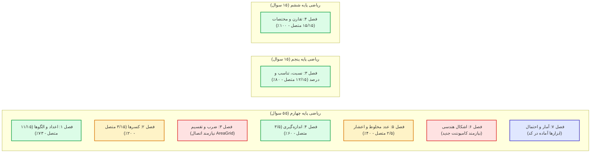

# اطلس جامع برنامه درسی، سوالات تشخیصی و ابزارهای دست‌ورزی تصویری

> **شناسه سند:** `DOC-CURRICULUM-VISUAL-TOOLS-MAP-V1`  
> **نسخه:** ۱.۱.۰ | **پوشش:** تمامی ۸۵ سوال کانونیکال در ۹ فصل تشخیصی پایه چهارم، پنجم و ششم ابتدایی  
> **هدف:** نقشه‌برداری کامل ارتباط میان «درس و مبحث»، «صورت سوال و کج‌فهمی‌های تشخیصی» و «ابزار بصری/دست‌ورزی متصل یا پیشنهادی» جهت ارتقای تعامل شناختی دانش‌آموزان.

## ۱. داشبورد وضعیت پوشش ابزارهای بصری به تفکیک درس‌ها

| ردیف | دوره و عنوان فصل | فایل کارتریج | تعداد مباحث | تعداد سوالات | وضعیت ابزار تصویری | درصد پوشش مستقیم | ابزارهای اصلی متصل یا پیشنهادی |
| :---: | :--- | :--- | :---: | :---: | :---: | :---: | :--- |
| 1 | پایه ۴ - فصل ۱: اعداد و الگوها | `grade4_math_ch1.json` | 5 | 15 | فعال در ۱۱ سوال (۷۳٪) | **۷۳٪** | Abacus, PlaceValueTable, PlaceValueBundles, Matchstick, DotPattern, I/O |
| 2 | پایه ۴ - فصل ۲: کسرها | `grade4_math_ch2.json` | 5 | 15 | فعال در ۳ سوال (۲۰٪) | **۲۰٪** | متصل: NumberLine, FractionStrip / پیشنهادی: AreaGrid, BalanceScale, BucketSort |
| 3 | پایه ۴ - فصل ۳: ضرب و تقسیم | `grade4_math_ch3.json` | 5 | 5 | فاقد ابزار در کارتریج (۰٪) | **۰٪** | پیشنهادی آماده: AreaGrid, PlaceValueTable |
| 4 | پایه ۴ - فصل ۴: اندازه‌گیری | `grade4_math_ch4.json` | 5 | 5 | فعال در ۳ سوال (۶۰٪) | **۶۰٪** | متصل: ProtractorVisualizer, ClockVisualizer |
| 5 | پایه ۴ - فصل ۵: عدد مخلوط و اعشار | `grade4_math_ch5.json` | 5 | 5 | فعال در ۲ سوال (۴۰٪) | **۴۰٪** | متصل: FractionCircle, AreaGrid |
| 6 | پایه ۴ - فصل ۶: شکل‌های هندسی | `grade4_math_ch6.json` | 5 | 5 | فاقد ابزار در کارتریج (۰٪) | **۰٪** | نیازمند طراحی کامپوننت: GeometricBoard, GridPolygon |
| 7 | پایه ۴ - فصل ۷: آمار و احتمال | `grade4_math_ch7.json` | 5 | 5 | ابزارها آماده در کد، غیرمتصل در کارتریج | **۰٪** | آماده در کد: ProbabilitySpinner, BrokenLineGraph |
| 8 | پایه ۵ - فصل ۳: نسبت و تناسب و درصد | `grade5_math_ch3.json` | 5 | 15 | فعال در ۱۲ سوال (۸۰٪) | **۸۰٪** | متصل: FractionStrip, NumberLine, BalanceScale, BucketSort, AreaGrid |
| 9 | پایه ۶ - فصل ۴: تقارن و مختصات | `grade6_math_ch4.json` | 5 | 15 | فعال در ۱۵ سوال (۱۰۰٪) | **۱۰۰٪** | متصل: CoordinateGridVisualizer, SymmetryPlayground, IntegerNumberLine |
| **کل** | **۹ فصل کانونیکال** | **۹ فایل کارتریج** | **۴۵ مبحث** | **۸۵ سوال** | **۴۶ سوال متصل مستقیم** | **۵۴.۱٪ مستقیم (۱۰۰٪ نقشه‌برداری)** | **۲۷ کامپوننت پارامتریک در مخزن** |

## ۲. تفکیک کامل درس‌ها، سوالات تشخیصی و ابزارهای بصری

### ۲. ریاضی پایه ۴ ابتدایی - فصل ۱: اعداد و الگوها
> **فایل منبع کارتریج:** [`data/canonical/grade4_math_ch1.json`](file:///g:/Code/education/data/canonical/grade4_math_ch1.json) | **تعداد سوالات:** 15

#### 🟢 سوال `ITEM-MATH4-CH01-001` — عددنویسی، جدول ارزش مکانی و خواندن و بازنمایی تا طبقه هزار
- **شناسه مبحث (KC ID):** `KC-MATH4-C01-01`
- **متن صورت سوال (Stem):** چرتکه‌ی زیر چه عددی را نشان می‌دهد؟
- **پاسخ صحیح (کلید):** `$407053$` | **ضریب دشواری:** `0.35`
- **کج‌فهمی‌های تشخیصی گزینه‌ها:** `MIS-MATH4-C01-01` (حذف یا نادیده گرفتن صفرهای میانی در عددنویسی)
- **وضعیت ابزار دست‌ورزی:** 🟢 **ابزار فعال در سوال**
- **نام کامپوننت ابزار:** `AbacusVisualizer`
- **تنظیمات پارامتریک (Props):** `{"number": 407053, "showDigitBadges": false, "showRodIndices": true}`
- **نقش پداگوژیک ابزار:** پل ارتباطی بین بازنمایی مجسم و نیمه‌مجسم در نمایش اعداد تا طبقه میلیون، مشاهده تعداد مهره در هر ستون و تطبیق مستقیم با رقم آن مرتبه.

#### 🟢 سوال `ITEM-MATH4-CH01-002` — عددنویسی، جدول ارزش مکانی و خواندن و بازنمایی تا طبقه هزار
- **شناسه مبحث (KC ID):** `KC-MATH4-C01-01`
- **متن صورت سوال (Stem):** در جدول ارزش مکانی زیر، چه رقمی باید در جای علامت ؟ قرار گیرد تا عدد $470295$ کامل شود؟
- **پاسخ صحیح (کلید):** `$7$` | **ضریب دشواری:** `0.3`
- **کج‌فهمی‌های تشخیصی گزینه‌ها:** `MIS-MATH4-C01-01` (حذف یا نادیده گرفتن صفرهای میانی در عددنویسی)
- **وضعیت ابزار دست‌ورزی:** 🟢 **ابزار فعال در سوال**
- **نام کامپوننت ابزار:** `PlaceValueTable`
- **تنظیمات پارامتریک (Props):** `{"number": 470295, "tiers": ["thousands", "ones"], "hiddenSlot": "دهگان‌هزار", "showLabels": true}`
- **نقش پداگوژیک ابزار:** درک ساختار ارزش مکانی ارقام در پایه‌های ده‌دهی، تفکیک طبقات یکی‌ها، هزارها و میلیون‌ها و درک صفرهای میانی به عنوان پرکننده مرتبه بدون ارزش رقمی.

#### 🟢 سوال `ITEM-MATH4-CH01-003` — عددنویسی، جدول ارزش مکانی و خواندن و بازنمایی تا طبقه هزار
- **شناسه مبحث (KC ID):** `KC-MATH4-C01-01`
- **متن صورت سوال (Stem):** اگر $3$ بسته صد‌هزارتایی، $5$ بسته ده‌هزارتایی و $8$ بسته هزارتایی را در کنار هم قرار دهیم، چه عددی ساخته می‌شود؟
- **پاسخ صحیح (کلید):** `$358000$` | **ضریب دشواری:** `0.38`
- **کج‌فهمی‌های تشخیصی گزینه‌ها:** `MIS-MATH4-C01-01` (حذف یا نادیده گرفتن صفرهای میانی در عددنویسی)
- **وضعیت ابزار دست‌ورزی:** 🟢 **ابزار فعال در سوال**
- **نام کامپوننت ابزار:** `PlaceValueBundles`
- **تنظیمات پارامتریک (Props):** `{"bundles": [{"count": 3, "unitValue": 100000, "unitLabel": "صدهزارتایی", "theme": "purple"}, {"count": 5, "unitValue": 10000, "unitLabel": "ده‌هزارتایی", "theme": "emerald"}, {"count": 8, "unitValue": 1000, "unitLabel": "هزارتایی", "theme": "sky"}]}`
- **نقش پداگوژیک ابزار:** تبدیل بازنمایی مجسم و نیمه‌مجسم بسته‌های ارزش مکانی به نماد عددی، و پیشگیری از خطای شناختی جمع ساده تعداد بسته‌ها (مانند ۳۵۸ به جای ۳۵۸,۰۰۰).

#### 🟢 سوال `ITEM-MATH4-CH01-004` — گسترده‌نویسی، مقایسه و ترتیب اعداد چندرقمی
- **شناسه مبحث (KC ID):** `KC-MATH4-C01-02`
- **متن صورت سوال (Stem):** شکل گسترده‌ی عدد $530408$ با کدام گزینه برابر است؟
- **پاسخ صحیح (کلید):** `$500000 + 30000 + 400 + 8$` | **ضریب دشواری:** `0.4`
- **کج‌فهمی‌های تشخیصی گزینه‌ها:** `MIS-MATH4-C01-02` (جمع ارقام مطلق به جای ارزش مکانی در گسترده‌نویسی)
- **وضعیت ابزار دست‌ورزی:** 🟢 **ابزار فعال در سوال**
- **نام کامپوننت ابزار:** `PlaceValueTable`
- **تنظیمات پارامتریک (Props):** `{"number": 530408, "tiers": ["thousands", "ones"], "showLabels": true, "label": "جدول ارزش مکانی عدد ۵۳۰,۴۰۸:"}`
- **نقش پداگوژیک ابزار:** درک ساختار ارزش مکانی ارقام در پایه‌های ده‌دهی، تفکیک طبقات یکی‌ها، هزارها و میلیون‌ها و درک صفرهای میانی به عنوان پرکننده مرتبه بدون ارزش رقمی.

#### 🔴 سوال `ITEM-MATH4-CH01-005` — گسترده‌نویسی، مقایسه و ترتیب اعداد چندرقمی
- **شناسه مبحث (KC ID):** `KC-MATH4-C01-02`
- **متن صورت سوال (Stem):** با رقم‌های $2$، $0$، $5$، $8$، $3$ و $9$ بدون تکرار، «بزرگ‌ترین» عدد شش‌رقمی کدام است؟
- **پاسخ صحیح (کلید):** `$985320$` | **ضریب دشواری:** `0.45`
- **کج‌فهمی‌های تشخیصی:** سنجش مفهومی مستقیم بدون برچسب کج‌فهمی اختصاصی
- **وضعیت ابزار دست‌ورزی:** 🔴 **فاقد ابزار در سیستم (پیشنهاد ابزار داده شد)**
- **ابزار پیشنهادی:** `PlaceValueTable` (جدول ارزش مکانی و کارت‌های گسترده‌نویسی)
- **کارکرد پداگوژیک پیشنهادی:** نمایش رقم‌ها در مرتبه‌های دهگان‌هزار و صدگان‌هزار و بازنمایی گسترده عدد

#### 🟢 سوال `ITEM-MATH4-CH01-006` — گسترده‌نویسی، مقایسه و ترتیب اعداد چندرقمی
- **شناسه مبحث (KC ID):** `KC-MATH4-C01-02`
- **متن صورت سوال (Stem):** در عدد $40400$، ارزش رقم «$4$» سمت چپ، چند برابر ارزش رقم «$4$» دیگر است؟
- **پاسخ صحیح (کلید):** `$100$ برابر` | **ضریب دشواری:** `0.48`
- **کج‌فهمی‌های تشخیصی گزینه‌ها:** `MIS-MATH4-C01-01` (حذف یا نادیده گرفتن صفرهای میانی در عددنویسی), `MIS-MATH4-C01-02` (جمع ارقام مطلق به جای ارزش مکانی در گسترده‌نویسی)
- **وضعیت ابزار دست‌ورزی:** 🟢 **ابزار فعال در سوال**
- **نام کامپوننت ابزار:** `PlaceValueTable`
- **تنظیمات پارامتریک (Props):** `{"number": 40400, "tiers": ["thousands", "ones"], "showLabels": true, "highlightColumn": "دهگان‌هزار", "label": "جدول ارزش مکانی عدد ۴۰,۴۰۰:"}`
- **نقش پداگوژیک ابزار:** درک ساختار ارزش مکانی ارقام در پایه‌های ده‌دهی، تفکیک طبقات یکی‌ها، هزارها و میلیون‌ها و درک صفرهای میانی به عنوان پرکننده مرتبه بدون ارزش رقمی.

#### 🟢 سوال `ITEM-MATH4-CH01-007` — الگوهای عددی، هندسی و کشف رابطه بین شماره شکل و تعداد
- **شناسه مبحث (KC ID):** `KC-MATH4-C01-03`
- **متن صورت سوال (Stem):** در یک الگوی هندسی چوب‌کبریت‌ها، شکل اول با $4$ چوب‌کبریت، شکل دوم با $7$ چوب‌کبریت و شکل سوم با $10$ چوب‌کبریت ساخته شده است. شکل دهم با چند چوب‌کبریت ساخته می‌شود؟
- **پاسخ صحیح (کلید):** `$31$` | **ضریب دشواری:** `0.5`
- **کج‌فهمی‌های تشخیصی گزینه‌ها:** `MIS-MATH4-C01-03` (فرض الگوی صرفاً جمعی و نادیده گرفتن رابطه شماره شکل یا ضرب), `MIS-MATH4-C01-03` (فرض الگوی صرفاً جمعی و نادیده گرفتن رابطه شماره شکل یا ضرب)
- **وضعیت ابزار دست‌ورزی:** 🟢 **ابزار فعال در سوال**
- **نام کامپوننت ابزار:** `MatchstickPattern`
- **تنظیمات پارامتریک (Props):** `{"patternKind": "squares", "stages": [{"stageNumber": 1, "count": 4, "isTarget": false}, {"stageNumber": 2, "count": 7, "isTarget": false}, {"stageNumber": 3, "count": 10, "isTarget": false}, {"stageNumber": 4, "count": 13, "isTarget": true}], "showCounts": true, "label": "مراحل ساخت الگوی چوب‌کبریت‌ها:"}`
- **نقش پداگوژیک ابزار:** تقویت تفکر جبری و الگویابی از طریق بازنمایی هندسی؛ تشخیص بخش ثابت الگو و ضریب تغییر متناسب با شماره شکل.

#### 🔴 سوال `ITEM-MATH4-CH01-008` — الگوهای عددی، هندسی و کشف رابطه بین شماره شکل و تعداد
- **شناسه مبحث (KC ID):** `KC-MATH4-C01-03`
- **متن صورت سوال (Stem):** در دنباله‌ی عددی مقابل، عدد بعدی کدام است؟ $$1, 2, 4, 8, 16, \dots$$
- **پاسخ صحیح (کلید):** `$32$` | **ضریب دشواری:** `0.38`
- **کج‌فهمی‌های تشخیصی گزینه‌ها:** `MIS-MATH4-C01-03` (فرض الگوی صرفاً جمعی و نادیده گرفتن رابطه شماره شکل یا ضرب), `MIS-MATH4-C01-03` (فرض الگوی صرفاً جمعی و نادیده گرفتن رابطه شماره شکل یا ضرب)
- **وضعیت ابزار دست‌ورزی:** 🔴 **فاقد ابزار در سیستم (پیشنهاد ابزار داده شد)**
- **ابزار پیشنهادی:** `CustomVisualizer` (ابزار متناسب با مفهوم)
- **کارکرد پداگوژیک پیشنهادی:** بازنمایی شهودی مسئله

#### 🟢 سوال `ITEM-MATH4-CH01-009` — الگوهای عددی، هندسی و کشف رابطه بین شماره شکل و تعداد
- **شناسه مبحث (KC ID):** `KC-MATH4-C01-03`
- **متن صورت سوال (Stem):** در الگوی مثلثی نقطه‌ها (مسئله صفحه ۲ کتاب)، تعداد نقطه‌ها به ترتیب $1$، $3$، $6$، $10$ و $15$ است. شکل هفتم با چند نقطه درست می‌شود؟
- **پاسخ صحیح (کلید):** `$28$` | **ضریب دشواری:** `0.52`
- **کج‌فهمی‌های تشخیصی گزینه‌ها:** `MIS-MATH4-C01-03` (فرض الگوی صرفاً جمعی و نادیده گرفتن رابطه شماره شکل یا ضرب)
- **وضعیت ابزار دست‌ورزی:** 🟢 **ابزار فعال در سوال**
- **نام کامپوننت ابزار:** `DotPatternVisualizer`
- **تنظیمات پارامتریک (Props):** `{"shapeType": "triangle", "stages": [{"stageNumber": 1, "dotCount": 1, "rows": 1}, {"stageNumber": 2, "dotCount": 3, "rows": 2}, {"stageNumber": 3, "dotCount": 6, "rows": 3}, {"stageNumber": 4, "dotCount": 10, "rows": 4, "isTarget": true}], "showCounts": true, "label": "الگوی آرایش نقطه‌ها در شکل‌های متوالی:"}`
- **نقش پداگوژیک ابزار:** نمایش تصویری روابط حسابی در قالب آرایش هندسی نقطه‌ها بر مبنای مسئله صفحه ۲ کتاب درسی ریاضی چهارم.

#### 🟢 سوال `ITEM-MATH4-CH01-010` — ماشین‌های ورودی ــ خروجی و عملیات معکوس
- **شناسه مبحث (KC ID):** `KC-MATH4-C01-04`
- **متن صورت سوال (Stem):** یک ماشین «محیط‌یاب»، طول ضلع مثلث متساوی‌الاضلاع را می‌گیرد و محیط آن را به عنوان خروجی تحویل می‌دهد. اگر عدد $14$ وارد این ماشین شود، چه عددی خارج می‌شود؟
- **پاسخ صحیح (کلید):** `$42$` | **ضریب دشواری:** `0.35`
- **کج‌فهمی‌های تشخیصی گزینه‌ها:** `MIS-MATH4-C01-04` (اشتباه در مسیر معکوس ماشین ورودی-خروجی یا اولویت عملیات)
- **وضعیت ابزار دست‌ورزی:** 🟢 **ابزار فعال در سوال**
- **نام کامپوننت ابزار:** `InputOutputMachine`
- **تنظیمات پارامتریک (Props):** `{"inputVal": 14, "outputVal": "؟", "operations": [{"op": "mul", "value": 3}], "machineTitle": "ماشین محیط‌یاب مثلث متساوی‌الاضلاع", "showTable": true, "tablePairs": [{"input": 2, "output": 6}, {"input": 5, "output": 15}, {"input": 14, "output": "؟"}], "label": "نمای عملکرد ماشین محیط‌یاب:"}`
- **نقش پداگوژیک ابزار:** درک مفهوم تابع و تبدیل‌های ریاضی به عنوان یک عملگر قاعده، تحلیل جدول داده‌های ورودی-خروجی و کشف فرآیند معکوس در حل مسئله.

#### 🟢 سوال `ITEM-MATH4-CH01-011` — ماشین‌های ورودی ــ خروجی و عملیات معکوس
- **شناسه مبحث (KC ID):** `KC-MATH4-C01-04`
- **متن صورت سوال (Stem):** در یک ماشین دو مرحله‌ای ورودی-خروجی، هر عددی وارد شود ابتدا «ضرب در ۴» و سپس حاصل «منهای ۵» می‌شود. اگر عدد $6$ وارد این ماشین شود، خروجی کدام است؟
- **پاسخ صحیح (کلید):** `$19$` | **ضریب دشواری:** `0.42`
- **کج‌فهمی‌های تشخیصی گزینه‌ها:** `MIS-MATH4-C01-04` (اشتباه در مسیر معکوس ماشین ورودی-خروجی یا اولویت عملیات), `MIS-MATH4-C01-04` (اشتباه در مسیر معکوس ماشین ورودی-خروجی یا اولویت عملیات)
- **وضعیت ابزار دست‌ورزی:** 🟢 **ابزار فعال در سوال**
- **نام کامپوننت ابزار:** `InputOutputMachine`
- **تنظیمات پارامتریک (Props):** `{"inputVal": 6, "outputVal": "؟", "operations": [{"op": "mul", "value": 4}, {"op": "sub", "value": 5}], "machineTitle": "ماشین دو مرحله‌ای", "label": "نمودار فرآیند ماشین دو مرحله‌ای:"}`
- **نقش پداگوژیک ابزار:** درک مفهوم تابع و تبدیل‌های ریاضی به عنوان یک عملگر قاعده، تحلیل جدول داده‌های ورودی-خروجی و کشف فرآیند معکوس در حل مسئله.

#### 🟢 سوال `ITEM-MATH4-CH01-012` — ماشین‌های ورودی ــ خروجی و عملیات معکوس
- **شناسه مبحث (KC ID):** `KC-MATH4-C01-04`
- **متن صورت سوال (Stem):** قاعده‌ی یک ماشین ورودی-خروجی «ضرب در ۳، سپس به علاوه ۴» است. اگر از این ماشین عدد $25$ خارج شده باشد، چه عددی وارد آن شده بود؟
- **پاسخ صحیح (کلید):** `$7$` | **ضریب دشواری:** `0.52`
- **کج‌فهمی‌های تشخیصی گزینه‌ها:** `MIS-MATH4-C01-04` (اشتباه در مسیر معکوس ماشین ورودی-خروجی یا اولویت عملیات), `MIS-MATH4-C01-04` (اشتباه در مسیر معکوس ماشین ورودی-خروجی یا اولویت عملیات)
- **وضعیت ابزار دست‌ورزی:** 🟢 **ابزار فعال در سوال**
- **نام کامپوننت ابزار:** `InputOutputMachine`
- **تنظیمات پارامتریک (Props):** `{"inputVal": "؟", "outputVal": 25, "operations": [{"op": "mul", "value": 3}, {"op": "add", "value": 4}], "machineTitle": "ماشین ورودی-خروجی (مسیر معکوس)", "label": "نمودار ماشین با خروجی مشخص:"}`
- **نقش پداگوژیک ابزار:** درک مفهوم تابع و تبدیل‌های ریاضی به عنوان یک عملگر قاعده، تحلیل جدول داده‌های ورودی-خروجی و کشف فرآیند معکوس در حل مسئله.

#### 🟢 سوال `ITEM-MATH4-CH01-013` — معرفی طبقه میلیون، جدول ارزش مکانی و مقایسه اعداد بزرگ
- **شناسه مبحث (KC ID):** `KC-MATH4-C01-05`
- **متن صورت سوال (Stem):** چند بسته «صدهزارتایی» در کنار هم، یک عدد «یک میلیون» ($1000000$) را تشکیل می‌دهند؟
- **پاسخ صحیح (کلید):** `$10$ بسته` | **ضریب دشواری:** `0.32`
- **کج‌فهمی‌های تشخیصی گزینه‌ها:** `MIS-MATH4-C01-05` (اشتباه در درک مقیاس طبقه میلیون و خلط آن با طبقه هزار), `MIS-MATH4-C01-05` (اشتباه در درک مقیاس طبقه میلیون و خلط آن با طبقه هزار)
- **وضعیت ابزار دست‌ورزی:** 🟢 **ابزار فعال در سوال**
- **نام کامپوننت ابزار:** `PlaceValueBundles`
- **تنظیمات پارامتریک (Props):** `{"bundles": [{"count": 10, "unitValue": 100000, "unitLabel": "صدهزارتایی", "theme": "purple"}], "label": "۱۰ بسته صدهزارتایی معادل یک میلیون:"}`
- **نقش پداگوژیک ابزار:** تبدیل بازنمایی مجسم و نیمه‌مجسم بسته‌های ارزش مکانی به نماد عددی، و پیشگیری از خطای شناختی جمع ساده تعداد بسته‌ها (مانند ۳۵۸ به جای ۳۵۸,۰۰۰).

#### 🟢 سوال `ITEM-MATH4-CH01-014` — معرفی طبقه میلیون، جدول ارزش مکانی و مقایسه اعداد بزرگ
- **شناسه مبحث (KC ID):** `KC-MATH4-C01-05`
- **متن صورت سوال (Stem):** نماد عددی «سی و پنج میلیون و چهارصد و هشت هزار و نه» با کدام گزینه برابر است؟
- **پاسخ صحیح (کلید):** `$35408009$` | **ضریب دشواری:** `0.42`
- **کج‌فهمی‌های تشخیصی گزینه‌ها:** `MIS-MATH4-C01-05` (اشتباه در درک مقیاس طبقه میلیون و خلط آن با طبقه هزار)
- **وضعیت ابزار دست‌ورزی:** 🟢 **ابزار فعال در سوال**
- **نام کامپوننت ابزار:** `AbacusVisualizer`
- **تنظیمات پارامتریک (Props):** `{"number": 35408009, "showDigitBadges": true, "label": "چرتکه نشان‌دهنده عدد مورد نظر:"}`
- **نقش پداگوژیک ابزار:** پل ارتباطی بین بازنمایی مجسم و نیمه‌مجسم در نمایش اعداد تا طبقه میلیون، مشاهده تعداد مهره در هر ستون و تطبیق مستقیم با رقم آن مرتبه.

#### 🟢 سوال `ITEM-MATH4-CH01-015` — معرفی طبقه میلیون، جدول ارزش مکانی و مقایسه اعداد بزرگ
- **شناسه مبحث (KC ID):** `KC-MATH4-C01-05`
- **متن صورت سوال (Stem):** ارزش مجموع دو فقره چک‌پول $500000$ ریالی و چهار فقره چک‌پول $1000000$ ریالی برابر با چند ریال است؟
- **پاسخ صحیح (کلید):** `$5000000$ ریال` | **ضریب دشواری:** `0.45`
- **کج‌فهمی‌های تشخیصی گزینه‌ها:** `MIS-MATH4-C01-05` (اشتباه در درک مقیاس طبقه میلیون و خلط آن با طبقه هزار), `MIS-MATH4-C01-05` (اشتباه در درک مقیاس طبقه میلیون و خلط آن با طبقه هزار)
- **وضعیت ابزار دست‌ورزی:** 🟢 **ابزار فعال در سوال**
- **نام کامپوننت ابزار:** `PlaceValueBundles`
- **تنظیمات پارامتریک (Props):** `{"bundles": [{"count": 4, "unitValue": 1000000, "unitLabel": "یک میلیونی", "theme": "purple"}, {"count": 2, "unitValue": 500000, "unitLabel": "پانصدهزارتایی", "theme": "emerald"}], "label": "دسته‌های چک‌پول ریالی:"}`
- **نقش پداگوژیک ابزار:** تبدیل بازنمایی مجسم و نیمه‌مجسم بسته‌های ارزش مکانی به نماد عددی، و پیشگیری از خطای شناختی جمع ساده تعداد بسته‌ها (مانند ۳۵۸ به جای ۳۵۸,۰۰۰).

### ۲. ریاضی پایه چهارم ابتدایی - فصل دوم: کسر
> **فایل منبع کارتریج:** [`data/canonical/grade4_math_ch2.json`](file:///g:/Code/education/data/canonical/grade4_math_ch2.json) | **تعداد سوالات:** 15

#### 🟢 سوال `ITEM-MATH4-CH02-001` — جمع و تفریق کسرهای هم‌مخرج و هم‌مخرج کردن کسرها
- **شناسه مبحث (KC ID):** `KC-MATH4-C02-04`
- **متن صورت سوال (Stem):** حاصل عبارت $\frac{2}{7} + \frac{3}{7}$ کدام است؟
- **پاسخ صحیح (کلید):** `$\frac{5}{7}$` | **ضریب دشواری:** `0.35`
- **کج‌فهمی‌های تشخیصی گزینه‌ها:** `MIS-ADD-NUM-DEN` (جمع همزمان صورت‌ها و مخرج‌ها با یکدیگر)
- **وضعیت ابزار دست‌ورزی:** 🟢 **ابزار فعال در سوال**
- **نام کامپوننت ابزار:** `FractionStrip`
- **تنظیمات پارامتریک (Props):** `{"totalSegments": 7, "initialColored": 0, "showSumMode": true, "operandA": 2, "operandB": 3}`
- **نقش پداگوژیک ابزار:** بازنمایی ساختار مفهومی و شهودی سوال

#### 🟢 سوال `ITEM-MATH4-CH02-002` — مقایسه کسرها با مخرج‌های مساوی یا نامساوی و درک اندازه نسبی
- **شناسه مبحث (KC ID):** `KC-MATH4-C02-03`
- **متن صورت سوال (Stem):** کدام یک از مقایسه‌های زیر درباره دو کسر $\frac{1}{4}$ و $\frac{1}{6}$ درست است؟
- **پاسخ صحیح (کلید):** `$\frac{1}{4} > \frac{1}{6}$` | **ضریب دشواری:** `0.45`
- **کج‌فهمی‌های تشخیصی گزینه‌ها:** `MIS-BIGGER-DEN-BIGGER-VAL` (پنداشت اینکه مخرج بزرگتر به معنای کسر بزرگتر است)
- **وضعیت ابزار دست‌ورزی:** 🟢 **ابزار فعال در سوال**
- **نام کامپوننت ابزار:** `BalanceScale`
- **تنظیمات پارامتریک (Props):** `{"leftValue": 0.25, "rightValue": 0.1666, "leftLabel": "1/4", "rightLabel": "1/6", "hideBadge": true}`
- **نقش پداگوژیک ابزار:** بازنمایی ساختار مفهومی و شهودی سوال

#### 🟢 سوال `ITEM-MATH4-CH02-003` — شناخت و تولید کسرهای مساوی با ضرب یا تقسیم صورت و مخرج
- **شناسه مبحث (KC ID):** `KC-MATH4-C02-02`
- **متن صورت سوال (Stem):** کدام کسر با کسر $\frac{2}{3}$ مساوی است؟
- **پاسخ صحیح (کلید):** `$\frac{4}{6}$` | **ضریب دشواری:** `0.4`
- **کج‌فهمی‌های تشخیصی گزینه‌ها:** `MIS-NUM-AS-SEPARATE-INTS` (تلقی صورت و مخرج به عنوان دو عدد مستقل)
- **وضعیت ابزار دست‌ورزی:** 🟢 **ابزار فعال در سوال**
- **نام کامپوننت ابزار:** `AreaGrid`
- **تنظیمات پارامتریک (Props):** `{"rows": 2, "cols": 3, "initialColored": 4, "coloredCount": 4, "highlightFractionA": "2/3", "highlightFractionB": "4/6"}`
- **نقش پداگوژیک ابزار:** بازنمایی ساختار مفهومی و شهودی سوال

#### 🟢 سوال `ITEM-MATH4-CH02-004` — نمایش کسرها و اعداد مخلوط روی محور اعداد
- **شناسه مبحث (KC ID):** `KC-MATH4-C02-05`
- **متن صورت سوال (Stem):** روی یک محور اعداد، بین عدد صفر و عدد یک به ۴ فاصله مساوی تقسیم شده است. نقطه نشان‌دهنده دومین خط بعد از صفر کدام کسر است؟
- **پاسخ صحیح (کلید):** `$\frac{2}{4}$` | **ضریب دشواری:** `0.42`
- **کج‌فهمی‌های تشخیصی گزینه‌ها:** `MIS-NUMBERLINE-TICK-COUNT` (شمارش خطوط تقسیم (تیک‌ها) به جای فواصل روی محور اعداد), `MIS-NUMBERLINE-TICK-COUNT` (شمارش خطوط تقسیم (تیک‌ها) به جای فواصل روی محور اعداد)
- **وضعیت ابزار دست‌ورزی:** 🟢 **ابزار فعال در سوال**
- **نام کامپوننت ابزار:** `NumberLine`
- **تنظیمات پارامتریک (Props):** `{"min": 0, "max": 1, "partitions": 4, "targetPoint": 0.5, "targetLabel": "نقطه مورد نظر"}`
- **نقش پداگوژیک ابزار:** بازنمایی ساختار مفهومی و شهودی سوال

#### 🟢 سوال `ITEM-MATH4-CH02-005` — شناخت مفهوم کسر به عنوان رابطه جزء از کل و تفکیک واحد
- **شناسه مبحث (KC ID):** `KC-MATH4-C02-01`
- **متن صورت سوال (Stem):** اگر یک نوار کاغذی به ۸ قسمت مساوی تقسیم شده باشد و ۵ قسمت آن رنگ شده باشد، کسر مربوط به بخش‌های رنگ‌نشده کدام است؟
- **پاسخ صحیح (کلید):** `$\frac{3}{8}$` | **ضریب دشواری:** `0.38`
- **کج‌فهمی‌های تشخیصی گزینه‌ها:** `MIS-NUM-AS-SEPARATE-INTS` (تلقی صورت و مخرج به عنوان دو عدد مستقل)
- **وضعیت ابزار دست‌ورزی:** 🟢 **ابزار فعال در سوال**
- **نام کامپوننت ابزار:** `FractionStrip`
- **تنظیمات پارامتریک (Props):** `{"totalSegments": 8, "initialColored": 5, "showSumMode": false}`
- **نقش پداگوژیک ابزار:** بازنمایی ساختار مفهومی و شهودی سوال

#### 🟢 سوال `ITEM-MATH4-CH02-006` — شناخت مفهوم کسر به عنوان رابطه جزء از کل و تفکیک واحد
- **شناسه مبحث (KC ID):** `KC-MATH4-C02-01`
- **متن صورت سوال (Stem):** با توجه به شکل زیر، آیا قسمت رنگ‌شده کسر $\frac{1}{3}$ شکل را نشان می‌دهد؟
- **پاسخ صحیح (کلید):** `خیر، زیرا شرط اصلی کسر این است که تمام قسمت‌ها با یکدیگر مساوی باشند.` | **ضریب دشواری:** `0.4`
- **کج‌فهمی‌های تشخیصی گزینه‌ها:** `MIS-UNEQUAL-PARTITIONS` (نادیده گرفتن شرط برابری قطعات در تعریف کسر), `MIS-UNEQUAL-PARTITIONS` (نادیده گرفتن شرط برابری قطعات در تعریف کسر)
- **وضعیت ابزار دست‌ورزی:** 🟢 **ابزار فعال در سوال**
- **نام کامپوننت ابزار:** `FractionStrip`
- **تنظیمات پارامتریک (Props):** `{"segmentRatios": [45, 18, 37], "coloredSegments": [1]}`
- **نقش پداگوژیک ابزار:** بازنمایی ساختار مفهومی و شهودی سوال

#### 🟢 سوال `ITEM-MATH4-CH02-007` — شناخت مفهوم کسر به عنوان رابطه جزء از کل و تفکیک واحد
- **شناسه مبحث (KC ID):** `KC-MATH4-C02-01`
- **متن صورت سوال (Stem):** در یک جعبه ۱۲ عدد مداد رنگی وجود دارد. اگر $\frac{1}{4}$ مدادها قرمز باشند، چند مداد قرمز در جعبه هست؟
- **پاسخ صحیح (کلید):** `۳ مداد` | **ضریب دشواری:** `0.35`
- **کج‌فهمی‌های تشخیصی:** سنجش مفهومی مستقیم بدون برچسب کج‌فهمی اختصاصی
- **وضعیت ابزار دست‌ورزی:** 🟢 **ابزار فعال در سوال**
- **نام کامپوننت ابزار:** `FractionStrip`
- **تنظیمات پارامتریک (Props):** `{"totalSegments": 12, "initialColored": 3, "showSumMode": false, "label": "نوار ۱۲ تایی مدادها و رنگ‌آمیزی ۱/۴ (۳ مداد قرمز):"}`
- **نقش پداگوژیک ابزار:** بازنمایی ساختار مفهومی و شهودی سوال

#### 🟢 سوال `ITEM-MATH4-CH02-008` — شناخت و تولید کسرهای مساوی با ضرب یا تقسیم صورت و مخرج
- **شناسه مبحث (KC ID):** `KC-MATH4-C02-02`
- **متن صورت سوال (Stem):** اگر به صورت و مخرج کسر $\frac{2}{5}$ عدد ۳ را اضافه کنیم تا کسر $\frac{5}{8}$ حاصل شود، آیا این دو کسر مساوی هستند؟
- **پاسخ صحیح (کلید):** `خیر، افزودن یک عدد ثابت به صورت و مخرج کسر مساوی تولید نمی‌کند.` | **ضریب دشواری:** `0.5`
- **کج‌فهمی‌های تشخیصی گزینه‌ها:** `MIS-NUM-AS-SEPARATE-INTS` (تلقی صورت و مخرج به عنوان دو عدد مستقل), `MIS-NUM-AS-SEPARATE-INTS` (تلقی صورت و مخرج به عنوان دو عدد مستقل)
- **وضعیت ابزار دست‌ورزی:** 🟢 **ابزار فعال در سوال**
- **نام کامپوننت ابزار:** `AreaGrid`
- **تنظیمات پارامتریک (Props):** `{"rows": 2, "cols": 4, "initialColored": 5, "coloredCount": 5}`
- **نقش پداگوژیک ابزار:** بازنمایی ساختار مفهومی و شهودی سوال

#### 🟢 سوال `ITEM-MATH4-CH02-009` — شناخت و تولید کسرهای مساوی با ضرب یا تقسیم صورت و مخرج
- **شناسه مبحث (KC ID):** `KC-MATH4-C02-02`
- **متن صورت سوال (Stem):** صورت و مخرج کسر $\frac{6}{9}$ را اگر بر ۳ تقسیم کنیم، کدام کسر مساوی با آن به دست می‌آید؟
- **پاسخ صحیح (کلید):** `$\frac{2}{3}$` | **ضریب دشواری:** `0.32`
- **کج‌فهمی‌های تشخیصی:** سنجش مفهومی مستقیم بدون برچسب کج‌فهمی اختصاصی
- **وضعیت ابزار دست‌ورزی:** 🟢 **ابزار فعال در سوال**
- **نام کامپوننت ابزار:** `FractionStrip`
- **تنظیمات پارامتریک (Props):** `{"totalSegments": 9, "initialColored": 6, "showSumMode": false}`
- **نقش پداگوژیک ابزار:** بازنمایی ساختار مفهومی و شهودی سوال

#### 🟢 سوال `ITEM-MATH4-CH02-010` — مقایسه کسرها با مخرج‌های مساوی یا نامساوی و درک اندازه نسبی
- **شناسه مبحث (KC ID):** `KC-MATH4-C02-03`
- **متن صورت سوال (Stem):** کدام رابطه مقایسه بین کسرها با مخرج‌های مساوی درست است؟
- **پاسخ صحیح (کلید):** `$\frac{3}{7} < \frac{5}{7}$` | **ضریب دشواری:** `0.3`
- **کج‌فهمی‌های تشخیصی گزینه‌ها:** `MIS-BIGGER-DEN-BIGGER-VAL` (پنداشت اینکه مخرج بزرگتر به معنای کسر بزرگتر است)
- **وضعیت ابزار دست‌ورزی:** 🟢 **ابزار فعال در سوال**
- **نام کامپوننت ابزار:** `BucketSort`
- **تنظیمات پارامتریک (Props):** `{"items": [{"id": "1", "label": "3/7", "value": 0.428}, {"id": "2", "label": "5/7", "value": 0.714}], "bucketALabel": "کوچک‌تر", "bucketBLabel": "بزرگ‌تر"}`
- **نقش پداگوژیک ابزار:** بازنمایی ساختار مفهومی و شهودی سوال

#### 🟢 سوال `ITEM-MATH4-CH02-011` — مقایسه کسرها با مخرج‌های مساوی یا نامساوی و درک اندازه نسبی
- **شناسه مبحث (KC ID):** `KC-MATH4-C02-03`
- **متن صورت سوال (Stem):** علی $\frac{1}{3}$ یک کیک و سامان $\frac{1}{5}$ همان کیک را خورده است. چه کسی سهم بیشتری خورده است؟
- **پاسخ صحیح (کلید):** `علی سهم بیشتری خورده است (چون کیک به ۳ قسمت تقسیم شده و قطعاتش بزرگترند).` | **ضریب دشواری:** `0.45`
- **کج‌فهمی‌های تشخیصی گزینه‌ها:** `MIS-BIGGER-DEN-BIGGER-VAL` (پنداشت اینکه مخرج بزرگتر به معنای کسر بزرگتر است)
- **وضعیت ابزار دست‌ورزی:** 🟢 **ابزار فعال در سوال**
- **نام کامپوننت ابزار:** `BalanceScale`
- **تنظیمات پارامتریک (Props):** `{"leftValue": 0.333, "rightValue": 0.2, "leftLabel": "1/3", "rightLabel": "1/5"}`
- **نقش پداگوژیک ابزار:** بازنمایی ساختار مفهومی و شهودی سوال

#### 🟢 سوال `ITEM-MATH4-CH02-012` — جمع و تفریق کسرهای هم‌مخرج و هم‌مخرج کردن کسرها
- **شناسه مبحث (KC ID):** `KC-MATH4-C02-04`
- **متن صورت سوال (Stem):** حاصل عبارت تفریق $\frac{6}{10} - \frac{2}{10}$ کدام است؟
- **پاسخ صحیح (کلید):** `$\frac{4}{10}$` | **ضریب دشواری:** `0.35`
- **کج‌فهمی‌های تشخیصی گزینه‌ها:** `MIS-ADD-NUM-DEN` (جمع همزمان صورت‌ها و مخرج‌ها با یکدیگر), `MIS-ADD-NUM-DEN` (جمع همزمان صورت‌ها و مخرج‌ها با یکدیگر)
- **وضعیت ابزار دست‌ورزی:** 🟢 **ابزار فعال در سوال**
- **نام کامپوننت ابزار:** `FractionStrip`
- **تنظیمات پارامتریک (Props):** `{"totalSegments": 10, "initialColored": 4, "showSumMode": false}`
- **نقش پداگوژیک ابزار:** بازنمایی ساختار مفهومی و شهودی سوال

#### 🟢 سوال `ITEM-MATH4-CH02-013` — جمع و تفریق کسرهای هم‌مخرج و هم‌مخرج کردن کسرها
- **شناسه مبحث (KC ID):** `KC-MATH4-C02-04`
- **متن صورت سوال (Stem):** حاصل عبارت $\frac{1}{6} + \frac{2}{6} + \frac{1}{6}$ برابر با کدام کسر است؟
- **پاسخ صحیح (کلید):** `$\frac{4}{6}$` | **ضریب دشواری:** `0.4`
- **کج‌فهمی‌های تشخیصی گزینه‌ها:** `MIS-ADD-NUM-DEN` (جمع همزمان صورت‌ها و مخرج‌ها با یکدیگر)
- **وضعیت ابزار دست‌ورزی:** 🟢 **ابزار فعال در سوال**
- **نام کامپوننت ابزار:** `FractionStrip`
- **تنظیمات پارامتریک (Props):** `{"totalSegments": 6, "initialColored": 4, "showSumMode": false}`
- **نقش پداگوژیک ابزار:** بازنمایی ساختار مفهومی و شهودی سوال

#### 🟢 سوال `ITEM-MATH4-CH02-014` — نمایش کسرها و اعداد مخلوط روی محور اعداد
- **شناسه مبحث (KC ID):** `KC-MATH4-C02-05`
- **متن صورت سوال (Stem):** روی محور اعداد، فاصله بین عدد صفر تا یک با ۲ خط نشانه‌گذاری در وسط به چند بخش مساوی تقسیم شده است؟
- **پاسخ صحیح (کلید):** `۳ بخش مساوی` | **ضریب دشواری:** `0.48`
- **کج‌فهمی‌های تشخیصی گزینه‌ها:** `MIS-NUMBERLINE-TICK-COUNT` (شمارش خطوط تقسیم (تیک‌ها) به جای فواصل روی محور اعداد), `MIS-NUMBERLINE-TICK-COUNT` (شمارش خطوط تقسیم (تیک‌ها) به جای فواصل روی محور اعداد)
- **وضعیت ابزار دست‌ورزی:** 🟢 **ابزار فعال در سوال**
- **نام کامپوننت ابزار:** `NumberLine`
- **تنظیمات پارامتریک (Props):** `{"min": 0, "max": 1, "partitions": 3, "targetPoint": 0.333, "targetLabel": "محور با ۲ خط میانی"}`
- **نقش پداگوژیک ابزار:** بازنمایی ساختار مفهومی و شهودی سوال

#### 🟢 سوال `ITEM-MATH4-CH02-015` — نمایش کسرها و اعداد مخلوط روی محور اعداد
- **شناسه مبحث (KC ID):** `KC-MATH4-C02-05`
- **متن صورت سوال (Stem):** روی یک محور، فاصله بین ۰ و ۱ به ۶ قسمت مساوی تقسیم شده و نقطه مورد نظر روی پنجمین خط بعد از صفر قرار دارد. این نقطه چه کسری را نشان می‌دهد؟
- **پاسخ صحیح (کلید):** `$\frac{5}{6}$` | **ضریب دشواری:** `0.42`
- **کج‌فهمی‌های تشخیصی گزینه‌ها:** `MIS-NUMBERLINE-TICK-COUNT` (شمارش خطوط تقسیم (تیک‌ها) به جای فواصل روی محور اعداد)
- **وضعیت ابزار دست‌ورزی:** 🟢 **ابزار فعال در سوال**
- **نام کامپوننت ابزار:** `NumberLine`
- **تنظیمات پارامتریک (Props):** `{"min": 0, "max": 1, "partitions": 6, "targetPoint": 0.833, "targetLabel": "نقطه مورد نظر"}`
- **نقش پداگوژیک ابزار:** بازنمایی ساختار مفهومی و شهودی سوال

### ۲. ریاضی پایه 4 ابتدایی - فصل 3: ضرب و تقسیم
> **فایل منبع کارتریج:** [`data/canonical/grade4_math_ch3.json`](file:///g:/Code/education/data/canonical/grade4_math_ch3.json) | **تعداد سوالات:** 5

#### 🔴 سوال `ITEM-MATH4-CH03-001` — درک مفهوم ضرب دو عدد دو رقمی با الگوی مساحت و گسترده‌نویسی
- **شناسه مبحث (KC ID):** `KC-MATH4-C03-01`
- **متن صورت سوال (Stem):** یک باغچه مستطیل‌شکل به طول $34$ متر و عرض $25$ متر داریم. اگر برای محاسبه‌ی مساحت آن از روش ضرب مساحتی استفاده کنیم و باغچه را به ۴ مستطیل فرعی با مساحت‌های $(30 \times 20)$، $(30 \times 5)$، $(4 \times 20)$ و $(4 \times 5)$ تقسیم کنیم، مساحت کل باغچه چند متر مربع می‌شود؟
- **پاسخ صحیح (کلید):** `$850$ متر مربع` | **ضریب دشواری:** `0.35`
- **کج‌فهمی‌های تشخیصی گزینه‌ها:** `MIS-MATH4-C03-02` (ضرب مؤلفه به مؤلفه ناشی از تعمیم غلط قواعد جمع)
- **وضعیت ابزار دست‌ورزی:** 🔴 **فاقد ابزار در سیستم (پیشنهاد ابزار داده شد)**
- **ابزار پیشنهادی:** `AreaGrid` (شبکه مساحتی و مدل مستطیلی ضرب)
- **کارکرد پداگوژیک پیشنهادی:** تقسیم مستطیل حاصل‌ضرب به ۴ بخش دهگان و یکان و رنگ‌آمیزی مساحت‌ها

#### 🔴 سوال `ITEM-MATH4-CH03-002` — اجرای الگوریتم ستونی و تکنیکی ضرب با حفظ ارزش مکانی
- **شناسه مبحث (KC ID):** `KC-MATH4-C03-02`
- **متن صورت سوال (Stem):** حاصل ضرب ستونی زیر کدام است؟ $$\begin{array}{r} 46 \\ \times \ 37 \\ \hline \end{array}$$
- **پاسخ صحیح (کلید):** `$1702$` | **ضریب دشواری:** `0.45`
- **کج‌فهمی‌های تشخیصی گزینه‌ها:** `MIS-MATH4-C03-01` (فراموشی صفر ارزش مکانی دهگان در سطر دوم ضرب ستونی)
- **وضعیت ابزار دست‌ورزی:** 🔴 **فاقد ابزار در سیستم (پیشنهاد ابزار داده شد)**
- **ابزار پیشنهادی:** `PlaceValueTable` (جدول ستونی ارزش مکانی ضرب)
- **کارکرد پداگوژیک پیشنهادی:** نگهداری ارزش مکانی دهگان و صدگان در ضرب‌های تکنیکی

#### 🔴 سوال `ITEM-MATH4-CH03-003` — تخمین و محاسبه‌ی تقریبی در ضرب و تقسیم
- **شناسه مبحث (KC ID):** `KC-MATH4-C03-03`
- **متن صورت سوال (Stem):** قیمت هر بسته آموزشی $29$ هزار تومان است. مدیر مدرسه‌ای می‌خواهد برای $48$ دانش‌آموز از این بسته‌ها تهیه کند. اگر او برای تخمین هزینه‌ی کل، هر دو عدد را به «نزدیک‌ترین ده‌گان» گرد کند، هزینه تقریبی کل بسته‌ها چند هزار تومان می‌شود؟
- **پاسخ صحیح (کلید):** `$1500$ هزار تومان` | **ضریب دشواری:** `0.4`
- **کج‌فهمی‌های تشخیصی گزینه‌ها:** `MIS-MATH4-C03-04` (حذف صفرهای ارزش مکانی در تقریب و برآورد ضرب)
- **وضعیت ابزار دست‌ورزی:** 🔴 **فاقد ابزار در سیستم (پیشنهاد ابزار داده شد)**
- **ابزار پیشنهادی:** `NumberLine` (محور اعداد تخمین و تقریب)
- **کارکرد پداگوژیک پیشنهادی:** نمایش موقعیت عدد نسبت به مضارب ۱۰ و ۱۰۰ جهت گردکردن

#### 🔴 سوال `ITEM-MATH4-CH03-004` — درک رابطه‌های درستی تقسیم و شرط باقی‌مانده
- **شناسه مبحث (KC ID):** `KC-MATH4-C03-04`
- **متن صورت سوال (Stem):** در تقسیم عدد $51$ بر مقسوم‌علیه $6$، کدام تساوی نشان‌دهنده‌ی یک تقسیم «درست و کامل» است؟
- **پاسخ صحیح (کلید):** `$51 = (6 \times 8) + 3$` | **ضریب دشواری:** `0.5`
- **کج‌فهمی‌های تشخیصی گزینه‌ها:** `MIS-MATH4-C03-03` (نادیده گرفتن شرط باقی‌مانده در تقسیم)
- **وضعیت ابزار دست‌ورزی:** 🔴 **فاقد ابزار در سیستم (پیشنهاد ابزار داده شد)**
- **ابزار پیشنهادی:** `BucketSort` (سطل‌ها و بسته‌های افرازی تقسیم)
- **کارکرد پداگوژیک پیشنهادی:** دسته‌بندی مقسوم به دسته‌های مساوی و نمایش بصری باقی‌مانده کمتر از مقسوم‌علیه

#### 🔴 سوال `ITEM-MATH4-CH03-005` — اجرای الگوریتم تقسیم چندرقمی و مدیریت رقم صفر در خارج‌قسمت
- **شناسه مبحث (KC ID):** `KC-MATH4-C03-05`
- **متن صورت سوال (Stem):** حاصل تقسیم $824 \div 4$ کدام است؟
- **پاسخ صحیح (کلید):** `$206$` | **ضریب دشواری:** `0.48`
- **کج‌فهمی‌های تشخیصی گزینه‌ها:** `MIS-MATH4-C03-05` (حذف رقم صفر در خارج‌قسمت تقسیم مرحله‌ای)
- **وضعیت ابزار دست‌ورزی:** 🔴 **فاقد ابزار در سیستم (پیشنهاد ابزار داده شد)**
- **ابزار پیشنهادی:** `PlaceValueTable` (جدول الگوریتم تقسیم چندرقمی)
- **کارکرد پداگوژیک پیشنهادی:** مدیریت ارزش مکانی ارقام خارج‌قسمت و ثبت صفر در مرتبه‌ها

### ۲. ریاضی پایه ۴ ابتدایی - فصل ۴: اندازه‌گیری
> **فایل منبع کارتریج:** [`data/canonical/grade4_math_ch4.json`](file:///g:/Code/education/data/canonical/grade4_math_ch4.json) | **تعداد سوالات:** 5

#### 🟢 سوال `ITEM-MATH4-CH04-001` — شناخت مفهوم زاویه، نام‌گذاری رأس و اضلاع و طبقه‌بندی انواع زاویه
- **شناسه مبحث (KC ID):** `KC-MATH4-C04-01`
- **متن صورت سوال (Stem):** اگر یک زاویه از زاویه راست ($90^\circ$) بزرگتر و از زاویه نیم‌صفحه ($180^\circ$) کوچکتر باشد، این زاویه چه نامیده می‌شود؟
- **پاسخ صحیح (کلید):** `زاویه باز (منفرجه)` | **ضریب دشواری:** `0.3`
- **کج‌فهمی‌های تشخیصی:** سنجش مفهومی مستقیم بدون برچسب کج‌فهمی اختصاصی
- **وضعیت ابزار دست‌ورزی:** 🟢 **ابزار فعال در سوال**
- **نام کامپوننت ابزار:** `ProtractorVisualizer`
- **تنظیمات پارامتریک (Props):** `{"angleDegree": 135, "showProtractor": false, "showClassification": false, "showDegreeLabel": false, "vertexLabel": "ب", "label": "نمای زاویه مورد نظر:"}`
- **نقش پداگوژیک ابزار:** آموزش دقیق نحوه خواندن درجه از روی نقاله نیم‌دایره‌ای ۱۸۰ درجه، تشخیص راس و اضلاع زاویه و طبقه‌بندی زوایای تند، راست و باز.

#### 🟢 سوال `ITEM-MATH4-CH04-002` — اندازه‌گیری و رسم دقیق زاویه با استفاده از نقاله و خواندن دو جهت مدرج
- **شناسه مبحث (KC ID):** `KC-MATH4-C04-02`
- **متن صورت سوال (Stem):** علی یک زاویه را با نقاله اندازه گرفته است. یکی از نیم‌خط‌های زاویه روی صفر درجه‌ی سمت راست نقاله قرار دارد و نیم‌خط دیگر از روبه‌روی دو عدد $50^\circ$ و $130^\circ$ عبور می‌کند. اندازه واقعی این زاویه چقدر است؟
- **پاسخ صحیح (کلید):** `$50^\circ$` | **ضریب دشواری:** `0.45`
- **کج‌فهمی‌های تشخیصی گزینه‌ها:** `MIS-MATH4-C04-02` (اشتباه در انتخاب درجه‌بندی داخلی یا خارجی نقاله)
- **وضعیت ابزار دست‌ورزی:** 🟢 **ابزار فعال در سوال**
- **نام کامپوننت ابزار:** `ProtractorVisualizer`
- **تنظیمات پارامتریک (Props):** `{"angleDegree": 50, "showProtractor": true, "startRayAngle": 0, "showClassification": false, "showDegreeLabel": false, "showDualScale": true, "vertexLabel": "ب", "label": "نقاله و زاویه اندازه گرفته شده توسط علی:"}`
- **نقش پداگوژیک ابزار:** آموزش دقیق نحوه خواندن درجه از روی نقاله نیم‌دایره‌ای ۱۸۰ درجه، تشخیص راس و اضلاع زاویه و طبقه‌بندی زوایای تند، راست و باز.

#### 🟢 سوال `ITEM-MATH4-CH04-003` — اندازه‌گیری زمان، تبدیل واحدهای ثانیه، دقیقه، ساعت و محاسبه زمان سپری‌شده
- **شناسه مبحث (KC ID):** `KC-MATH4-C04-03`
- **متن صورت سوال (Stem):** زنگ ورزش دبستان در ساعت $10:45$ شروع شد و $40$ دقیقه طول کشید. این کلاس در چه ساعتی به پایان رسید؟
- **پاسخ صحیح (کلید):** `$11:25$` | **ضریب دشواری:** `0.5`
- **کج‌فهمی‌های تشخیصی گزینه‌ها:** `MIS-MATH4-C04-03` (اعمال محاسبات ده‌دهی به جای مبنای شصت‌تایی در زمان)
- **وضعیت ابزار دست‌ورزی:** 🟢 **ابزار فعال در سوال**
- **نام کامپوننت ابزار:** `ClockVisualizer`
- **تنظیمات پارامتریک (Props):** `{"hours": 10, "minutes": 45, "elapsedMinutes": 40, "showDigital": true, "label": "ساعت شروع زنگ ورزش (۱۰:۴۵) با چرخش ۴۰ دقیقه‌ای:"}`
- **نقش پداگوژیک ابزار:** ارتقای مهارت خواندن زمان از صفحه مدرج ۱۲ ساعته و محاسبه شهودی مدت زمان گذشته با تفکیک عقربه‌های ساعت‌شمار و دقیقه‌شمار.

#### 🟢 سوال `ITEM-MATH4-CH04-004` — اندازه‌گیری طول و سطح، تبدیل واحدهای متداول و محاسبه مساحت مستطیل و مربع
- **شناسه مبحث (KC ID):** `KC-MATH4-C04-04`
- **متن صورت سوال (Stem):** مساحت یک مستطیل به طول $8$ سانتی‌متر و عرض $5$ سانتی‌متر چند سانتی‌متر مربع است؟
- **پاسخ صحیح (کلید):** `$40$ سانتی‌متر مربع` | **ضریب دشواری:** `0.35`
- **کج‌فهمی‌های تشخیصی گزینه‌ها:** `MIS-MATH4-C04-04` (خلط مفهوم محیط با مساحت و استفاده از واحدهای خطی برای سطح)
- **وضعیت ابزار دست‌ورزی:** 🟢 **ابزار فعال در سوال**
- **نام کامپوننت ابزار:** `AreaGrid`
- **تنظیمات پارامتریک (Props):** `{"rows": 5, "cols": 8, "initialColored": 40, "coloredCount": 40, "hideBadge": true}`
- **نقش پداگوژیک ابزار:** بازنمایی ساختار مفهومی و شهودی سوال

#### 🔴 سوال `ITEM-MATH4-CH04-005` — مفهوم حجم و گنجایش و تبدیل واحدهای لیتر و میلی‌لیتر (سی‌سی)
- **شناسه مبحث (KC ID):** `KC-MATH4-C04-05`
- **متن صورت سوال (Stem):** یک بطری حاوی $2$ لیتر و $350$ میلی‌لیتر آبمیوه است. حجم این آبمیوه روی هم چند میلی‌لیتر است؟
- **پاسخ صحیح (کلید):** `$2350$ میلی‌لیتر` | **ضریب دشواری:** `0.4`
- **کج‌فهمی‌های تشخیصی گزینه‌ها:** `MIS-MATH4-C04-05` (استفاده از ضریب تبدیل ۱۰۰ به جای ۱۰۰۰ در لیتر و میلی‌لیتر)
- **وضعیت ابزار دست‌ورزی:** 🔴 **فاقد ابزار در سیستم (پیشنهاد ابزار داده شد)**
- **ابزار پیشنهادی:** `BucketSort` (ظروف مدرج حجم و گنجایش)
- **کارکرد پداگوژیک پیشنهادی:** بازنمایی تبدیل لیتر به میلی‌لیتر (سی‌سی) با پر کردن ظروف حجمی

### ۲. ریاضی پایه ۴ ابتدایی - فصل ۵: عدد مخلوط و عدد اعشاری
> **فایل منبع کارتریج:** [`data/canonical/grade4_math_ch5.json`](file:///g:/Code/education/data/canonical/grade4_math_ch5.json) | **تعداد سوالات:** 5

#### 🟢 سوال `ITEM-MATH4-CH05-001` — درک مفهوم عدد مخلوط به عنوان ترکیب واحد کامل و کسر کوچکتر از واحد
- **شناسه مبحث (KC ID):** `KC-MATH4-C05-01`
- **متن صورت سوال (Stem):** شکل رو‌به‌رو شامل $3$ دایره کامل رنگ‌شده و $2$ قسمت از $5$ قسمت یک دایره دیگر است. این مقدار با کدام عدد مخلوط نشان داده می‌شود؟
- **پاسخ صحیح (کلید):** `$3 \frac{2}{5}$` | **ضریب دشواری:** `0.35`
- **کج‌فهمی‌های تشخیصی گزینه‌ها:** `MIS-MATH4-C05-01` (برداشت ضربی از عدد مخلوط به جای جمع واحد و کسر)
- **وضعیت ابزار دست‌ورزی:** 🟢 **ابزار فعال در سوال**
- **نام کامپوننت ابزار:** `FractionCircle`
- **تنظیمات پارامتریک (Props):** `{"totalSlices": 5, "shadedSlices": 2, "wholeUnits": 3, "colorTheme": "indigo", "showFractionBadge": false, "showSliceLabels": false, "label": "شکل رو‌به‌رو با ۳ واحد کامل و ۲ قسمت از ۵ قسمت:"}`
- **نقش پداگوژیک ابزار:** تثبیت مفهوم جزء از کل، بازنمایی کسرهای کوچکتر از واحد، کسرهای مساوی و نمایش اعداد مخلوط در قالب واحدهای دایره‌ای یکپارچه.

#### 🟢 سوال `ITEM-MATH4-CH05-002` — تبدیل کسرهای بزرگتر از واحد به عدد مخلوط و تبدیل معکوس عدد مخلوط به کسر
- **شناسه مبحث (KC ID):** `KC-MATH4-C05-02`
- **متن صورت سوال (Stem):** کسر بزرگتر از واحد $\frac{14}{3}$ با کدام عدد مخلوط برابر است؟
- **پاسخ صحیح (کلید):** `$4 \frac{2}{3}$` | **ضریب دشواری:** `0.45`
- **کج‌فهمی‌های تشخیصی گزینه‌ها:** `MIS-MATH4-C05-02` (جابجایی خارج‌قسمت و باقی‌مانده در تبدیل کسر به عدد مخلوط)
- **وضعیت ابزار دست‌ورزی:** 🟢 **ابزار فعال در سوال**
- **نام کامپوننت ابزار:** `FractionCircle`
- **تنظیمات پارامتریک (Props):** `{"totalSlices": 3, "shadedSlices": 2, "wholeUnits": 4, "colorTheme": "emerald", "showFractionBadge": false, "showSliceLabels": false, "label": "نمایش تصویری کسر بزرگتر از واحد ۱۴/۳:"}`
- **نقش پداگوژیک ابزار:** تثبیت مفهوم جزء از کل، بازنمایی کسرهای کوچکتر از واحد، کسرهای مساوی و نمایش اعداد مخلوط در قالب واحدهای دایره‌ای یکپارچه.

#### 🟢 سوال `ITEM-MATH4-CH05-003` — شناخت مفهوم عدد اعشاری با مخرج‌های ۱۰ و ۱۰۰ و نماد ممیز
- **شناسه مبحث (KC ID):** `KC-MATH4-C05-03`
- **متن صورت سوال (Stem):** کسر $\frac{7}{100}$ با کدام نماد اعشاری نمایش داده می‌شود؟
- **پاسخ صحیح (کلید):** `$0/07$` | **ضریب دشواری:** `0.4`
- **کج‌فهمی‌های تشخیصی گزینه‌ها:** `MIS-MATH4-C05-05` (عدم درک صدم در ممیزهای تک رقمی)
- **وضعیت ابزار دست‌ورزی:** 🟢 **ابزار فعال در سوال**
- **نام کامپوننت ابزار:** `AreaGrid`
- **تنظیمات پارامتریک (Props):** `{"rows": 10, "cols": 10, "initialColored": 7, "coloredCount": 7, "color": "indigo", "hideBadge": true}`
- **نقش پداگوژیک ابزار:** بازنمایی ساختار مفهومی و شهودی سوال

#### 🟢 سوال `ITEM-MATH4-CH05-004` — جدول ارزش مکانی اعشاری و مقایسه عددهای اعشاری
- **شناسه مبحث (KC ID):** `KC-MATH4-C05-04`
- **متن صورت سوال (Stem):** کدام رابطه مقایسه‌ای در بین گزینه‌های زیر درست است؟
- **پاسخ صحیح (کلید):** `$0/6 > 0/48$` | **ضریب دشواری:** `0.45`
- **کج‌فهمی‌های تشخیصی گزینه‌ها:** `MIS-MATH4-C05-03` (تعمیم قواعد اعداد صحیح به قسمت اعشار در مقایسه اعداد)
- **وضعیت ابزار دست‌ورزی:** 🟢 **ابزار فعال در سوال**
- **نام کامپوننت ابزار:** `AreaGrid`
- **تنظیمات پارامتریک (Props):** `{"rows": 10, "cols": 10, "initialColored": 60, "coloredCount": 60, "color": "sky", "hideBadge": true}`
- **نقش پداگوژیک ابزار:** بازنمایی ساختار مفهومی و شهودی سوال

#### 🔴 سوال `ITEM-MATH4-CH05-005` — جمع و تفریق عددهای اعشاری با تراز کردن خط ممیز
- **شناسه مبحث (KC ID):** `KC-MATH4-C05-05`
- **متن صورت سوال (Stem):** حاصل جمع دو عدد اعشاری $3/6 + 2/15$ کدام است؟
- **پاسخ صحیح (کلید):** `$5/75$` | **ضریب دشواری:** `0.5`
- **کج‌فهمی‌های تشخیصی گزینه‌ها:** `MIS-MATH4-C05-04` (تراز کردن ستونی از سمت راست به جای ممیز در جمع و تفریق)
- **وضعیت ابزار دست‌ورزی:** 🔴 **فاقد ابزار در سیستم (پیشنهاد ابزار داده شد)**
- **ابزار پیشنهادی:** `PlaceValueTable` (جدول ستونی جمع و تفریق اعشار)
- **کارکرد پداگوژیک پیشنهادی:** نگهداری ممیز زیر ممیز و انتقال یکان و دهم

### ۲. ریاضی پایه ۴ ابتدایی - فصل ۶: شکل‌های هندسی
> **فایل منبع کارتریج:** [`data/canonical/grade4_math_ch6.json`](file:///g:/Code/education/data/canonical/grade4_math_ch6.json) | **تعداد سوالات:** 5

#### 🔴 سوال `ITEM-MATH4-CH06-001` — تشخیص و رسم خطوط موازی، متقاطع و عمود بر هم با گونیا و خط‌کش
- **شناسه مبحث (KC ID):** `KC-MATH4-C06-01`
- **متن صورت سوال (Stem):** دو خط در صفحه به گونه‌ای قرار دارند که هر چه آن‌ها را از دو طرف امتداد دهیم، هرگز یکدیگر را قطع نمی‌کنند و فاصله بین آن‌ها همواره ثابت است. این دو خط چه نام دارند؟
- **پاسخ صحیح (کلید):** `خطوط موازی` | **ضریب دشواری:** `0.3`
- **کج‌فهمی‌های تشخیصی:** سنجش مفهومی مستقیم بدون برچسب کج‌فهمی اختصاصی
- **وضعیت ابزار دست‌ورزی:** 🔴 **فاقد ابزار در سیستم (پیشنهاد ابزار داده شد)**
- **ابزار پیشنهادی:** `GeometricBoard` (تخته میخی/مختصاتی خطوط موازی و متقاطع)
- **کارکرد پداگوژیک پیشنهادی:** رسم خطوط با گونیا و تشخیص عمود بودن با زاویه ۹۰ درجه

#### 🔴 سوال `ITEM-MATH4-CH06-002` — شناخت ویژگی‌ها و روابط خانواده چهارضلعی‌ها (متوازی‌الاضلاع، لوزی، مستطیل، مربع و ذوزنقه)
- **شناسه مبحث (KC ID):** `KC-MATH4-C06-02`
- **متن صورت سوال (Stem):** چهارضلعی که در آن «هر چهار ضلع با هم برابر» هستند و «قطرها عمودمنصف یکدیگرند» چه نام دارد؟
- **پاسخ صحیح (کلید):** `لوزی` | **ضریب دشواری:** `0.4`
- **کج‌فهمی‌های تشخیصی:** سنجش مفهومی مستقیم بدون برچسب کج‌فهمی اختصاصی
- **وضعیت ابزار دست‌ورزی:** 🔴 **فاقد ابزار در سیستم (پیشنهاد ابزار داده شد)**
- **ابزار پیشنهادی:** `GeometricBoard` (چهارضلعی‌های پویا و لولاها)
- **کارکرد پداگوژیک پیشنهادی:** تغییر زوایا و طول اضلاع لوزی، متوازی‌الاضلاع و ذوزنقه

#### 🔴 سوال `ITEM-MATH4-CH06-003` — تشخیص و رسم ارتفاع و قاعده متناظر در متوازی‌الاضلاع و انواع مثلث
- **شناسه مبحث (KC ID):** `KC-MATH4-C06-03`
- **متن صورت سوال (Stem):** در یک متوازی‌الاضلاع، «ارتفاع» نسبت به یک «قاعده» چگونه خطی است؟
- **پاسخ صحیح (کلید):** `خطی که از ضلع روبرو بر آن قاعده عمود می‌شود ($90^\circ$)` | **ضریب دشواری:** `0.35`
- **کج‌فهمی‌های تشخیصی گزینه‌ها:** `MIS-MATH4-C06-02` (ضرب ضلع مایل به جای ارتفاع در مساحت متوازی‌الاضلاع)
- **وضعیت ابزار دست‌ورزی:** 🔴 **فاقد ابزار در سیستم (پیشنهاد ابزار داده شد)**
- **ابزار پیشنهادی:** `AreaGrid` (شبکه شطرنجی ارتفاع و قاعده)
- **کارکرد پداگوژیک پیشنهادی:** رسم خط عمود از رأس به امتداد ضلع روبرو در انواع مثلث

#### 🔴 سوال `ITEM-MATH4-CH06-004` — محاسبه مساحت متوازی‌الاضلاع با تبدیل به مستطیل معادل (قاعده × ارتفاع)
- **شناسه مبحث (KC ID):** `KC-MATH4-C06-04`
- **متن صورت سوال (Stem):** یک متوازی‌الاضلاع دارای قاعده‌ای به طول $12$ سانتی‌متر و ارتفاع مربوط به آن قاعده به طول $6$ سانتی‌متر است. اگر طول ضلع دیگر آن $8$ سانتی‌متر باشد، مساحت این متوازی‌الاضلاع چند سانتی‌متر مربع است؟
- **پاسخ صحیح (کلید):** `$72$ سانتی‌متر مربع` | **ضریب دشواری:** `0.45`
- **کج‌فهمی‌های تشخیصی گزینه‌ها:** `MIS-MATH4-C06-02` (ضرب ضلع مایل به جای ارتفاع در مساحت متوازی‌الاضلاع), `MIS-MATH4-C06-04` (ضرب ارتفاع یک قاعده در قاعده‌ی غیرمتناظر)
- **وضعیت ابزار دست‌ورزی:** 🔴 **فاقد ابزار در سیستم (پیشنهاد ابزار داده شد)**
- **ابزار پیشنهادی:** `AreaGrid` (انتقال مثلثی متوازی‌الاضلاع به مستطیل)
- **کارکرد پداگوژیک پیشنهادی:** برش مثلث قائم‌الزاویه و تبدیل متوازی‌الاضلاع به مستطیل معادل

#### 🔴 سوال `ITEM-MATH4-CH06-005` — محاسبه مساحت مثلث به عنوان نصف متوازی‌الاضلاع هم‌قاعده و هم‌ارتفاع
- **شناسه مبحث (KC ID):** `KC-MATH4-C06-05`
- **متن صورت سوال (Stem):** مساحت مثلثی با قاعده $10$ سانتی‌متر و ارتفاع متناظر $7$ سانتی‌متر چند سانتی‌متر مربع است؟
- **پاسخ صحیح (کلید):** `$35$ سانتی‌متر مربع` | **ضریب دشواری:** `0.4`
- **کج‌فهمی‌های تشخیصی گزینه‌ها:** `MIS-MATH4-C06-03` (فراموش کردن تقسیم بر ۲ در مساحت مثلث)
- **وضعیت ابزار دست‌ورزی:** 🔴 **فاقد ابزار در سیستم (پیشنهاد ابزار داده شد)**
- **ابزار پیشنهادی:** `AreaGrid` (دو برابر کردن مثلث برای ساخت متوازی‌الاضلاع)
- **کارکرد پداگوژیک پیشنهادی:** نمایش مساحت مثلث به عنوان نصف متوازی‌الاضلاع هم‌ارتفاع

### ۲. ریاضی پایه ۴ ابتدایی - فصل ۷: آمار و احتمال
> **فایل منبع کارتریج:** [`data/canonical/grade4_math_ch7.json`](file:///g:/Code/education/data/canonical/grade4_math_ch7.json) | **تعداد سوالات:** 5

#### 🔴 سوال `ITEM-MATH4-CH07-001` — جمع‌آوری و سازماندهی داده‌ها با جدول داده و خط‌نشان
- **شناسه مبحث (KC ID):** `KC-MATH4-C07-01`
- **متن صورت سوال (Stem):** در یک نظرسنجی کلاسی برای شمارش کتاب‌های مورد علاقه دانش‌آموزان، برای کتاب داستان ۴ بسته خط‌نشان پنج‌تایی و ۳ خط‌نشان تکی ثبت شده است. تعداد کل دانش‌آموزانی که کتاب داستان را انتخاب کرده‌اند چند نفر است؟
- **پاسخ صحیح (کلید):** `۲۳ نفر` | **ضریب دشواری:** `0.25`
- **کج‌فهمی‌های تشخیصی:** سنجش مفهومی مستقیم بدون برچسب کج‌فهمی اختصاصی
- **وضعیت ابزار دست‌ورزی:** 🔴 **فاقد ابزار در سیستم (پیشنهاد ابزار داده شد)**
- **ابزار پیشنهادی:** `DataTallyBoard` (جدول خط‌نشان و فراوانی)
- **کارکرد پداگوژیک پیشنهادی:** دسته‌بندی پنج‌تایی داده‌ها و خواندن جدول

#### 🔴 سوال `ITEM-MATH4-CH07-002` — رسم، خواندن و تحلیل نمودار ستونی برای مقایسه داده‌ها
- **شناسه مبحث (KC ID):** `KC-MATH4-C07-02`
- **متن صورت سوال (Stem):** در یک نمودار ستونی، محور عمودی که تعداد گل‌ها را نشان می‌دهد با گام‌های ۵تایی (۰، ۵، ۱۰، ۱۵، ۲۰، ...) درجه‌بندی شده است. اگر ستون مربوط به گل‌های رز دقیقاً روی خط چهارم بعد از عدد صفر قرار گیرد، تعداد گل‌های رز چند شاخه است؟
- **پاسخ صحیح (کلید):** `۲۰ شاخه` | **ضریب دشواری:** `0.35`
- **کج‌فهمی‌های تشخیصی گزینه‌ها:** `MIS-MATH4-C07-02` (خطای خواندن مقیاس محور عمودی در نمودار ستونی یا خط شکسته)
- **وضعیت ابزار دست‌ورزی:** 🔴 **فاقد ابزار در سیستم (پیشنهاد ابزار داده شد)**
- **ابزار پیشنهادی:** `BrokenLineGraph` (نمودار ستونی مقایسه‌ای)
- **کارکرد پداگوژیک پیشنهادی:** ستون‌های عمودی با محور عمودی مدرج برای قیاس مقادیر

#### 🟢 سوال `ITEM-MATH4-CH07-003` — رسم و تفسیر نمودار خط شکسته برای بررسی تغییرات در طول زمان
- **شناسه مبحث (KC ID):** `KC-MATH4-C07-03`
- **متن صورت سوال (Stem):** پزشک می‌خواهد دمای بدن یک کودک را که در طول ۲۴ ساعت هر ۳ ساعت یک‌بار اندازه‌گیری شده است روی نمودار ثبت کند تا روند بالا رفتن یا کاهش تب را به صورت پیوسته ببیند. کدام نمودار بهترین گزینه برای این هدف است؟
- **پاسخ صحیح (کلید):** `نمودار خط شکسته` | **ضریب دشواری:** `0.3`
- **کج‌فهمی‌های تشخیصی گزینه‌ها:** `MIS-MATH4-C07-01` (اشتباه در انتخاب نوع نمودار برای نمایش تغییرات پیوسته در زمان)
- **وضعیت ابزار دست‌ورزی:** 🟢 **ابزار فعال در سوال**
- **نام کامپوننت ابزار:** `BrokenLineGraph`
- **تنظیمات پارامتریک (Props):** `{"xLabels": ["۳", "۶", "۹", "۱۲", "۱۵", "۱۸", "۲۱", "۲۴"], "yValues": [38, 38.5, 39, 38.8, 38.2, 37.8, 37.2, 37], "yMin": 36, "yMax": 40, "yStep": 1, "xTitle": "ساعت سنجش", "yTitle": "دمای بدن (درجه سانتی‌گراد)", "label": "نمودار خط شکسته تغییرات دمای بدن در طول شبانه‌روز:"}`
- **نقش پداگوژیک ابزار:** یادگیری ثبت و تحلیل روند تغییرات در طول زمان (مانند دما، بارش یا قد) بر روی محورهای مختصات مدرج طبق درس اول فصل هفتم.

#### 🟢 سوال `ITEM-MATH4-CH07-004` — درک و تحلیل نمودار دایره‌ای با رویکرد جزء به کل (کسری)
- **شناسه مبحث (KC ID):** `KC-MATH4-C07-04`
- **متن صورت سوال (Stem):** یک نمودار دایره‌ای به ۴ قسمت مساوی تقسیم شده است. ۲ قسمت آن با رنگ سبز، ۱ قسمت آن با رنگ زرد و ۱ قسمت با رنگ نارنجی مشخص شده است. چه کسری از کل این نمودار به رنگ سبز تعلق دارد؟
- **پاسخ صحیح (کلید):** `$\frac{2}{4}$ (یا $\frac{1}{2}$)` | **ضریب دشواری:** `0.3`
- **کج‌فهمی‌های تشخیصی:** سنجش مفهومی مستقیم بدون برچسب کج‌فهمی اختصاصی
- **وضعیت ابزار دست‌ورزی:** 🟢 **ابزار فعال در سوال**
- **نام کامپوننت ابزار:** `ProbabilitySpinner`
- **تنظیمات پارامتریک (Props):** `{"sectors": [{"color": "#10b981", "fraction": 0.5, "label": "سبز"}, {"color": "#f59e0b", "fraction": 0.25, "label": "زرد"}, {"color": "#f97316", "fraction": 0.25, "label": "نارنجی"}], "pointerAngle": 45, "showLegend": true, "label": "نمودار دایره‌ای تقسیم بخش‌های رنگی:"}`
- **نقش پداگوژیک ابزار:** درک تجربی و شهودی احتمال رخداد پیشامدها، مقایسه شانس ایستادن عقربه روی بخش‌های با مساحت متفاوت بر اساس فصل هفتم کتاب.

#### 🟢 سوال `ITEM-MATH4-CH07-005` — ارزیابی احتمال وقوع پیشامدها و مفهوم شانس برابر
- **شناسه مبحث (KC ID):** `KC-MATH4-C07-05`
- **متن صورت سوال (Stem):** درون یک کیسه کدر ۹۹ مهره سفید و فقط ۱ مهره سیاه قرار دارد که از نظر اندازه و وزن کاملاً یکسان هستند. اگر یک مهره را بدون نگاه کردن از کیسه خارج کنیم، کدام گزینه وضعیت خروج مهره سفید را به درستی توصیف می‌کند؟
- **پاسخ صحیح (کلید):** `خروج مهره سفید «بسیار محتمل» (با شانس بسیار بالا) است، اما حتمی نیست.` | **ضریب دشواری:** `0.4`
- **کج‌فهمی‌های تشخیصی گزینه‌ها:** `MIS-MATH4-C07-05` (خلط مفهوم پیشامد حتمی با پیشامد با شانس بسیار زیاد)
- **وضعیت ابزار دست‌ورزی:** 🟢 **ابزار فعال در سوال**
- **نام کامپوننت ابزار:** `ProbabilitySpinner`
- **تنظیمات پارامتریک (Props):** `{"sectors": [{"color": "#f1f5f9", "fraction": 0.99, "label": "مهره‌های سفید"}, {"color": "#0f172a", "fraction": 0.01, "label": "مهره سیاه"}], "pointerAngle": 135, "showLegend": true, "label": "گردونه احتمال بر مبنای ترکیب مهره‌های درون کیسه:"}`
- **نقش پداگوژیک ابزار:** درک تجربی و شهودی احتمال رخداد پیشامدها، مقایسه شانس ایستادن عقربه روی بخش‌های با مساحت متفاوت بر اساس فصل هفتم کتاب.

### ۲. ریاضی پایه پنجم ابتدایی - فصل سوم: نسبت، تناسب و درصد
> **فایل منبع کارتریج:** [`data/canonical/grade5_math_ch3.json`](file:///g:/Code/education/data/canonical/grade5_math_ch3.json) | **تعداد سوالات:** 15

#### 🟢 سوال `ITEM-MATH5-C03-01` — درک مفهوم نسبت به عنوان مقایسه دو کمیت و تفکیک آن از کسر ساده
- **شناسه مبحث (KC ID):** `KC-MATH5-C03-01`
- **متن صورت سوال (Stem):** در یک گلدان، ۳ شاخه گل رز قرمز و ۵ شاخه گل رز سفید وجود دارد. نسبت تعداد گل‌های قرمز به **کل گل‌ها** کدام است؟
- **پاسخ صحیح (کلید):** `\frac{3}{8}` | **ضریب دشواری:** `0.4`
- **کج‌فهمی‌های تشخیصی گزینه‌ها:** `MIS-PART-WHOLE-CONFUSION` (اشتباه گرفتن نسبت جزء به جزء با نسبت جزء به کل), `MIS-RATIO-ORDER-INVERT` (معکوس کردن ترتیب کمیت‌ها در صورت و مخرج نسبت)
- **وضعیت ابزار دست‌ورزی:** 🟢 **ابزار فعال در سوال**
- **نام کامپوننت ابزار:** `FractionStrip`
- **تنظیمات پارامتریک (Props):** `{"totalSegments": 8, "initialColored": 3, "color": "rose"}`
- **نقش پداگوژیک ابزار:** بازنمایی ساختار مفهومی و شهودی سوال

#### 🟢 سوال `ITEM-MATH5-C03-02` — درک مفهوم نسبت به عنوان مقایسه دو کمیت و تفکیک آن از کسر ساده
- **شناسه مبحث (KC ID):** `KC-MATH5-C03-01`
- **متن صورت سوال (Stem):** طول یک مداد ۱۵ سانتی‌متر و طول یک خط‌کش نیم متر است. نسبت طول مداد به طول خط‌کش کدام است؟
- **پاسخ صحیح (کلید):** `\frac{15}{50}` | **ضریب دشواری:** `0.55`
- **کج‌فهمی‌های تشخیصی گزینه‌ها:** `MIS-UNIT-INCOMPATIBILITY` (مقایسه و محاسبه نسبت بدون یکسان‌سازی واحدها), `MIS-RATIO-ORDER-INVERT` (معکوس کردن ترتیب کمیت‌ها در صورت و مخرج نسبت), `MIS-UNIT-INCOMPATIBILITY` (مقایسه و محاسبه نسبت بدون یکسان‌سازی واحدها)
- **وضعیت ابزار دست‌ورزی:** 🟢 **ابزار فعال در سوال**
- **نام کامپوننت ابزار:** `NumberLine`
- **تنظیمات پارامتریک (Props):** `{"divisions": 10, "targetPoint": 3, "unitLength": 1}`
- **نقش پداگوژیک ابزار:** بازنمایی ساختار مفهومی و شهودی سوال

#### 🔴 سوال `ITEM-MATH5-C03-03` — درک مفهوم نسبت به عنوان مقایسه دو کمیت و تفکیک آن از کسر ساده
- **شناسه مبحث (KC ID):** `KC-MATH5-C03-01`
- **متن صورت سوال (Stem):** کدام گزینه بیان درستی از مفهوم «نسبت» است؟
- **پاسخ صحیح (کلید):** `مقایسه اندازه‌ی دو کمیت از یک جنس با یکدیگر` | **ضریب دشواری:** `0.45`
- **کج‌فهمی‌های تشخیصی گزینه‌ها:** `MIS-RATIO-ADDITIVE` (پنداشت تفکر جمعی به جای رابطه‌ی ضربی در تناسب), `MIS-RATIO-ORDER-INVERT` (معکوس کردن ترتیب کمیت‌ها در صورت و مخرج نسبت)
- **وضعیت ابزار دست‌ورزی:** 🔴 **فاقد ابزار در سیستم (پیشنهاد ابزار داده شد)**
- **ابزار پیشنهادی:** `CustomVisualizer` (ابزار متناسب با مفهوم)
- **کارکرد پداگوژیک پیشنهادی:** بازنمایی شهودی مسئله

#### 🟢 سوال `ITEM-MATH5-C03-04` — شناخت و تولید نسبت‌های مساوی و مفهوم تناسب
- **شناسه مبحث (KC ID):** `KC-MATH5-C03-02`
- **متن صورت سوال (Stem):** اگر نسبت ۲ به ۳ با نسبت ۶ به عدد مجهول برابر باشد (تناسب)، عدد مجهول کدام است؟
- **پاسخ صحیح (کلید):** `9` | **ضریب دشواری:** `0.35`
- **کج‌فهمی‌های تشخیصی گزینه‌ها:** `MIS-RATIO-ADDITIVE` (پنداشت تفکر جمعی به جای رابطه‌ی ضربی در تناسب)
- **وضعیت ابزار دست‌ورزی:** 🟢 **ابزار فعال در سوال**
- **نام کامپوننت ابزار:** `BalanceScale`
- **تنظیمات پارامتریک (Props):** `{"leftValue": 1, "rightValue": 1, "leftLabel": "۲ به ۳", "rightLabel": "۶ به ؟"}`
- **نقش پداگوژیک ابزار:** بازنمایی ساختار مفهومی و شهودی سوال

#### 🔴 سوال `ITEM-MATH5-C03-05` — شناخت و تولید نسبت‌های مساوی و مفهوم تناسب
- **شناسه مبحث (KC ID):** `KC-MATH5-C03-02`
- **متن صورت سوال (Stem):** کدام جفت نسبت، یک **تناسب** تشکیل می‌دهند؟
- **پاسخ صحیح (کلید):** `\frac{4}{6} = \frac{10}{15}` | **ضریب دشواری:** `0.45`
- **کج‌فهمی‌های تشخیصی گزینه‌ها:** `MIS-RATIO-ADDITIVE` (پنداشت تفکر جمعی به جای رابطه‌ی ضربی در تناسب), `MIS-RATIO-ADDITIVE` (پنداشت تفکر جمعی به جای رابطه‌ی ضربی در تناسب)
- **وضعیت ابزار دست‌ورزی:** 🔴 **فاقد ابزار در سیستم (سوال مقایسه‌ای متنی)**

#### 🔴 سوال `ITEM-MATH5-C03-06` — شناخت و تولید نسبت‌های مساوی و مفهوم تناسب
- **شناسه مبحث (KC ID):** `KC-MATH5-C03-02`
- **متن صورت سوال (Stem):** اگر در یک نسبت هر دو عدد را بر ۴ تقسیم کنیم، نسبت حاصل چه تغییری می‌کند؟
- **پاسخ صحیح (کلید):** `تغییری نمی‌کند و مساوی نسبت اولیه باقی می‌ماند` | **ضریب دشواری:** `0.4`
- **کج‌فهمی‌های تشخیصی گزینه‌ها:** `MIS-RATIO-ADDITIVE` (پنداشت تفکر جمعی به جای رابطه‌ی ضربی در تناسب)
- **وضعیت ابزار دست‌ورزی:** 🔴 **فاقد ابزار در سیستم (پیشنهاد ابزار داده شد)**
- **ابزار پیشنهادی:** `CustomVisualizer` (ابزار متناسب با مفهوم)
- **کارکرد پداگوژیک پیشنهادی:** بازنمایی شهودی مسئله

#### 🟢 سوال `ITEM-MATH5-C03-07` — جدول تناسب، ضریب تناسب و روش‌های حل (ضرب متقاطع)
- **شناسه مبحث (KC ID):** `KC-MATH5-C03-03`
- **متن صورت سوال (Stem):** در یک کارگاه با ۳ لیتر رنگ می‌توان ۱۲ مترمربع دیوار را رنگ‌آمیزی کرد. با ۷ لیتر رنگ چند مترمربع دیوار رنگ می‌شود؟
- **پاسخ صحیح (کلید):** `28` | **ضریب دشواری:** `0.45`
- **کج‌فهمی‌های تشخیصی گزینه‌ها:** `MIS-RATIO-ADDITIVE` (پنداشت تفکر جمعی به جای رابطه‌ی ضربی در تناسب)
- **وضعیت ابزار دست‌ورزی:** 🟢 **ابزار فعال در سوال**
- **نام کامپوننت ابزار:** `BalanceScale`
- **تنظیمات پارامتریک (Props):** `{"leftValue": 1, "rightValue": 1, "leftLabel": "۳ به ۱۲", "rightLabel": "۷ به ؟"}`
- **نقش پداگوژیک ابزار:** بازنمایی ساختار مفهومی و شهودی سوال

#### 🟢 سوال `ITEM-MATH5-C03-08` — جدول تناسب، ضریب تناسب و روش‌های حل (ضرب متقاطع)
- **شناسه مبحث (KC ID):** `KC-MATH5-C03-03`
- **متن صورت سوال (Stem):** قیمت ۵ کیلوگرم پرتقال ۱۰۰ هزار تومان است. قیمت ۸ کیلوگرم از همان پرتقال چقدر است؟
- **پاسخ صحیح (کلید):** `160 هزار تومان` | **ضریب دشواری:** `0.4`
- **کج‌فهمی‌های تشخیصی گزینه‌ها:** `MIS-RATIO-ADDITIVE` (پنداشت تفکر جمعی به جای رابطه‌ی ضربی در تناسب)
- **وضعیت ابزار دست‌ورزی:** 🟢 **ابزار فعال در سوال**
- **نام کامپوننت ابزار:** `NumberLine`
- **تنظیمات پارامتریک (Props):** `{"divisions": 10, "targetPoint": 8, "unitLength": 20}`
- **نقش پداگوژیک ابزار:** بازنمایی ساختار مفهومی و شهودی سوال

#### 🔴 سوال `ITEM-MATH5-C03-09` — جدول تناسب، ضریب تناسب و روش‌های حل (ضرب متقاطع)
- **شناسه مبحث (KC ID):** `KC-MATH5-C03-03`
- **متن صورت سوال (Stem):** در جدول تناسب زیر، مقدار $\square$ کدام است؟   $$\frac{4}{\square} = \frac{12}{21}$$
- **پاسخ صحیح (کلید):** `7` | **ضریب دشواری:** `0.45`
- **کج‌فهمی‌های تشخیصی گزینه‌ها:** `MIS-RATIO-ADDITIVE` (پنداشت تفکر جمعی به جای رابطه‌ی ضربی در تناسب)
- **وضعیت ابزار دست‌ورزی:** 🔴 **فاقد ابزار در سیستم (پیشنهاد ابزار داده شد)**
- **ابزار پیشنهادی:** `CustomVisualizer` (ابزار متناسب با مفهوم)
- **کارکرد پداگوژیک پیشنهادی:** بازنمایی شهودی مسئله

#### 🟢 سوال `ITEM-MATH5-C03-10` — نسبت‌های چندتایی و حل مسایل تسهیم به نسبت
- **شناسه مبحث (KC ID):** `KC-MATH5-C03-04`
- **متن صورت سوال (Stem):** پول یک کتاب ۵۰ هزار تومانی را علی و رضا به نسبت ۲ به ۳ پرداخت کردند. سهم علی چقدر است؟
- **پاسخ صحیح (کلید):** `20 هزار تومان` | **ضریب دشواری:** `0.5`
- **کج‌فهمی‌های تشخیصی گزینه‌ها:** `MIS-RATIO-ORDER-INVERT` (معکوس کردن ترتیب کمیت‌ها در صورت و مخرج نسبت)
- **وضعیت ابزار دست‌ورزی:** 🟢 **ابزار فعال در سوال**
- **نام کامپوننت ابزار:** `FractionStrip`
- **تنظیمات پارامتریک (Props):** `{"totalSegments": 5, "initialColored": 2, "color": "emerald"}`
- **نقش پداگوژیک ابزار:** بازنمایی ساختار مفهومی و شهودی سوال

#### 🔴 سوال `ITEM-MATH5-C03-11` — نسبت‌های چندتایی و حل مسایل تسهیم به نسبت
- **شناسه مبحث (KC ID):** `KC-MATH5-C03-04`
- **متن صورت سوال (Stem):** زاویه‌های یک مثلث به نسبت ۱، ۲ و ۳ هستند. بزرگترین زاویه این مثلث چند درجه است؟ (مجموع زوایای مثلث ۱۸۰ درجه است)
- **پاسخ صحیح (کلید):** `90 درجه` | **ضریب دشواری:** `0.6`
- **کج‌فهمی‌های تشخیصی گزینه‌ها:** `MIS-RATIO-ORDER-INVERT` (معکوس کردن ترتیب کمیت‌ها در صورت و مخرج نسبت)
- **وضعیت ابزار دست‌ورزی:** 🔴 **فاقد ابزار در سیستم (مسئله حل زاویه)**

#### 🟢 سوال `ITEM-MATH5-C03-12` — نسبت‌های چندتایی و حل مسایل تسهیم به نسبت
- **شناسه مبحث (KC ID):** `KC-MATH5-C03-04`
- **متن صورت سوال (Stem):** نسبت سن مریم به مادرش ۲ به ۵ است. اگر اختلاف سن آن‌ها ۲۴ سال باشد، سن مریم چند سال است؟
- **پاسخ صحیح (کلید):** `16 سال` | **ضریب دشواری:** `0.65`
- **کج‌فهمی‌های تشخیصی گزینه‌ها:** `MIS-RATIO-ORDER-INVERT` (معکوس کردن ترتیب کمیت‌ها در صورت و مخرج نسبت), `MIS-RATIO-ADDITIVE` (پنداشت تفکر جمعی به جای رابطه‌ی ضربی در تناسب)
- **وضعیت ابزار دست‌ورزی:** 🟢 **ابزار فعال در سوال**
- **نام کامپوننت ابزار:** `NumberLine`
- **تنظیمات پارامتریک (Props):** `{"divisions": 6, "targetPoint": 2, "unitLength": 8}`
- **نقش پداگوژیک ابزار:** بازنمایی ساختار مفهومی و شهودی سوال

#### 🟢 سوال `ITEM-MATH5-C03-13` — مفهوم درصد به عنوان نسبت با مخرج ۱۰۰ و تبدیل کسر به درصد
- **شناسه مبحث (KC ID):** `KC-MATH5-C03-05`
- **متن صورت سوال (Stem):** کسر $\frac{7}{20}$ برابر با چند درصد است؟
- **پاسخ صحیح (کلید):** `35٪` | **ضریب دشواری:** `0.4`
- **کج‌فهمی‌های تشخیصی گزینه‌ها:** `MIS-PERCENT-ABSOLUTE` (تلقی درصد به عنوان یک عدد مطلق یا ثابت), `MIS-RATIO-ADDITIVE` (پنداشت تفکر جمعی به جای رابطه‌ی ضربی در تناسب)
- **وضعیت ابزار دست‌ورزی:** 🟢 **ابزار فعال در سوال**
- **نام کامپوننت ابزار:** `AreaGrid`
- **تنظیمات پارامتریک (Props):** `{"rows": 10, "cols": 10, "coloredCount": 35, "color": "indigo"}`
- **نقش پداگوژیک ابزار:** بازنمایی ساختار مفهومی و شهودی سوال

#### 🟢 سوال `ITEM-MATH5-C03-14` — مفهوم درصد به عنوان نسبت با مخرج ۱۰۰ و تبدیل کسر به درصد
- **شناسه مبحث (KC ID):** `KC-MATH5-C03-05`
- **متن صورت سوال (Stem):** کالایی با قیمت ۲۰۰ هزار تومان، ۲۰ درصد تخفیف خورده است. خریدار چه مبلغی بابت کالا می‌پردازد؟
- **پاسخ صحیح (کلید):** `160 هزار تومان` | **ضریب دشواری:** `0.55`
- **کج‌فهمی‌های تشخیصی گزینه‌ها:** `MIS-PERCENT-ABSOLUTE` (تلقی درصد به عنوان یک عدد مطلق یا ثابت)
- **وضعیت ابزار دست‌ورزی:** 🟢 **ابزار فعال در سوال**
- **نام کامپوننت ابزار:** `AreaGrid`
- **تنظیمات پارامتریک (Props):** `{"rows": 10, "cols": 10, "initialColored": 20, "color": "amber"}`
- **نقش پداگوژیک ابزار:** بازنمایی شبکه ۱۰۰ تایی درصد و نمایش ۲۰ خانه تخفیف در برابر ۸۰ خانه پرداختی

#### 🟢 سوال `ITEM-MATH5-C03-15` — مفهوم درصد به عنوان نسبت با مخرج ۱۰۰ و تبدیل کسر به درصد
- **شناسه مبحث (KC ID):** `KC-MATH5-C03-05`
- **متن صورت سوال (Stem):** در یک آزمون با ۵۰ سوال، دانش‌آموزی به ۴۰ سوال پاسخ صحیح داده است. او به چند درصد سوالات پاسخ صحیح داده است؟
- **پاسخ صحیح (کلید):** `80٪` | **ضریب دشواری:** `0.45`
- **کج‌فهمی‌های تشخیصی گزینه‌ها:** `MIS-PERCENT-ABSOLUTE` (تلقی درصد به عنوان یک عدد مطلق یا ثابت), `MIS-RATIO-ADDITIVE` (پنداشت تفکر جمعی به جای رابطه‌ی ضربی در تناسب)
- **وضعیت ابزار دست‌ورزی:** 🟢 **ابزار فعال در سوال**
- **نام کامپوننت ابزار:** `AreaGrid`
- **تنظیمات پارامتریک (Props):** `{"rows": 10, "cols": 10, "coloredCount": 80, "color": "emerald"}`
- **نقش پداگوژیک ابزار:** بازنمایی ساختار مفهومی و شهودی سوال

### ۹. ریاضی پایه ۶ ابتدایی - فصل ۴: تقارن و مختصات
> **فایل منبع کارتریج:** [`data/canonical/grade6_math_ch4.json`](file:///g:/Code/education/data/canonical/grade6_math_ch4.json) | **تعداد سوالات:** 15

#### 🟢 سوال `ITEM-MATH6-C04-01` — مرکز تقارن و دوران ۱۸۰ درجه شکل‌های هندسی
- **شناسه مبحث (KC ID):** `KC-MATH6-C04-01`
- **متن صورت سوال (Stem):** کدام‌یک از شکل‌های هندسی زیر دارای **مرکز تقارن** است، اما **هیچ خط تقارنی ندارد**؟
- **پاسخ صحیح (کلید):** متوازی‌الاضلاع (غیر لوزی و غیر مستطیل) | **ضریب دشواری:** `0.35`
- **کج‌فهمی‌های تشخیصی گزینه‌ها:** `MIS-CENTRAL-ROTATION-AXIAL` (اشتباه گرفتن تقارن مرکزی (دوران ۱۸۰ درجه) با تقارن محوری (تا کردن))
- **وضعیت ابزار دست‌ورزی:** 🟢 **ابزار فعال در سوال**
- **نام کامپوننت ابزار:** `SymmetryPlayground`
- **تنظیمات پارامتریک (Props):** `{"initialMode": "central", "initialShape": "parallelogram"}`
- **نقش پداگوژیک ابزار:** بازنمایی ساختار مفهومی سوال و آزمایش بصری تعاملی توسط دانش‌آموز.

#### 🟢 سوال `ITEM-MATH6-C04-02` — مرکز تقارن و دوران ۱۸۰ درجه شکل‌های هندسی
- **شناسه مبحث (KC ID):** `KC-MATH6-C04-01`
- **متن صورت سوال (Stem):** اگر یک شکل هندسی حول نقطه $O$ به اندازه $۱۸۰^\circ$ دوران داده شود و دقیقاً روی خودش منطبق گردد، نقطه $O$ چه نام دارد؟
- **پاسخ صحیح (کلید):** مرکز تقارن | **ضریب دشواری:** `0.3`
- **کج‌فهمی‌های تشخیصی گزینه‌ها:** `MIS-CENTRAL-ROTATION-AXIAL` (اشتباه گرفتن تقارن مرکزی (دوران ۱۸۰ درجه) با تقارن محوری (تا کردن))
- **وضعیت ابزار دست‌ورزی:** 🟢 **ابزار فعال در سوال**
- **نام کامپوننت ابزار:** `SymmetryPlayground`
- **تنظیمات پارامتریک (Props):** `{"initialMode": "central"}`
- **نقش پداگوژیک ابزار:** بازنمایی ساختار مفهومی سوال و آزمایش بصری تعاملی توسط دانش‌آموز.

#### 🟢 سوال `ITEM-MATH6-C04-03` — مرکز تقارن و دوران ۱۸۰ درجه شکل‌های هندسی
- **شناسه مبحث (KC ID):** `KC-MATH6-C04-01`
- **متن صورت سوال (Stem):** در کدام‌یک از حروف انگلیسی زیر، **مرکز تقارن** وجود دارد اما خط تقارن وجود ندارد؟
- **پاسخ صحیح (کلید):** حرف N | **ضریب دشواری:** `0.45`
- **کج‌فهمی‌های تشخیصی گزینه‌ها:** `MIS-CENTRAL-ROTATION-AXIAL` (اشتباه گرفتن تقارن مرکزی (دوران ۱۸۰ درجه) با تقارن محوری (تا کردن))
- **وضعیت ابزار دست‌ورزی:** 🟢 **ابزار فعال در سوال**
- **نام کامپوننت ابزار:** `SymmetryPlayground`
- **تنظیمات پارامتریک (Props):** `{"initialMode": "central"}`
- **نقش پداگوژیک ابزار:** بازنمایی ساختار مفهومی سوال و آزمایش بصری تعاملی توسط دانش‌آموز.

#### 🟢 سوال `ITEM-MATH6-C04-04` — تقارن محوری و تصویر آینه‌ای نسبت به خطوط تقارن
- **شناسه مبحث (KC ID):** `KC-MATH6-C04-02`
- **متن صورت سوال (Stem):** نقطه $A$ به فاصله ۴ خانه در سمت چپ خط تقارن عمودی قرار دارد. قرینه این نقطه نسبت به خط تقارن در کجا قرار می‌گیرد؟
- **پاسخ صحیح (کلید):** به فاصله ۴ خانه در سمت راست خط تقارن و در همان ارتفاع | **ضریب دشواری:** `0.35`
- **کج‌فهمی‌های تشخیصی گزینه‌ها:** `MIS-SYMMETRY-AXIS-DISTANCE` (عدم رعایت فاصله عمودی یکسان از خط تقارن در قرینه‌یابی)
- **وضعیت ابزار دست‌ورزی:** 🟢 **ابزار فعال در سوال**
- **نام کامپوننت ابزار:** `CoordinateGridVisualizer`
- **تنظیمات پارامتریک (Props):** `{"quadrantMode": "quadrant1", "showProjections": true}`
- **نقش پداگوژیک ابزار:** بازنمایی ساختار مفهومی سوال و آزمایش بصری تعاملی توسط دانش‌آموز.

#### 🟢 سوال `ITEM-MATH6-C04-05` — تقارن محوری و تصویر آینه‌ای نسبت به خطوط تقارن
- **شناسه مبحث (KC ID):** `KC-MATH6-C04-02`
- **متن صورت سوال (Stem):** یک دایره چند خط تقارن و چند مرکز تقارن دارد؟
- **پاسخ صحیح (کلید):** بی‌شمار خط تقارن و ۱ مرکز تقارن (مرکز دایره) | **ضریب دشواری:** `0.3`
- **کج‌فهمی‌های تشخیصی گزینه‌ها:** `MIS-CENTRAL-ROTATION-AXIAL` (اشتباه گرفتن تقارن مرکزی (دوران ۱۸۰ درجه) با تقارن محوری (تا کردن))
- **وضعیت ابزار دست‌ورزی:** 🟢 **ابزار فعال در سوال**
- **نام کامپوننت ابزار:** `SymmetryPlayground`
- **تنظیمات پارامتریک (Props):** `{"initialMode": "central"}`
- **نقش پداگوژیک ابزار:** بازنمایی ساختار مفهومی سوال و آزمایش بصری تعاملی توسط دانش‌آموز.

#### 🟢 سوال `ITEM-MATH6-C04-06` — تقارن محوری و تصویر آینه‌ای نسبت به خطوط تقارن
- **شناسه مبحث (KC ID):** `KC-MATH6-C04-02`
- **متن صورت سوال (Stem):** قرینه پاره‌خط افقی $AB$ به طول ۵ سانتی‌متر نسبت به یک خط راست، چه ویژگی‌ای دارد؟
- **پاسخ صحیح (کلید):** پاره‌خطی به طول دقیقاً ۵ سانتی‌متر است | **ضریب دشواری:** `0.4`
- **کج‌فهمی‌های تشخیصی گزینه‌ها:** `MIS-SYMMETRY-AXIS-DISTANCE` (عدم رعایت فاصله عمودی یکسان از خط تقارن در قرینه‌یابی)
- **وضعیت ابزار دست‌ورزی:** 🟢 **ابزار فعال در سوال**
- **نام کامپوننت ابزار:** `CoordinateGridVisualizer`
- **تنظیمات پارامتریک (Props):** `{"quadrantMode": "quadrant1"}`
- **نقش پداگوژیک ابزار:** بازنمایی ساختار مفهومی سوال و آزمایش بصری تعاملی توسط دانش‌آموز.

#### 🟢 سوال `ITEM-MATH6-C04-07` — معرفی دستگاه مختصات دو بعدی و نمایش نقطه با طول و عرض
- **شناسه مبحث (KC ID):** `KC-MATH6-C04-03`
- **متن صورت سوال (Stem):** در دستگاه مختصات، برای نمایش نقطه $[۴, ۳]$ چه مراحلی را باید از مبدا مختصات طی کنیم؟
- **پاسخ صحیح (کلید):** ۴ واحد به سمت راست روی محور طول (افقی) و سپس ۳ واحد به سمت بالا روی محور عرض (عمودی) | **ضریب دشواری:** `0.35`
- **کج‌فهمی‌های تشخیصی گزینه‌ها:** `MIS-COORD-ORIGIN-OFFSET` (شمارش خطوط یا خانه‌ها به جای شمارش فواصل از مبدا صفر), `MIS-COORD-ORDER-CONFUSION` (جابه‌جایی محور طول (X) با محور عرض (Y))
- **وضعیت ابزار دست‌ورزی:** 🟢 **ابزار فعال در سوال**
- **نام کامپوننت ابزار:** `CoordinateGridVisualizer`
- **تنظیمات پارامتریک (Props):** `{"initialPoints": [{"id": "P", "label": "نقطه", "x": 4, "y": 3}], "showProjections": true}`
- **نقش پداگوژیک ابزار:** بازنمایی ساختار مفهومی سوال و آزمایش بصری تعاملی توسط دانش‌آموز.

#### 🟢 سوال `ITEM-MATH6-C04-08` — معرفی دستگاه مختصات دو بعدی و نمایش نقطه با طول و عرض
- **شناسه مبحث (KC ID):** `KC-MATH6-C04-03`
- **متن صورت سوال (Stem):** مختصات نقطه‌ای که دقیقاً روی **محور عمودی (عرض‌ها)** و در ارتفاع ۵ قرار دارد، کدام است؟
- **پاسخ صحیح (کلید):** [۰, ۵] | **ضریب دشواری:** `0.4`
- **کج‌فهمی‌های تشخیصی گزینه‌ها:** `MIS-COORD-ORIGIN-OFFSET` (شمارش خطوط یا خانه‌ها به جای شمارش فواصل از مبدا صفر), `MIS-COORD-ORDER-CONFUSION` (جابه‌جایی محور طول (X) با محور عرض (Y))
- **وضعیت ابزار دست‌ورزی:** 🟢 **ابزار فعال در سوال**
- **نام کامپوننت ابزار:** `CoordinateGridVisualizer`
- **تنظیمات پارامتریک (Props):** `{"initialPoints": [{"id": "YPoint", "label": "نقطه", "x": 0, "y": 5}], "showProjections": true}`
- **نقش پداگوژیک ابزار:** بازنمایی ساختار مفهومی سوال و آزمایش بصری تعاملی توسط دانش‌آموز.

#### 🟢 سوال `ITEM-MATH6-C04-09` — معرفی دستگاه مختصات دو بعدی و نمایش نقطه با طول و عرض
- **شناسه مبحث (KC ID):** `KC-MATH6-C04-03`
- **متن صورت سوال (Stem):** اگر مختصات مبدا دستگاه مختصات را بنویسیم، کدام گزینه درست است؟
- **پاسخ صحیح (کلید):** [۰, ۰] | **ضریب دشواری:** `0.25`
- **کج‌فهمی‌های تشخیصی گزینه‌ها:** `MIS-COORD-ORIGIN-OFFSET` (شمارش خطوط یا خانه‌ها به جای شمارش فواصل از مبدا صفر)
- **وضعیت ابزار دست‌ورزی:** 🟢 **ابزار فعال در سوال**
- **نام کامپوننت ابزار:** `CoordinateGridVisualizer`
- **تنظیمات پارامتریک (Props):** `{"quadrantMode": "quadrant1"}`
- **نقش پداگوژیک ابزار:** بازنمایی ساختار مفهومی سوال و آزمایش بصری تعاملی توسط دانش‌آموز.

#### 🟢 سوال `ITEM-MATH6-C04-10` — رسم شکل‌های هندسی در صفحه مختصات و تعیین مختصات رأس‌ها
- **شناسه مبحث (KC ID):** `KC-MATH6-C04-04`
- **متن صورت سوال (Stem):** سه رأس یک مستطیل در نقاط $A=[۲, ۱]$، $B=[۷, ۱]$ و $C=[۷, ۵]$ قرار دارند. مختصات **رأس چهارم** ($D$) کدام است؟
- **پاسخ صحیح (کلید):** [۲, ۵] | **ضریب دشواری:** `0.45`
- **کج‌فهمی‌های تشخیصی گزینه‌ها:** `MIS-COORD-ORIGIN-OFFSET` (شمارش خطوط یا خانه‌ها به جای شمارش فواصل از مبدا صفر), `MIS-COORD-ORDER-CONFUSION` (جابه‌جایی محور طول (X) با محور عرض (Y))
- **وضعیت ابزار دست‌ورزی:** 🟢 **ابزار فعال در سوال**
- **نام کامپوننت ابزار:** `CoordinateGridVisualizer`
- **تنظیمات پارامتریک (Props):** `{"initialShape": [[2, 1], [7, 1], [7, 5], [2, 5]]}`
- **نقش پداگوژیک ابزار:** بازنمایی ساختار مفهومی سوال و آزمایش بصری تعاملی توسط دانش‌آموز.

#### 🟢 سوال `ITEM-MATH6-C04-11` — رسم شکل‌های هندسی در صفحه مختصات و تعیین مختصات رأس‌ها
- **شناسه مبحث (KC ID):** `KC-MATH6-C04-04`
- **متن صورت سوال (Stem):** پاره‌خطی دو نقطه $M=[۲, ۳]$ و $N=[۸, ۳]$ را به هم وصل کرده است. **طول این پاره‌خط** چند واحد است؟
- **پاسخ صحیح (کلید):** ۶ واحد | **ضریب دشواری:** `0.35`
- **کج‌فهمی‌های تشخیصی گزینه‌ها:** `MIS-COORD-ORIGIN-OFFSET` (شمارش خطوط یا خانه‌ها به جای شمارش فواصل از مبدا صفر), `MIS-COORD-ORDER-CONFUSION` (جابه‌جایی محور طول (X) با محور عرض (Y))
- **وضعیت ابزار دست‌ورزی:** 🟢 **ابزار فعال در سوال**
- **نام کامپوننت ابزار:** `CoordinateGridVisualizer`
- **تنظیمات پارامتریک (Props):** `{"initialPoints": [{"id": "M", "label": "M", "x": 2, "y": 3}, {"id": "N", "label": "N", "x": 8, "y": 3}]}`
- **نقش پداگوژیک ابزار:** بازنمایی ساختار مفهومی سوال و آزمایش بصری تعاملی توسط دانش‌آموز.

#### 🟢 سوال `ITEM-MATH6-C04-12` — رسم شکل‌های هندسی در صفحه مختصات و تعیین مختصات رأس‌ها
- **شناسه مبحث (KC ID):** `KC-MATH6-C04-04`
- **متن صورت سوال (Stem):** یک مثلث قائم‌الزاویه دارای رأس‌های $[۱, ۲]$، $[۵, ۲]$ و $[۱, ۶]$ است. **مساحت** این مثلث چند واحد مربع است؟
- **پاسخ صحیح (کلید):** ۸ واحد مربع | **ضریب دشواری:** `0.5`
- **کج‌فهمی‌های تشخیصی گزینه‌ها:** `MIS-COORD-ORIGIN-OFFSET` (شمارش خطوط یا خانه‌ها به جای شمارش فواصل از مبدا صفر)
- **وضعیت ابزار دست‌ورزی:** 🟢 **ابزار فعال در سوال**
- **نام کامپوننت ابزار:** `CoordinateGridVisualizer`
- **تنظیمات پارامتریک (Props):** `{"initialShape": [[1, 2], [5, 2], [1, 6]]}`
- **نقش پداگوژیک ابزار:** بازنمایی ساختار مفهومی سوال و آزمایش بصری تعاملی توسط دانش‌آموز.

#### 🟢 سوال `ITEM-MATH6-C04-13` — انتقال و قرینه‌یابی شکل‌ها در دستگاه مختصات
- **شناسه مبحث (KC ID):** `KC-MATH6-C04-05`
- **متن صورت سوال (Stem):** اگر نقطه $A=[۴, ۳]$ را **۲ واحد به سمت چپ** و **۳ واحد به سمت بالا** انتقال دهیم، مختصات نقطه جدید کدام است؟
- **پاسخ صحیح (کلید):** [۲, ۶] | **ضریب دشواری:** `0.45`
- **کج‌فهمی‌های تشخیصی گزینه‌ها:** `MIS-COORD-TRANSFORMATION-DIRECTION` (اعمال اشتباه جهت انتقال بر مختصات (جمع به جای تفریق در حرکت به چپ یا پایین))
- **وضعیت ابزار دست‌ورزی:** 🟢 **ابزار فعال در سوال**
- **نام کامپوننت ابزار:** `CoordinateGridVisualizer`
- **تنظیمات پارامتریک (Props):** `{"initialPoints": [{"id": "A1", "label": "اولیه", "x": 4, "y": 3}, {"id": "A2", "label": "جدید", "x": 2, "y": 6}]}`
- **نقش پداگوژیک ابزار:** بازنمایی ساختار مفهومی سوال و آزمایش بصری تعاملی توسط دانش‌آموز.

#### 🟢 سوال `ITEM-MATH6-C04-14` — انتقال و قرینه‌یابی شکل‌ها در دستگاه مختصات
- **شناسه مبحث (KC ID):** `KC-MATH6-C04-05`
- **متن صورت سوال (Stem):** در دستگاه مختصات با چهار ناحیه، قرینه نقطه $[۳, ۴]$ نسبت به **محور طول‌ها (محور افقی)** کدام نقطه است؟
- **پاسخ صحیح (کلید):** [۳, ۴-] | **ضریب دشواری:** `0.55`
- **کج‌فهمی‌های تشخیصی گزینه‌ها:** `MIS-CENTRAL-ROTATION-AXIAL` (اشتباه گرفتن تقارن مرکزی (دوران ۱۸۰ درجه) با تقارن محوری (تا کردن)), `MIS-COORD-ORDER-CONFUSION` (جابه‌جایی محور طول (X) با محور عرض (Y))
- **وضعیت ابزار دست‌ورزی:** 🟢 **ابزار فعال در سوال**
- **نام کامپوننت ابزار:** `CoordinateGridVisualizer`
- **تنظیمات پارامتریک (Props):** `{"quadrantMode": "all4", "symmetryType": "x_axis"}`
- **نقش پداگوژیک ابزار:** بازنمایی ساختار مفهومی سوال و آزمایش بصری تعاملی توسط دانش‌آموز.

#### 🟢 سوال `ITEM-MATH6-C04-15` — انتقال و قرینه‌یابی شکل‌ها در دستگاه مختصات
- **شناسه مبحث (KC ID):** `KC-MATH6-C04-05`
- **متن صورت سوال (Stem):** قرینه نقطه $[۵, ۲-]$ نسبت به **مبدا مختصات [۰, ۰]** کدام نقطه خواهد بود؟
- **پاسخ صحیح (کلید):** [۵-, ۲+] | **ضریب دشواری:** `0.6`
- **کج‌فهمی‌های تشخیصی گزینه‌ها:** `MIS-COORD-ORDER-CONFUSION` (جابه‌جایی محور طول (X) با محور عرض (Y))
- **وضعیت ابزار دست‌ورزی:** 🟢 **ابزار فعال در سوال**
- **نام کامپوننت ابزار:** `CoordinateGridVisualizer`
- **تنظیمات پارامتریک (Props):** `{"quadrantMode": "all4", "symmetryType": "origin"}`
- **نقش پداگوژیک ابزار:** بازنمایی ساختار مفهومی سوال و آزمایش بصری تعاملی توسط دانش‌آموز.

## ۳. ماتریس کاتالوگ ۲۷ ابزار بصری پیاده‌سازی‌شده در پلتفرم

| نام کامپوننت | نام فارسی | هدف پداگوژیک | سرفصل‌های مرتبط | وضعیت فعلی |
| :--- | :--- | :--- | :--- | :---: |
| `PlaceValueTable` | جدول ارزش مکانی پویا (میلیارد و اعشار) | درک ارزش مکانی ارقام ده‌دهی، تفکیک طبقات یکی، هزار، میلیون و میلیارد و مرتبه‌های اعشاری دهم تا هزارم | فصل ۱ و ۵ پایه ۴، فصل ۱ و ۵ پایه ۵ | 🟢 فعال (ارتقا به میلیارد و اعشار) |
| `PlaceValueBundles` | بسته‌های ارزش مکانی سه‌بعدی | بازنمایی حجمی یکی، ده‌تایی، صدتایی و مکعب ۱۰۰۰تایی برای ساخت عدد | فصل ۱ پایه چهارم | 🟢 فعال |
| `AbacusVisualizer` | چرتکه ارزش مکانی | درک ارزش مکانی با مهره‌های چرتکه و مقایسه اعدادی با ارقام یکسان در مرتبه‌های مختلف | فصل ۱ پایه چهارم | 🟢 فعال |
| `InputOutputMachine` | ماشین ورودی ــ خروجی | کشف روابط ریاضی، عملیات معکوس و تعیین ورودی از روی خروجی | فصل ۱، فصل ۳ پایه چهارم | 🟢 فعال |
| `MatchstickPattern` | الگوی چوب‌کبریت‌ها | کشف رابطه حسابی و هندسی بین شماره شکل و تعداد چوب‌کبریت‌ها | فصل ۱ پایه چهارم | 🟢 فعال |
| `DotPatternVisualizer` | الگوی نقطه‌ها | مدل‌سازی اعداد مثلثی و مربعی با آرایش فضایی نقطه‌ها | فصل ۱ پایه چهارم | 🟢 فعال |
| `FractionStrip` | نوار کسری تعاملی | درک مفهوم جزء از کل، تفکیک واحد و نمایش عملیات جمع و تفریق کسرها | فصل ۲ پایه ۴ و فصل ۳ پایه ۵ | 🟢 فعال |
| `AreaGrid` | شبکه مساحتی (مستطیلی/درصد) | نمایش تساوی کسرها با افراز مساحت، مدل مساحتی ضرب و شبکه ۱۰۰تایی درصد | فصل ۲ پایه ۴، فصل ۳ پایه ۵ | 🟢 فعال |
| `BalanceScale` | ترازوی تعادل و مقایسه | مقایسه وزنی کسرها، برابری نسبت‌ها و مفهوم پویای تعادل و تناسب | فصل ۲ پایه ۴، فصل ۳ پایه ۵ | 🟢 فعال |
| `BucketSort` | سطل‌های دسته‌بندی و مقایسه | دسته‌بندی شهودی کسرها (کمتر از نصف، برابر نصف، بیشتر از نصف) و تسهیم نسبت | فصل ۲ پایه ۴، فصل ۳ پایه ۵ | 🟢 فعال |
| `NumberLine` | محور اعداد تعاملی | نمایش جایگاه کسرها، اعداد مخلوط و مقایسه پیوسته روی خط مدرج | فصل ۲ پایه ۴، فصل ۳ پایه ۵ | 🟢 فعال |
| `ProtractorVisualizer` | نقاله و زاویه‌سنج | اندازه‌گیری تعاملی انواع زاویه، تراز کردن رأس و خوانش دوجهته درجات | فصل ۴ پایه چهارم | 🟡 آماده در فرانت‌اند |
| `ClockVisualizer` | ساعت عقربه‌ای دوگانه | سنجش زمان سپری‌شده، تبدیل ثانیه و دقیقه و دوران عقربه‌ها | فصل ۴ پایه چهارم | 🟡 آماده در فرانت‌اند |
| `FractionCircle` | دایره‌های کسری عدد مخلوط | نمایش واحدهای کامل دایره‌ای در کنار قطاع‌های باقیمانده برای اعداد مخلوط | فصل ۲، فصل ۵ پایه چهارم | 🟡 آماده در فرانت‌اند |
| `ProbabilitySpinner` | چرخنده شانس و احتمال | آزمایش احتمال تجربی، شانس برابر و نابرابر با چرخش عقربه روی قطاع‌های رنگی | فصل ۷ پایه چهارم | 🟡 آماده در فرانت‌اند |
| `BrokenLineGraph` | نمودار خط شکسته پویا | ترسیم تغییرات داده‌ها در طول زمان و تحلیل روند صعودی/نزولی | فصل ۷ پایه چهارم | 🟡 آماده در فرانت‌اند |
| `VolumePrismVisualizer` | حجم سه‌بعدی و مکعب‌های واحد | رسم ایزومتریک مکعب‌مستطیل، شمارش مکعب‌های ۱ سانتی‌متری، لایه‌برداری و اثبات $V = L \times W \times H$ | فصل ۶ پایه پنجم | 🟢 فعال در کارگاه و دیسپچر |
| `SymmetryPlayground` | میز کار تقارن محوری و مرکزی | تقارن آینه‌ای با خطوط تقارن و تقارن نقطه‌ای ۱۸۰ درجه با انیمیشن چرخش و خطوط اتصال | فصل ۴ پایه پنجم | 🟢 فعال در کارگاه و دیسپچر |
| `FractionAreaMultiplier` | مدل مساحت دوطرفه ضرب کسر | افراز افقی و عمودی مربع واحد و نمایش رنگی هم‌پوشانی ضرب صورت در صورت و مخرج در مخرج | فصل ۲ و ۵ پایه پنجم | 🟢 فعال در کارگاه و دیسپچر |
| `PolygonAreaDecomposer` | اثبات مساحت لوزی و ذوزنقه | تبدیل و تجزیه لوزی و ذوزنقه به مستطیل و متوازی‌الاضلاع و اثبات تقسیم بر ۲ | فصل ۶ پایه پنجم | 🟢 فعال در کارگاه و دیسپچر |
| `CircleMeasurementVisualizer` | بازگشایی دایره و عدد پی | رول کردن محیط دایره روی خط‌کش و تبدیل قطاع‌های دایره به مستطیل معادل | فصل ۶ پایه پنجم | 🟢 فعال در کارگاه و دیسپچر |
| `CompoundUnitCalculator` | محاسبات زمان‌های مرکب | جمع و تفریق ساعت، دقیقه و ثانیه با انیمیشن و یادآوری قرض گرفتن ۶۰تایی به جای ده‌دهی | فصل ۱ پایه پنجم | 🟢 فعال در کارگاه و دیسپچر |
| `CoordinateGridVisualizer` | دستگاه مختصات دو بعدی و بازنمایی طول و عرض | نمایش طول و عرض در صفحه مختصات دکارتی، ترسیم شکل و تقارن نسبت به محورها | فصل ۴ پایه ششم | 🟢 فعال در کارگاه و دیسپچر |
| `IntegerNumberLine` | محور اعداد صحیح، جهت‌ها و مقایسه | نمایش مبدا صفر، جهت‌های مثبت و منفی، استعاره‌های دماسنج و ارتفاع و قرینه اعداد | فصل ۱ پایه ششم | 🟢 فعال در کارگاه و دیسپچر |
| `AngleRelationshipVisualizer` | روابط زاویه‌ها: متقابل به رأس، متمم و مکمل | بازنمایی تعاملی خطوط متقاطع، تساوی زاویه‌های روبه‌رو، مجموع ۹۰ درجه و ۱۸۰ درجه | فصل ۵ پایه ششم | 🟢 فعال در کارگاه و دیسپچر |
| `FractionDivisionVisualizer` | مدل‌سازی دیداری تقسیم کسرها | مدل‌سازی پیمانه‌ای چند بار جا شدن کسر دوم در کسر اول و پیوند به قاعده ضرب در معکوس | فصل ۲ پایه ششم | 🟢 فعال در کارگاه و دیسپچر |
| `CylinderVolumeVisualizer` | حجم و مساحت جانبی استوانه و گسترده آن | ترسیم ایزومتریک استوانه، باز کردن سطح جانبی به مستطیل و اثبات $V = \pi r^2 h$ | فصل ۵ پایه ششم | 🟢 فعال در کارگاه و دیسپچر |

## ۴. برنامه اقدام و نقشه راه رساندن پوشش به ۱۰۰٪

برای این‌که تمامی درس‌ها و سوالات پلتفرم دارای ابزار دست‌ورزی شوند، نقشه راه زیر پیشنهاد می‌شود:

1. **فاز ۱ — اتصال سریع ابزارهای موجود (Low Hanging Fruits):**
   - اتصال `ProtractorVisualizer` و `ClockVisualizer` به سوالات فصل ۴ (`ITEM-MATH4-CH04-002` و `ITEM-MATH4-CH04-003`).
   - اتصال `FractionCircle` به سوالات عدد مخلوط فصل ۵ (`ITEM-MATH4-CH05-001`).
   - اتصال `ProbabilitySpinner` و `BrokenLineGraph` به سوالات آمار و احتمال فصل ۷ (`ITEM-MATH4-CH07-003` و `ITEM-MATH4-CH07-005`).
2. **فاز ۲ — اتصال ابزارهای ارزش مکانی و مساحت به فصل‌های ۳ و ۵:**
   - استفاده از `AreaGrid` برای مدل مساحتی ضرب دو رقمی در فصل ۳ (`KC-MATH4-C03-01`).
   - استفاده از `PlaceValueTable` برای الگوریتم تکنیکی ضرب و تقسیم چندرقمی در فصل ۳.
   - استفاده از `PlaceValueTable` ممیزدار برای اعشار در فصل ۵.
3. **فاز ۳ — طراحی ابزار تعاملی هندسه (فصل ۶):**
   - طراحی کامپوننت `GeometryCanvas` یا `ShapeTransformer` برای رسم خطوط موازی/متقاطع و تبدیل متوازی‌الاضلاع به مستطیل معادل جهت درک فرمول مساحت.